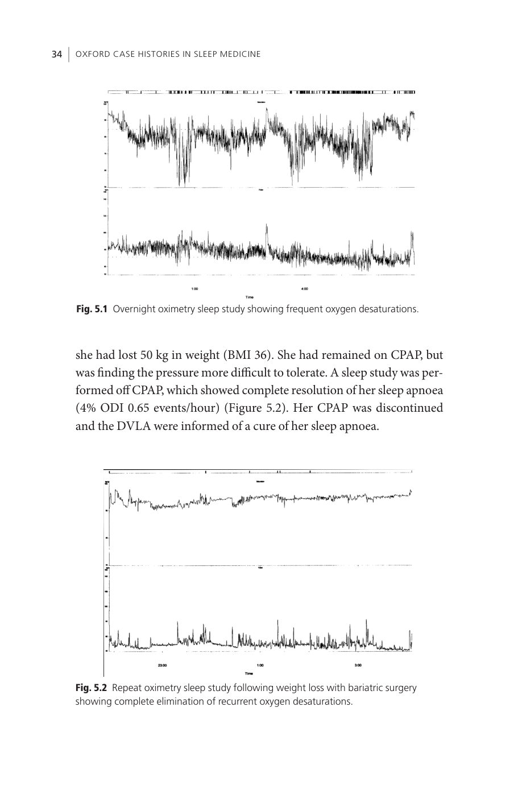
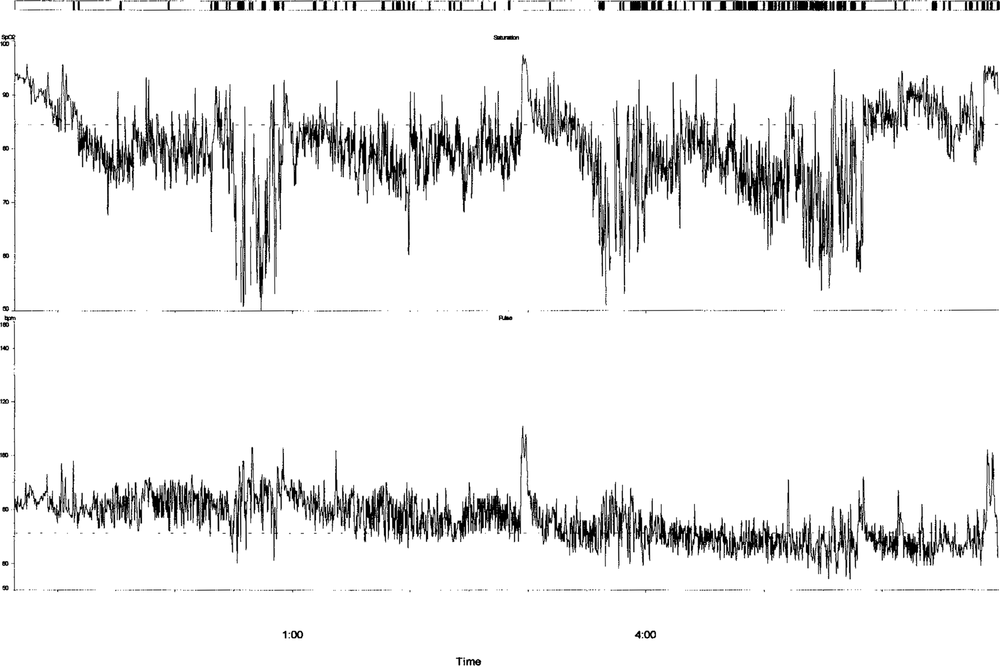
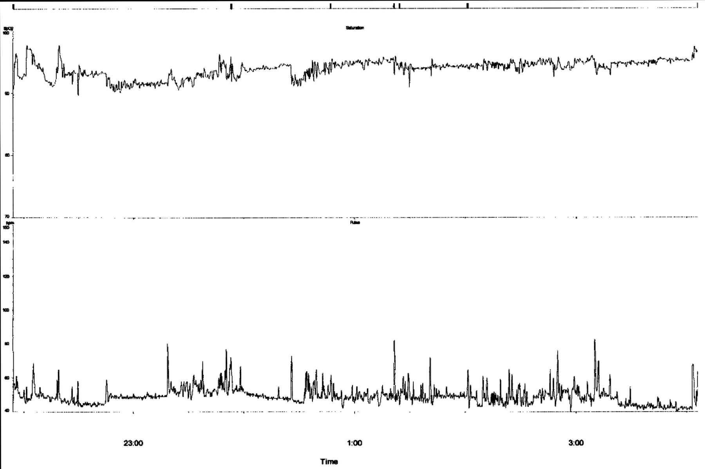

# Case 5 A sleepy bus driver

<!-- pdf-page: 46 -->

A 41-year-old lady was referred for an urgent assessment by the bariatric team. She gave a history of loud snoring and witnessed apnoeas. She described sleepiness and rated herself on the ESS with a rating of 21 out of 24. She had prior medical history of depression, migraines and asthma. She was prescribed asthma inhalers which she rarely used, as well as fluoxetine. She worked as a bus driver and admitted to momentary lapses of concentration when driving, although she had had no motor vehicle accidents. She regularly consumed energy drinks, as she felt these helped keep her awake.

### Case 5

### A sleepy bus driver

On examination she was obese, with a BMI of 54.3. She had a crowded oropharynx with a Mallampati score of 3 and reported three episodes of tonsillitis in the previous year.

Due to her status as an occupational driver, a sleep study was performed that night. Pulse oximetry revealed a 4% dip rate of 99 events/ hour with a minimum SpO2 of 33% (Figure 5.1).

She was commenced on CPAP the next day. She had an average compliance of 6.5 hours/night on auto-titration and was commenced on a fixed pressure of 11 cm of water. When seen back at clinic, her sleepiness had resolved (ESS 2/24) and her snoring had been abolished.

She informed the Driver Vehicle Licensing Agency (DVLA) of her diagnosis and underwent regular review to ascertain the effectiveness of her CPAP treatment. In view of her large tonsils and recurrent tonsillitis, she was referred for a tonsillectomy, which was performed. Postoperative recovery was uneventful.

She subsequently underwent bariatric surgery. Post-operative recovery was uneventful. When she was seen at clinic some months after surgery,

<!-- pdf-page: 47 -->

Fig. 5.1 Overnight oximetry sleep study showing frequent oxygen desaturations.

she had lost 50 kg in weight (BMI 36). She had remained on CPAP, but was finding the pressure more difficult to tolerate. A sleep study was performed off CPAP, which showed complete resolution of her sleep apnoea (4% ODI 0.65 events/hour) (Figure 5.2). Her CPAP was discontinued and the DVLA were informed of a cure of her sleep apnoea.

Fig. 5.2 Repeat oximetry sleep study following weight loss with bariatric surgery

showing complete elimination of recurrent oxygen desaturations.

<!-- pdf-page: 48 -->

Case 5 35

#### Questions

1 How is sleepiness assessed?

2 What are the post-operative risks of sleep apnoea?

3 What are the motor vehicle accident risks of sleep apnoea?

<!-- pdf-page: 49 -->

#### Answers

#### 1. How is sleepiness assessed?

Sleepiness is defined as the propensity to fall asleep and should be differentiated from tiredness, which is regarded as a psychological propensity to feel fatigued. Sleepiness can be assessed by patient history as well as objective measures which may be undertaken in the sleep laboratory. The most common measure of sleepiness used is the ESS, which is an eight-point questionnaire assessing the self-rated likelihood of falling asleep in a number of defined situations. The questionnaire has been validated against EEG markers of sleep and is the most commonly used questionnaire. It has the benefit of being selfadministered and easy to use. Usually, score of >11 is regarded as showing that the patient is sleepy, and score of >15 indicates severe sleepiness. However, the scale is not perfect—for example, severely sleepy patients may avoid situations in which they are likely to fall asleep, giving an aberrantly low score, resulting in an underestimate of their sleepiness. Drivers may also be reluctant to admit to sleepiness when driving for fear of losing their licence. The American Academy of Sleep Medicine has suggested assessing sleepiness in the history by asking the patient about falling asleep in active (e.g. having a conversation), semi-active (e.g. at the cinema) and passive (e.g. watching television) situations, and this may provide a rough guide of sleepiness. Other questionnaires to assess sleepiness are available (Berlin sleep questionnaire, Pittsburgh sleep questionnaire), but are less frequently used. It is often useful to get a partner’s estimate of sleepiness, and many clinics will routinely ask partners to attend clinic appointments and to fill in an Epworth score on their perception of their partner’s sleepiness. Sleepiness may also be measured using studies in the sleep laboratory. The multiple sleep latency time (MSLT) involves giving patients five nap opportunities in a dark, quiet room. EEG monitoring is used to confirm the onset of sleep and the mean time taken to fall asleep

<!-- pdf-page: 50 -->

Case 5 37

is taken from five sleep opportunities. An MSLT of <8 minutes is regarded as showing sleepiness. The test is mainly used to aid in the diagnosis of narcolepsy (a neurological condition causing sleepiness) and, in this case, the onset of REM sleep in at least two sleep opportunities with a mean sleep latency time of <8 minutes may be regarded as diagnostic. An overnight sleep study should be done the night before an MSLT to ensure that other sleep disorders or sleep deprivation (both of which may cause sleep onset REM) have been excluded. The test is difficult to perform and is labour intensive. It is largely carried out in specialist centres used to confirm a diagnosis of narcolepsy. A maintenance of wakefulness test (MWT) is less well validated than MSLT. The patient has EEG monitoring and is placed in a quiet, dark room for five separate periods. In this test, the patient is given instruction to stay awake on each occasion. The Osler test is a variant of the MWT. EEG monitoring is not required. A red light is intermittently flashed at random intervals and the patient asked to press a button registering that they have seen the light. The lack of response to the light is taken as an indication that the patient has fallen asleep. Osler and the MWT have been used mainly to ascertain the effectiveness of treatment in patients whose work is vigilance critical, e.g. to ascertain the effectiveness of CPAP treatment in heavy goods vehicle drivers. However, while improvements in MWT and Osler may be seen after treatment of sleep apnoea, there is no clear evidence that performance on a single day is related to accident risk.

#### 2. What are the post-operative risks of sleep apnoea?

There are several case reports of patients with previously undiagnosed or unrecognized sleep apnoea going into respiratory failure after an anaesthetic. Use of anaesthetic agents may result in the loss of the usual arousal mechanism that occurs after an apnoea. Thus, patients with sleep apnoea may desaturate more profoundly and become more hypoxic after an anaesthetic.

<!-- pdf-page: 51 -->

Patients with sleep apnoea may have reduced airway calibre than those without. This may result potentially in a more difficult intubation and may be especially crucial in patients undergoing upper airway surgery who may have additional upper airway compromise due to post-operative upper airway oedema. During an anaesthetic, there may be intra-operative atelectasis, which will result in reduction of functional residual capacity (FRC) and a resultant decrease in lung volume. Reductions in lung volume will allow the upper airway to become more collapsible and may exacerbate pre-existing sleep apnoea. It is very difficult to perform any randomized trials on the risk of sleep apnoea in the post-operative period and much of the evidence comes from observational studies which differ widely in the surgery carried out, type of anaesthesia given and location of post-operative care (High Dependency Unit (HDU) versus ward). As no randomized controlled data exist for this group of patients, it is difficult to make firm recommendations. Many anaesthetists will advise putting post-operative patients with sleep apnoea on to CPAP when extubated and, for this reason, prefer that patients are initiated and habituated to CPAP in the pre-operative period. Closer observations in an HDU setting may be appropriate in the post-operative period.

#### 3. What are the motor vehicle accident risks of sleep

#### apnoea?

There are difficulties in assessing the exact risks of patients with untreated OSA who are driving. Patients will often under-report any issues with driving for fear of losing their licence. This is ­particularly relevant in patients who may rely on driving for their livelihood. Epidemiological studies have reported an increased risk of between 1.9 and 10.9 of patients with OSA having motor vehicle accidents. There is also evidence from simulator performance and vigilance testing that driving performance is impaired in untreated patients. CPAP has been shown to improve performance on both driving simulators and vigilance testing. Accident risk in OSA has been estimated to reduce by 40% in patients treated with CPAP.

<!-- pdf-page: 52 -->

Case 5 39

#### Learning points

Excessive daytime sleepiness can be assessed either by using a sleepi­

ness questionnaire, such as ESS, or objectively by measurement of MSLT or maintenance of wakefulness (MWT).

EDS due to OSA increases the risk of motor vehicle accidents.

OSA increases post-operative risks, which can be prevented by prior

Chung F et al. Patients with difficult airway may need referral to sleep clinics. Anaes

treatment with CPAP.

#### Further reading

Analg 2008;107:1543–63. George CF. Driving and automobile crashes in patients with obstructive sleep apnoea

hypopnoea syndrome. Thorax 2004;59:804–7.
