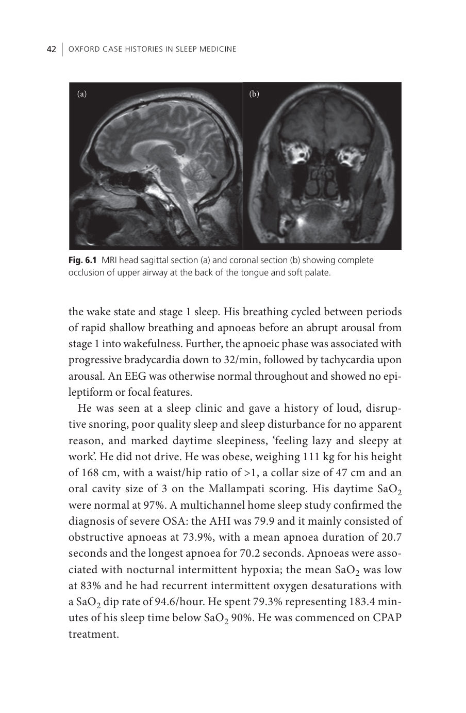
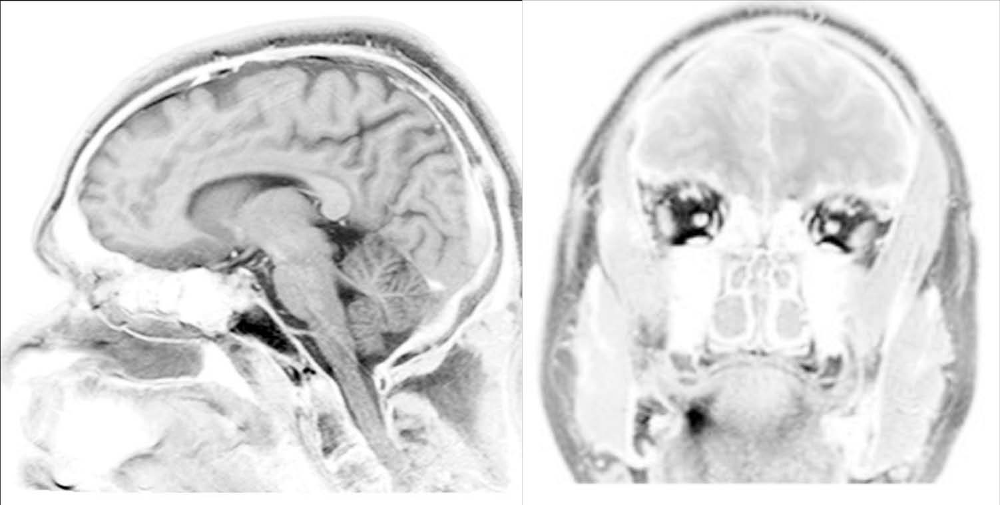
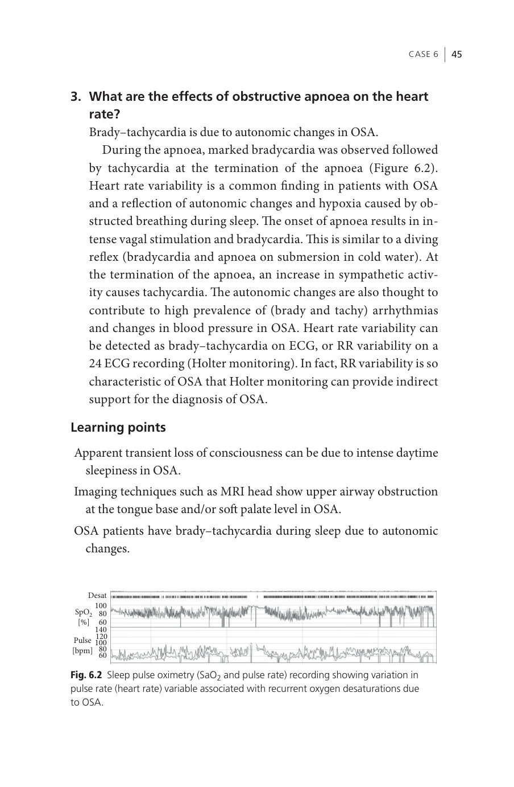
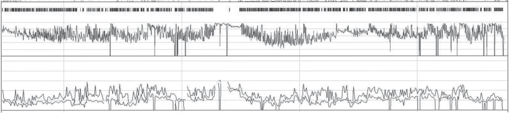

# Case 6 Rapid onset daytime sleep presenting as transient loss of consciousness

<!-- pdf-page: 54 -->

A 27-year-old single Asian man employed as a healthcare worker, presented to the A&E department following an episode of loss of consciousness. He was helping a patient to dress when, all of a sudden, he went blank and stopped what he was doing for about five minutes, though he could hear people shouting his name. During another episode, witnessed by his brother, whilst walking home from a mosque, he stopped walking all of a sudden, stared straight ahead and became unresponsive for about a minute, and then returned rapidly to normal. He reported four or five similar episodes over two years. He was suspected to have petit-mal seizures, but the neurologist felt that the history was not typical for epilepsy—the episodes were not associated with postictal phenomenon, automatism and orofacial movements, and were preceded by an increasing fatigue before the apparent loss of consciousness. However, complex partial seizures could not be ruled out, and an MRI head scan and EEG were requested and treatment with Lamotrigine recommended. The neurologist noted that his sleep was disturbed and of poor quality, with EDS (ESS 18/24) and he was obese. He was suspected to have OSA and referred to a sleep clinic.

### Case 6

### Rapid onset daytime sleep

### presenting as transient loss

### of consciousness

His MRI head scan was normal, but showed complete occlusion of the hypopharynx at the tongue base on the sagittal view and of the oral cavity, with apposition of the tongue to the soft palate on the coronal view (Figure 6.1).

During the EEG recording, he fell asleep and the neurophysiologist found him to have frequent apnoeas. His EEG pattern rotated between

<!-- pdf-page: 55 -->

(a) (b)

Fig. 6.1 MRI head sagittal section (a) and coronal section (b) showing complete

occlusion of upper airway at the back of the tongue and soft palate.

the wake state and stage 1 sleep. His breathing cycled between periods of rapid shallow breathing and apnoeas before an abrupt arousal from stage 1 into wakefulness. Further, the apnoeic phase was associated with progressive bradycardia down to 32/min, followed by tachycardia upon arousal. An EEG was otherwise normal throughout and showed no epileptiform or focal features.

He was seen at a sleep clinic and gave a history of loud, disruptive snoring, poor quality sleep and sleep disturbance for no apparent reason, and marked daytime sleepiness, ‘feeling lazy and sleepy at work’. He did not drive. He was obese, weighing 111 kg for his height of 168 cm, with a waist/hip ratio of >1, a collar size of 47 cm and an oral cavity size of 3 on the Mallampati scoring. His daytime SaO2 were normal at 97%. A multichannel home sleep study confirmed the diagnosis of severe OSA: the AHI was 79.9 and it mainly consisted of obstructive apnoeas at 73.9%, with a mean apnoea duration of 20.7 seconds and the longest apnoea for 70.2 seconds. Apnoeas were associated with nocturnal intermittent hypoxia; the mean SaO2 was low at 83% and he had recurrent intermittent oxygen desaturations with a SaO2 dip rate of 94.6/hour. He spent 79.3% representing 183.4 minutes of his sleep time below SaO2 90%. He was commenced on CPAP treatment.

<!-- pdf-page: 56 -->

Case 6 43

#### Questions

1 How do you differentiate between EDS due to OSA and transient

loss of consciousness due to epilepsy?

3 What are the effects of obstructive apnoea on the heart rate?

2 What does an MRI head scan show?

<!-- pdf-page: 57 -->

#### Answers

#### 1. How do you differentiate between EDS due to OSA and

#### transient loss of consciousness due to epilepsy?

EDS and falling asleep during the daytime is a common presenting feature of OSA. However, rapid onset of intense daytime sleepiness leading to sleep could be confused with transient loss of consciousness due to other causes. Transient loss of consciousness due to epilepsy is easy to recognize if associated with other features of epilepsy. The associated features are often absent in petit-mal or complex partial seizures and an EEG is required for the confirmation of the diagnosis. A normal EEG and observation of obstructed apnoea during sleep by a neurophysiologist pointed to the diagnosis of OSA. EDS is common in OSA patients and they often report falling asleep watching television, reading a book or sometimes when stopped at traffic lights while driving. However, it is unusual for OSA patients to experience intense sleepiness enough for them to fall asleep during motor activities, such as walking. EDS is mainly due to sleep disruption and poor sleep quality as a result of recurrent obstructive apnoeas.

A normal MRI head scan excluded a neurological cause for apparent episodes of transient loss of consciousness. However, an MRI (performed while the patient is in a lying down position) demonstrated an incidental finding of upper airway occlusion (Figure 6.1). Upper airway imaging techniques, including an MRI scan, have shown that patients with OSA have narrow upper airways when awake and sitting, which completely obstruct on lying down during sleep. Upper airway narrowing and obstruction is either located at the back of the tongue or soft palate, or can be at multiple levels. The narrow upper airway becomes narrower on lying down due to the tongue/soft palate falling back as a result of gravity. During sleep, loss of the upper airway muscle tone leads to complete or partial obstruction of the upper airway and cessation of breathing (obstructive apnoea).

#### 2. What does an MRI head scan show?

<!-- pdf-page: 58 -->

Case 6 45

#### 3. What are the effects of obstructive apnoea on the heart

#### rate?

Brady–tachycardia is due to autonomic changes in OSA.

During the apnoea, marked bradycardia was observed followed by tachycardia at the termination of the apnoea (Figure 6.2). Heart rate variability is a common finding in patients with OSA and a ­reflection of autonomic changes and hypoxia caused by obstructed breathing during sleep. The onset of apnoea results in intense vagal stimulation and bradycardia. This is similar to a diving reflex (bradycardia and apnoea on submersion in cold water). At the termination of the apnoea, an increase in sympathetic activity causes tachycardia. The autonomic changes are also thought to contribute to high prevalence of (brady and tachy) arrhythmias and changes in blood pressure in OSA. Heart rate variability can be detected as brady–tachycardia on ECG, or RR variability on a 24 ECG recording (Holter monitoring). In fact, RR variability is so characteristic of OSA that Holter monitoring can provide indirect support for the diagnosis of OSA.

Apparent transient loss of consciousness can be due to intense daytime

#### Learning points

Imaging techniques such as MRI head show upper airway obstruction

sleepiness in OSA.

OSA patients have brady–tachycardia during sleep due to autonomic

at the tongue base and/or soft palate level in OSA.

Fig. 6.2 Sleep pulse oximetry (SaO2 and pulse rate) recording showing variation in

pulse rate (heart rate) variable associated with recurrent oxygen desaturations due to OSA.

changes.

Desat

100 80 60 140 120 100 80 60

SpO2 [%]

Pulse [bpm]

<!-- pdf-page: 59 -->

#### Further reading

Guilleminault C, Brooks SN. Excessive daytime sleepiness: a challenge for the practis­

ing neurologist. Brain 2001 Aug;124(Pt 8):1482–91. Review. Gula LJ, Krahn AD, Skanes AC, Yee R, Klein GJ. Clinical relevance of arrhythmias dur­

ing sleep: guidance for clinicians. Heart 2004 Mar;90(3):347–52. Review. Schwab RJ. Imaging for the snoring and sleep apnea patient. Dent Clin North Am 2001

Oct;45(4):759–96. Review.
