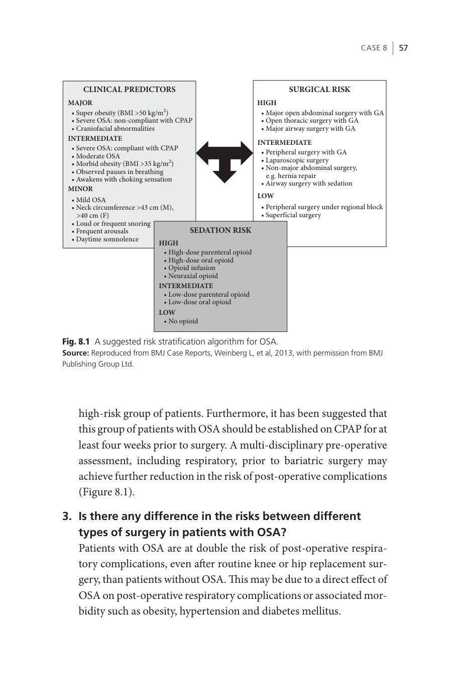

# Case 8 Post-operative apnoeas and hypoxia due to undiagnosed OSA

<!-- pdf-page: 66 -->

### Case 8

### Post-operative apnoeas and

### hypoxia due to undiagnosed OSA

A 66-year-old man, a smoker of a 50 pack year with a history of hypertension and angioplasty for myocardial infarction, had two transient ischaemic attacks and was found to have 70% stenosis of the left internal carotid artery. He underwent a left-sided carotid endarterectomy. During post-operative period he had multiple episodes of apnoea associated with low oxygen saturations and referred to a sleep clinic. He had moderate bruising around the left neck wound following surgery. He snored heavily and had witnessed apnoea, according to his wife. He felt tired and sleepy during the daytime (ESS 14/24) and often nodded off at meetings working as a financial advisor—he did not drive. He was morbidly obese with a BMI of 51.3, neck size of 50 cm and a crowded oral cavity (Mallampati score of 4). He had evidence of airflow obstruction on spirometry lung function tests: FEV1 1.7 litre (55% of predicted) and FVC 2.5 litre. His visilab sleep study consisting of overnight audio-video monitoring with oximetry confirmed the diagnosis of severe OSA. The oximetry showed characteristic repetitive SaO2 desaturations with a dip rate of 39.31/hour and nocturnal hypoxia with mean SaO2 of 83.62%. Observation of the video recording during desaturation confirmed loud snoring following by prolonged obstructive apnoeas. His daytime SaO2 on air were normal at 94%.

He was treated with CPAP at a fixed pressure of 9 cm of water delivered via a nasal CPAP mask. CPAP was effective in correcting his OSA, with a reduction in SaO2 dips to 3.91 hours and nocturnal hypoxia persisted— mean SaO2 86.62%. His objective CPAP compliance was satisfactory. His sleep quality improved and he felt less tired and sleepy during the

<!-- pdf-page: 67 -->

daytime (ESS 4/12). He had a reduced exercise tolerance of half a flight of stairs and was unable to lose any weight, despite an improvement in his daytime symptoms. He was referred to a bariatric service; however, he refused to have bariatric surgery or consider dietary interventions. He had frequent admissions to hospital because of acute hypercapnic respiratory failure following pneumonia and a lower respiratory tract infection, and required prolonged invasive ventilation and a prolonged stay on the intensive care unit. The CPAP was changed to bi-level positive airway pressure (BiPAP), and he had no further admissions to hospital and noticed an improvement in sleep, daytime sleepiness and exercise tolerance.

<!-- pdf-page: 68 -->

Case 8 55

#### Questions

1 What are the peri-operative risks and peri-operative complica­

tions of undiagnosed/untreated OSA?

3 Is there any difference in the risks between different types of sur­

2 How can you prevent these complications?

gery in patients with OSA?

<!-- pdf-page: 69 -->

#### Answers

#### 1. What are the peri-operative risks and peri-operative

#### complications of undiagnosed/untreated OSA?

OSA remains undiagnosed in 80% of the population. Patients with undiagnosed/untreated OSA are at an increased risk of peri-operative respiratory complications. During the pre-operative period, use of pre-operative sedation and upper airway muscles relaxation can precipitate OSA and hypoxia. Patients with OSA have narrow upper airways and are at a higher risk of difficult (tracheal) intubation. Prolonged apnoea during the post-operative period while recovering from a general anaesthesia can cause respiratory distress and respiratory arrest. This may need re-intubation or an emergency tracheostomy. It is known that anaesthetic agents reduce the tone of pharyngeal musculature, depress ventilation, diminish ventilatory response to carbon dioxide and also abolish arousals from sleep. Moreover, trauma from airway manipulation, drugs and pain can affect sleep architecture and regulation of the upper airway muscles in the post-operative period.

#### 2. How can you prevent these complications?

Anaesthetists have a key role in identifying patients at an increased risk of OSA. Simple questionnaire-based screening or upper airway assessment at the pre-anaesthetic check can identify patients at an increased risk of OSA. If the assessment suggests a high risk of obstructive apnoea, they should have further sleep investigations. Identification of difficult airways at the pre-anaesthetic check-up or before intubation can help the anaesthetist plan for the management of difficult airways. Careful respiratory monitoring during the post-operative period and early intervention with non-invasive ventilator support oxygen, CPAP or BiPAP can reduce ­post-operative risk.

Patients undergoing bariatric surgery for morbid obesity have a very high prevalence (up to 70%) of OSA. A routine screening and assessment including a sleep study has been suggested for such a

<!-- pdf-page: 70 -->

Case 8 57

CLINICAL PREDICTORS SURGICAL RISK

MAJOR HIGH

• Super obesity (BMI >50 kg/m2)
• Severe OSA: non-compliant with CPAP
• Craniofacial abnormalities

• Major open abdominal surgery with GA
• Open thoracic surgery with GA
• Major airway surgery with GA

INTERMEDIATE

Fig. 8.1 A suggested risk stratification algorithm for OSA.

Source: Reproduced from BMJ Case Reports, Weinberg L, et al, 2013, with permission from BMJ Publishing Group Ltd.

• Severe OSA: compliant with CPAP
• Moderate OSA
• Morbid obesity (BMI >35 kg/m2)
• Observed pauses in breathing
• Awakens with choking sensation

MINOR

• Mild OSA
• Neck circumference >43 cm (M), >40 cm (F)
• Loud or frequent snoring
• Frequent arousals
• Daytime somnolence

SEDATION RISK

HIGH

• High-dose parenteral opioid
• High-dose oral opioid
• Opioid infusion
• Neuraxial opioid

INTERMEDIATE

• Low-dose parenteral opioid
• Low-dose oral opioid

LOW

• No opioid

INTERMEDIATE

• Peripheral surgery with GA
• Laparoscopic surgery
• Non-major abdominal surgery, e.g. hernia repair
• Airway surgery with sedation

LOW

• Peripheral surgery under regional block
• Superficial surgery

high-risk group of patients. Furthermore, it has been suggested that this group of patients with OSA should be established on CPAP for at least four weeks prior to surgery. A multi-disciplinary pre-­operative assessment, including respiratory, prior to bariatric surgery may achieve further reduction in the risk of post-operative complications (Figure 8.1).

#### 3. Is there any difference in the risks between different

#### types of surgery in patients with OSA?

Patients with OSA are at double the risk of post-operative respiratory complications, even after routine knee or hip replacement surgery, than patients without OSA. This may be due to a direct effect of OSA on post-operative respiratory complications or associated morbidity such as obesity, hypertension and diabetes mellitus.

<!-- pdf-page: 71 -->

However, patients undergoing upper airways surgery have a much higher risk of post-operative obstructed breathing and respiratory complications. They may have undiagnosed or untreated OSA due to an upper airways problem requiring surgery such as a tonsillectomy for large tonsils. Post-operative upper airways swelling/haematoma may further obstruct the upper airways.

Similarly, patients undergoing palatal or tongue base surgery for snoring may be at a higher risk of post-operative respiratory problems, particularly if they were not screened for OSA.

Undiagnosed OSA may present as post-operative apnoeas and hypoxia.

#### Learning points

Undiagnosed OSA is associated with an increased risk of peri-operative

Screening for OSA with a sleep questionnaire or upper airways assess­

respiratory complications.

ment at a pre-anaesthetic check can identify patients at risk of OSA.

OSA patients at high risk of post-operative complications, such as mor­

bidly obese patients with cardiovascular co-morbidity, should have a sleep study and be established on CPAP prior to surgery.

Adesanya AO, Lee W, Greilich NB, Joshi GP. Perioperative management of obstructive

#### Further reading

sleep apnea. Chest 2010 Dec;138(6):1489–98. den Herder C, Schmeck J, Appelboom DJ, de Vries N. Risks of general anaesthesia in

people with obstructive sleep apnoea. BMJ 2004 Oct 23;329(7472):955–9. Review. Weinberg L, Houli N, Nikfarjam M. Improving outcomes for pancreatic cancer: radical

surgery with patient-tailored, surgery-specific advanced haemodynamic monitoring. BMJ Case Rep 2013 Apr 30;2013.
