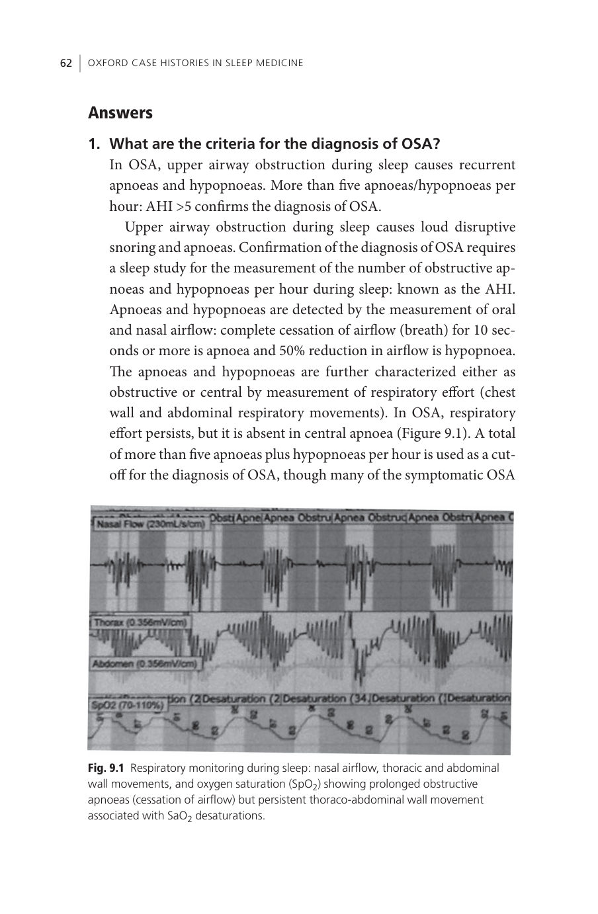
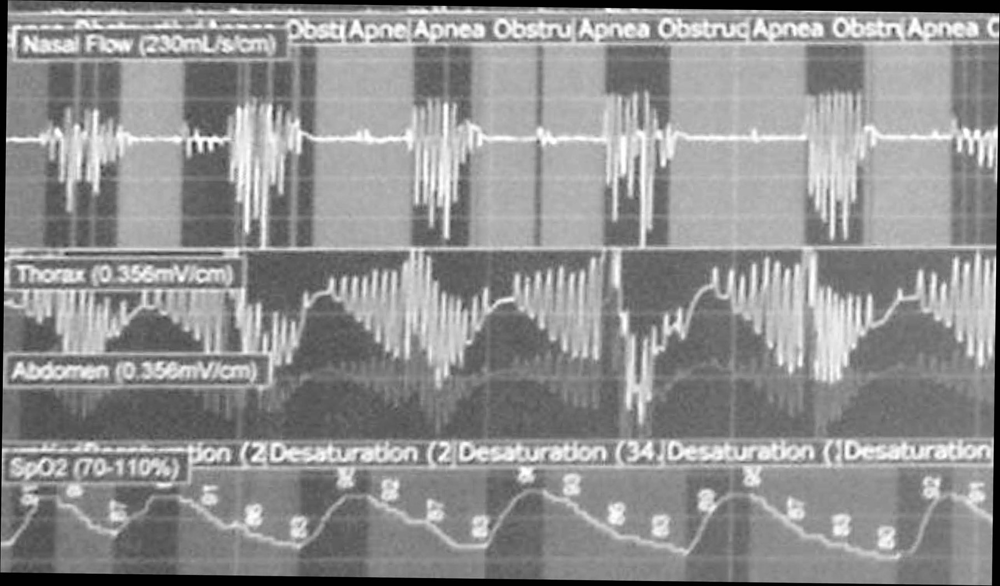
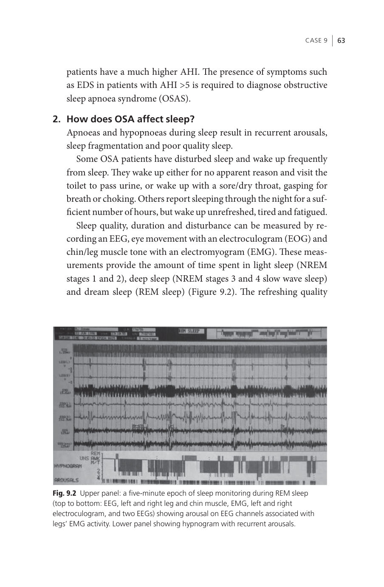
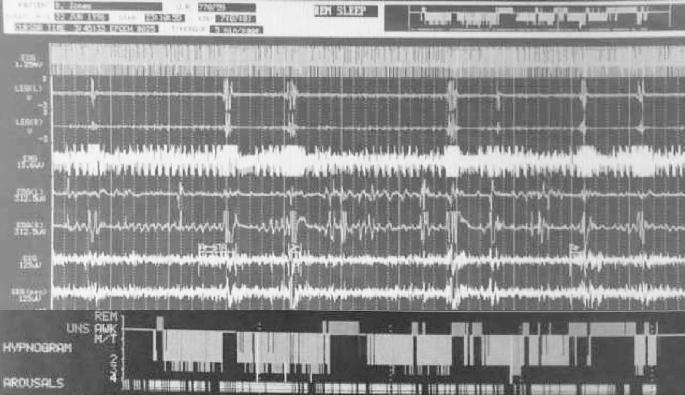

# Case 9 Polycythemia got better with CPAP

<!-- pdf-page: 72 -->

A 56-year-old man, a retired insurance underwriter, was referred by a haematologist to establish if his polycythemia was due to nocturnal hypoxia as a result of sleep apnoea. His haemoglobin and red cell mass remained elevated, despite venesection. He was a smoker (20 per day) and known to have chronic obstructive pulmonary disease (COPD), but his exercise tolerance was more than a mile and spirometry showed moderately severe airflow obstruction (FEV1 53% of predicted, FEV1/FVC 61%) with no significant reversibility.

### Case 9

### Polycythemia got better

### with CPAP

He had put on weight after his retirement and felt sleepy during the daytime; he fell asleep on public transport on several occasions. His ESS was high at 16/24. His wife noted that he stopped breathing during his sleep. He snored loudly enough for his wife to wear earplugs or sleep in a separate room. He was plethoric and obese (BMI 30) with a neck size of 44.5 cm. His pulse was regular at 72/minute and blood pressure was normal at 125/85 mmHg. He had a widespread wheeze on auscultation of his chest.

Respiratory monitoring showed frequent obstructed apnoeas (263 episodes of complete cessation of breathing for >10 seconds) and hypopnoeas (203 episodes of 50% reduction in respiratory effort for >10 seconds) with an AHI of 62.3 (number of apnoeas and hypopnoeas per hour of sleep). The average duration of apnoeas was 31 seconds and hypopnoeas 23 seconds, and the longest apnoea lasted for 138 seconds and hypopnoea 86 seconds.

A PSG confirmed severe OSA.

Sleep monitoring demonstrated that respiratory disturbance was due to recurrent obstructive apnoea/hypopnoeas that caused disturbed and

<!-- pdf-page: 73 -->

poor quality sleep. He woke up from sleep every two minutes with an EEG arousal index of 30/hour and poor sleep quality with very little dream sleep: REM sleep for 16.3 minutes only. Non-rapid eye movement (NREM) sleep consisted of light sleep (stages 1 and 2) for 164.7 minutes and deep sleep (stages 3 and 4) for 271 minutes.

Oxygen saturation (SaO2) monitoring with pulse oximetry showed that apnoeas and hypopnoeas resulted in intermittent nocturnal hypoxia. There was 54/hour transient reduction in SaO2 (>4% from baseline): SaO2 desaturation dip rate, mean SaO2 during sleep was low at 76.59% and 90% of TST spent below SaO2 of 90% (TST <SaO2 90%).

His OSA was treated with CPAP at 8 cm of water delivered to the upper airways via a nasal mask. He noticed a marked improvement in his sleep quality and woke up feeling fresh, with an improvement in daytime sleepiness and a reduction in daytime sleepiness (ESS of 9/24 compared to 16/24). His self-reported CPAP compliance was six nights a week and seven hours each night. Repeat sleep study on CPAP (CPAP sleep study) showed normalization of AHI to 5.3 from a baseline AHI of 62.3. This was associated with a reduction and improvement in sleep quality and sleep disturbance. The arousal index was 9.4/hour compared to a baseline of 30/hour, and REM sleep duration increased to 148 minutes from 16.3 minutes and with no change in stage 3 and stage 4 NREM sleep duration. There was a marked improvement in the nocturnal hypoxia: mean SaO2 improved to 90.92% from 76.59%, dip rate reduced to 16.17 from 54.36 and TST <90% to 2 hours and 2 minutes.

He did not require further venesection to maintain his haemoglobin within the normal range.

<!-- pdf-page: 74 -->

Case 9 61

#### Questions

1 What are the criteria for the diagnosis of OSA?

2 How does OSA affect sleep?

3 What is the effect of OSA on respiration during sleep?

4 What is the effect of CPAP on sleep and respiration in OSA?

<!-- pdf-page: 75 -->

#### Answers

#### 1. What are the criteria for the diagnosis of OSA?

In OSA, upper airway obstruction during sleep causes recurrent apnoeas and hypopnoeas. More than five apnoeas/hypopnoeas per hour: AHI >5 confirms the diagnosis of OSA.

Upper airway obstruction during sleep causes loud disruptive snoring and apnoeas. Confirmation of the diagnosis of OSA requires a sleep study for the measurement of the number of obstructive apnoeas and hypopnoeas per hour during sleep: known as the AHI. Apnoeas and hypopnoeas are detected by the measurement of oral and nasal airflow: complete cessation of airflow (breath) for 10 seconds or more is apnoea and 50% reduction in airflow is hypopnoea. The apnoeas and hypopnoeas are further characterized either as obstructive or central by measurement of respiratory effort (chest wall and abdominal respiratory movements). In OSA, respiratory effort persists, but it is absent in central apnoea (Figure 9.1). A total of more than five apnoeas plus hypopnoeas per hour is used as a cutoff for the diagnosis of OSA, though many of the symptomatic OSA

Fig. 9.1 Respiratory monitoring during sleep: nasal airflow, thoracic and abdominal

wall movements, and oxygen saturation (SpO2) showing prolonged obstructive apnoeas (cessation of airflow) but persistent thoraco-abdominal wall movement associated with SaO2 desaturations.

<!-- pdf-page: 76 -->

Case 9 63

patients have a much higher AHI. The presence of symptoms such as EDS in patients with AHI >5 is required to diagnose obstructive sleep apnoea syndrome (OSAS).

Apnoeas and hypopnoeas during sleep result in recurrent arousals, sleep fragmentation and poor quality sleep.

#### 2. How does OSA affect sleep?

Some OSA patients have disturbed sleep and wake up frequently from sleep. They wake up either for no apparent reason and visit the toilet to pass urine, or wake up with a sore/dry throat, gasping for breath or choking. Others report sleeping through the night for a sufficient number of hours, but wake up unrefreshed, tired and fatigued.

Sleep quality, duration and disturbance can be measured by recording an EEG, eye movement with an electroculogram (EOG) and chin/leg muscle tone with an electromyogram (EMG). These measurements provide the amount of time spent in light sleep (NREM stages 1 and 2), deep sleep (NREM stages 3 and 4 slow wave sleep) and dream sleep (REM sleep) (Figure 9.2). The refreshing quality

Fig. 9.2 Upper panel: a five-minute epoch of sleep monitoring during REM sleep

(top to bottom: EEG, left and right leg and chin muscle, EMG, left and right electroculogram, and two EEGs) showing arousal on EEG channels associated with legs’ EMG activity. Lower panel showing hypnogram with recurrent arousals.

<!-- pdf-page: 77 -->

to sleep is mainly due to slow wave and dream sleep. However, obstructive apnoeas are most common and prolonged during deep and dream sleep, and recurrent arousal results in poor quality sleep (light sleep). The measurement of the number of arousals/hour and relative duration spent during different stages of sleep (hypnogram) helps to establish sleep duration, efficiency and quality.

#### 3. What is the effect of OSA on respiration during sleep?

Apnoeas and hypopnoeas during sleep result in recurrent nocturnal SaO2 desaturation and chronic intermittent nocturnal hypoxia.

Patients with OSA have a recurrent drop in SaO2 during sleep. A minimum drop in SaO2 by 4% from the baseline is equated to each apnoea/hypopnoea. However, prolonged apnoea and hypopnoeas, particularly during deep and dream sleep, result in a marked drop in SaO2 by 20% or more. Intermittent nocturnal hypoxia as a result of the effect of recurrent apnoeas and hypopnoeas can be quantified by measuring not only the number of 4% drops in SaO2 per hour— SaO2 dip rate—but also mean SaO2 and TST spent below SaO2 of 90%. Low mean SaO2 <88% and TST of 30% below SaO2 of 90% is considered to reflect a significant nocturnal hypoxia and hypoventilation. Patients with undiagnosed and untreated OSA have chronic intermittent hypoxia. Many of the adverse consequences of OSA, including polycythemia, are thought to be related to nocturnal hypoxia. It is likely that secondary polycythemia was due to chronic nocturnal hypoxia in the patient in this case, though contribution of the associated risk factors, such as COPD and smoking, could not be excluded.

#### 4. What is the effect of CPAP on sleep and respiration in

#### OSA?

CPAP reverses the abnormalities mentioned here and is the most effective treatment of OSA.

CPAP abolishes apnoea and hypopnoeas including snoring, corrects intermittent nocturnal hypoxia and restores sleep quality to normal.

<!-- pdf-page: 78 -->

Case 9 65

#### Learning points

In OSA, upper airway obstruction during sleep causes recurrent ap­

noeas and hypopnoeas. More than five apnoeas/hypopnoeas per hour: AHI >5 confirms the diagnosis of OSA.

Apnoeas and hypopnoeas during sleep result in recurrent arousals,

Apnoea and hypopnoeas during sleep result in recurrent SaO2 desatu­

sleep fragmentation and poor quality sleep.

ration and chronic intermittent hypoxia.

CPAP reverses these abnormalities and is the most effective treatment

McNicholas WT. Diagnosis of obstructive sleep apnea in adults. Proc Am Thorac Soc

of OSA.

#### Further reading

2008;5:154–60. National Institute of Health and Clinical Excellence (NICE). Continuous positive air­

way pressure for the treatment of obstructive sleep apnoea/hypopnoea syndrome. Health Technology Appraisal. NICE Technology Appraisal guidance 139 March 2008. Scottish Intercollegiate Guidelines Network (SIGN). Management of obstructive sleep

apnoea/hypopnoea syndrome in adults. Scottish Intercollegiate Guidelines Network. 2003. ISBN 1 899893 33 4
