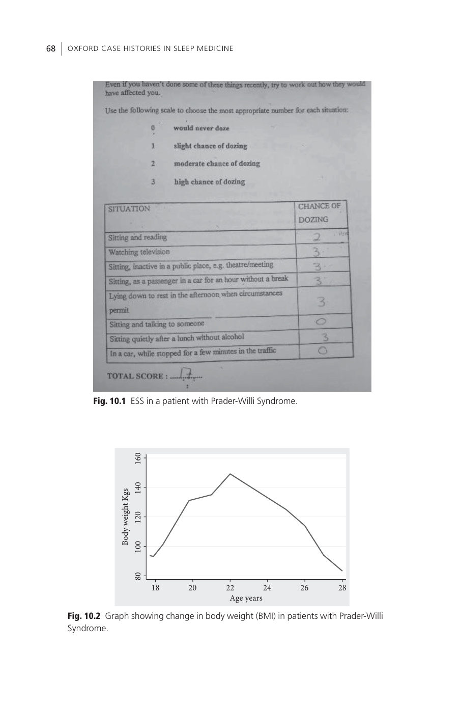
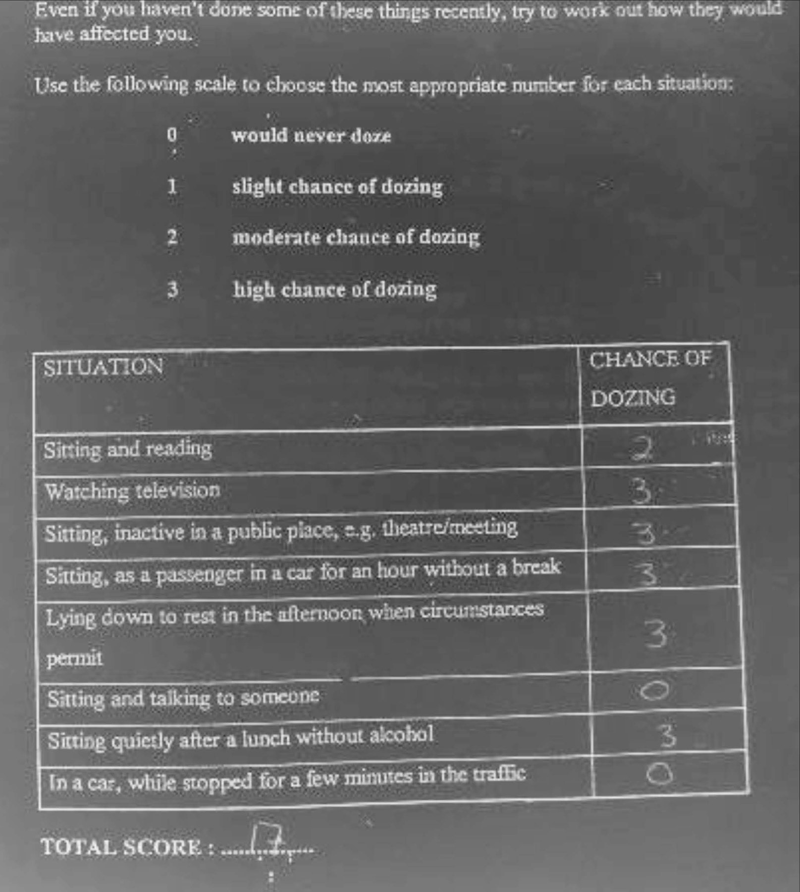

# Case 10 Hyperphagia and sleep disorder in Prader-Willi Syndrome

<!-- pdf-page: 80 -->

### Case 10

### Hyperphagia and sleep disorder

### in Prader-Willi Syndrome

A 22-year-old obese man with a diagnosis of Prader-Willi Syndrome was suspected to have OSA by an endocrinologist. His mother reported that he had loud, disruptive snoring and was always sleepy during the daytime—his ESS score was 17/24 (Figure 10.1). He weighed 149.2 kg for his height of 165.4 cm, but his collar size was normal at 35 cm. He was diagnosed to have Prader-Willi Syndrome at the age of 3 weeks on the basis of clinical features of almond-shaped eyes, a triangular mouth and hypotonia. The diagnosis was later confirmed at the age of 5 years with a genetic test showing deletion on chromosome 15. During puberty, he had genital hypoplasia, gynaecomastia and low testosterone levels. He was treated with testosterone and gonadotropins. His weight was 93.7 kg and his height 159.1 cm at the age of 18 years, but he put on 40 kg in weight over the next year and a half due to uncontrollable hyperphagia (Figure 10.2). His mother had to keep food locked away at home and his employer at the supermarket kept him away from the food section. He weighed 131.1 kg for his height of 165 cm at age 19 years. He also developed insulin resistance and was treated with metformin.

The visilab sleep study (audio-video sleep monitoring with oximetry) confirmed mild sleep apnoea. He was treated with a custom-made mandibular advancement splint (MAS) which eliminated snoring (his brother was able to sleep undisturbed in the next room). His sleep quality improved with a reduction in daytime tiredness, but his ESS remained high. Treatment with stimulant modafinil was considered but not prescribed, as he had stopped working and did not drive. He remained compliant with MAS with an improvement in sleep apnoea symptoms,

<!-- pdf-page: 81 -->

Fig. 10.2 Graph showing change in body weight (BMI) in patients with Prader-Willi

Syndrome.

Fig. 10.1 ESS in a patient with Prader-Willi Syndrome.

80 100 120 140 160

Body weight Kgs

18 20 22 24 26 28 Age years

<!-- pdf-page: 82 -->

Case 10 69

and lost 25 kg in weight with a combination of dietary restriction and exercise over the next three years. He lost further weight with the appetite suppressing agent rimonabant over the next year. His MAS broke, but he had no snoring or disturbed sleep despite not using his splint for a year. A repeat sleep study at the age of 28 years, when he had lost a total of 57 kg and weighed 83.2 kg, showed no evidence of sleep apnoea and he was discharged from the clinic.

1 What are the common causes of obesity in children?

#### Questions

2 What is the explanation for hyperphagia and obesity in patients

3 How common is sleep apnoea in patients with Prader-Willi

with Prader-Willi Syndrome?

Syndrome?

<!-- pdf-page: 83 -->

#### Answers

#### 1. What are the common causes of obesity in children?

In the UK, approximately 10% of school children in reception (5–6 years) and 20% in Year 6 (10–11 years) are obese and at risk of developing obesity-related problems. OSA has been reported to occur in up to 60% of obese children and adolescents. Obesity in most children is due to an unhealthy lifestyle—excessive eating and lack of exercise. However, in a few, it can be due to endocrine/­genetic disorders. It can be due to endocrine problems, such as Cushing’s syndrome and hypothyroidism. Prader-Willi Syndrome is the commonest hereditary cause of obesity. It is seen in 1 out of 20,000 children. In most, it is due to non-inherited (de novo) mutation in paternally derived chromosome 15.

#### 2. What is the explanation for hyperphagia and obesity in

#### patient with Prader-Willi Syndrome?

Patients with Prader-Willi Syndrome go through different stages of feeding/eating problems. During infancy, an inability to suck effectively makes them undernourished and lose weight, with no further difficulties in feeding during childhood. This is followed by hyperphagia and an insatiable appetite during adolescence, leading to morbid obesity.

Hyperphagia is due to hypothalamic dysfunction causing decreased satiety, an increased reward to food and increased hunger. They have high levels of leptin and ghrelin which should lead to satiety and decreased food intake. However, patients with hypothalamic dysfunction fail to respond to these feedback mechanisms to control appetite. Hyperphagia is best managed with a strict controlled diet and reduced access to food.

#### 3. How common is sleep apnoea in patients with Prader-

#### Willi Syndrome?

Respiratory problems during sleep are very common in adult patients with Prader-Willi Syndrome—one study found 95% of patients with the syndrome had OSA. It is mainly due to obesity; however,

<!-- pdf-page: 84 -->

Case 10 71

associated hypotonia and reduced respiratory drive also contribute to nocturnal hypoventilation seen in many of these patients. Marked daytime sleepiness (hypersomnia) is due to a combination of OSA and hypothalamic dysfunction, and may persist despite treatment of OSA. However, treatment of OSA with CPAP has the potential of improving neurocognitive function.

Childhood obesity is common and rising. In most children, it is due

#### Learning points

to an unhealthy lifestyle but, in a few, it could be due to genetic and endocrine causes.

Prader-Willi Syndrome is the commonest genetic cause of OSA.

Most patients with Prader-Willi Syndrome have OSA.

Hypersomnia due to hypothalamic syndrome may persist despite treat­

Butler MG. Prader-Willi Syndrome: obesity due to genomic imprinting. Current Genom­

ment of OSA with CPAP.

#### Further reading

ics 2011;12:204–15.
