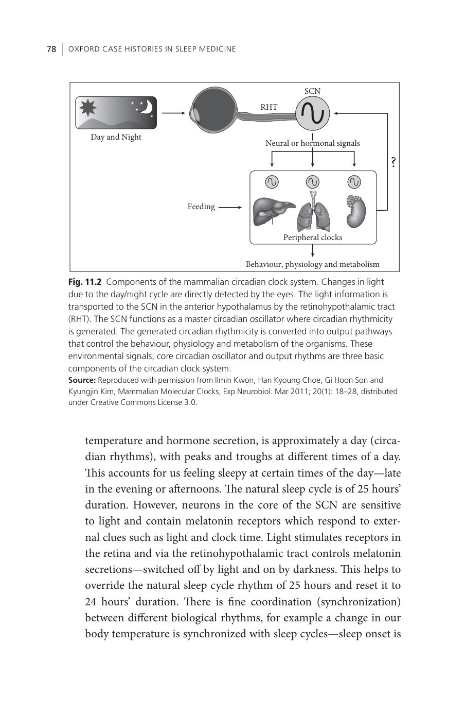
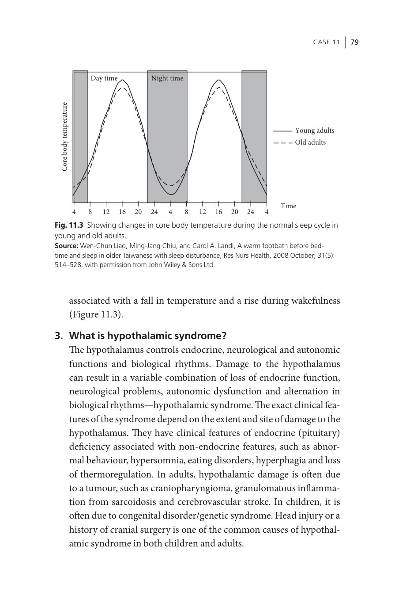

# Case 11 Shot in the head—acquired hypothalamic syndrome

<!-- pdf-page: 86 -->

A 9-year-old boy sustained a gunshot injury to his head that damaged his right eye, frontal lobe and hypothalamus. He had successful neurosurgery and survived, but was left with a blind right eye, cognitive and memory impairment, and hypothalamic syndrome resulting in hypothyroidism and diabetes insipidus. He always felt hungry and could not control his appetite, and started stealing food from home and shops. He weighed 82 kg with a height of 169 cm at the age of 14 years. His insatiable hunger persisted and he put on further weight, and weighed 136.9 kg with a height of 171 cm at the age of 18 years. He was a loud snorer with a history of witnessed apnoea and was markedly sleepy during the daytime. He weighed 152 kg, BMI 52, at the age of 21 years and a sleep study confirmed OSA (25/hour mean SaO2 90%). CPAP was successful in correcting his sleep apnoea and nocturnal hypoxia (dip rate 4.7 and mean SaO2 95%), abolishing snoring and improving sleep, but he remained excessively sleepy during the daytime with an ESS score of 22/24. His CPAP compliance was good and repeat sleep studies on CPAP consistently showed no evidence of OSA. He continued to put on more weight and weighed 166 kg at the age of 24 years. He found no improvement in his daytime sleepiness with modafinil. His diet consisted of a high amount of liquid calorie food and he was found unsuitable for gastric band surgery on bariatric assessment. He continued to put on weight and weighed 172.3 kg, BMI 57, collar size 56 cm at the age of 26 years. He remains on CPAP with good compliance, but is still sleepy with an ESS of 14/24. His most recent assessment showed persistent morbid obesity and EDS, despite good compliance and effectiveness of CPAP in

### Case 11

### Shot in the head—acquired

### hypothalamic syndrome

<!-- pdf-page: 87 -->

correcting his sleep apnoea. He remains obese due to hyperphagia and hypersomnolence, despite correction of sleep apnoea due to hypothalamic syndrome as a result of the brain injury during childhood.

<!-- pdf-page: 88 -->

Case 11 75

#### Questions

1 What is the role of hypothalamus in control of appetite and sleep?

2 How is our sleep rhythm generated and controlled?

3 What is hypothalamic syndrome?

<!-- pdf-page: 89 -->

#### Answers

#### 1. What is the role of hypothalamus in control of appetite

#### and sleep?

The hypothalamus is one of the primitive parts of the brain, the size of an almond, located just below the thalamus and above the brainstem. It controls some of the basic life functions such as hunger, thirst, sleep, body temperature and our internal/biological clocks (circadian rhythms), in addition to endocrine hormone secretion via the hypothalamic–pituitary axis.

The appetite (hunger and satiety) is controlled by a group of neurons located in the ventromedial nucleus of the hypothalamus. This nucleus has a medial and lateral part. The neurons in the lateral part control satiety—stimulation of the satiety centre causes an increase in food intake while damage leads to complete cessation of food intake. The satiety centre is controlled by the medial part, and damage to this part causes hyperphagia and obesity. The activity of neurons in the satiety centre is also regulated by leptin produced by the adipose/ fat cells, and increased levels of leptin reduce food intake. Similarly, a reduction in glucose utilization by the satiety centre leads to an increase in food intake—deoxyglucose reduces glucose utilization and increases food intake. Similarly, body temperature also controls food intake—a cold body temperature stimulates appetite and food intake, and a high body temperature lowers appetite and food intake.

The hypothalamus has been known to control sleep and wakefulness since experiments carried out by von Economo in 1918. He examined the brains of patients who suffered from encephalitis lethargica. Most of these patients slept for a long time—up to 20 hours a day, but had good cognitive function (von Economo sleeping sickness). They were found to have lesions at the junction of the brainstem and forebrain, now known to be the ascending arousal system (wakeful centre). A few patients could not sleep—they slept for only a few hours and felt tired and sleepy. They had lesions in the anterior hypothalamus—near the pre-optic area, now known as the ventro-lateral pre-optic area (VLPA) (sleep centre) (Figure 11.1).

<!-- pdf-page: 90 -->

Case 11 77

T

A4

a

V3

O

J Hy

N.oculomet

Y4

The balance of activity in two areas of the brain determines wakefulness or sleepiness. Narcolepsy is thought to be due to damage to the lateral hypothalamus—an area in between the two brain areas. This area is now known to have orexin/hypocretin-containing neurons and thought to provide a switch between the sleep and wakefulness centres. Patients with narcolepsy have reduced orexin-containing neurons and low levels of orexins in cerebrospinal fluid (CSF).

#### 2. How is our sleep rhythm generated and controlled?

The Supra Chiasmatic Nucleus (SCN) is located in the anterior hypothalamus (Figure 11.2) and controls all our biological rhythms including sleep—it is a master clock. The neurons in the SCN fire spontaneously and generates different types of body rhythms. The duration of most of our biological rhythms, including sleep, body

<!-- pdf-page: 91 -->

SCN

RHT

Day and Night

Neural or hormonal signals

Fig. 11.2 Components of the mammalian circadian clock system. Changes in light

due to the day/night cycle are directly detected by the eyes. The light information is transported to the SCN in the anterior hypothalamus by the retinohypothalamic tract (RHT). The SCN functions as a master circadian oscillator where circadian rhythmicity is generated. The generated circadian rhythmicity is converted into output pathways that control the behaviour, physiology and metabolism of the organisms. These environmental signals, core circadian oscillator and output rhythms are three basic components of the circadian clock system. Source: Reproduced with permission from Ilmin Kwon, Han Kyoung Choe, Gi Hoon Son and Kyungjin Kim, Mammalian Molecular Clocks, Exp Neurobiol. Mar 2011; 20(1): 18–28, distributed under Creative Commons License 3.0.

Feeding

### ?

Peripheral clocks

Behaviour, physiology and metabolism

temperature and hormone secretion, is approximately a day (circadian rhythms), with peaks and troughs at different times of a day. This accounts for us feeling sleepy at certain times of the day—late in the evening or afternoons. The natural sleep cycle is of 25 hours’ duration. However, neurons in the core of the SCN are sensitive to light and contain melatonin receptors which respond to external clues such as light and clock time. Light stimulates receptors in the retina and via the retinohypothalamic tract controls melatonin secretions—switched off by light and on by darkness. This helps to override the natural sleep cycle rhythm of 25 hours and reset it to 24 hours’ duration. There is fine coordination (synchronization) between different biological rhythms, for example a change in our body temperature is synchronized with sleep cycles—sleep onset is

<!-- pdf-page: 92 -->

Case 11 79

Day time

Night time

Fig. 11.3 Showing changes in core body temperature during the normal sleep cycle in

young and old adults. Source: Wen-Chun Liao, Ming-Jang Chiu, and Carol A. Landi, A warm footbath before bedtime and sleep in older Taiwanese with sleep disturbance, Res Nurs Health. 2008 October; 31(5): 514–528, with permission from John Wiley & Sons Ltd.

Core body temperature

8 12 16 20 24 4 4 8 12 16 20 24

4

Young adults

Old adults

Time

associated with a fall in temperature and a rise during wakefulness (Figure 11.3).

The hypothalamus controls endocrine, neurological and autonomic functions and biological rhythms. Damage to the hypothalamus can result in a variable combination of loss of endocrine function, neurological problems, autonomic dysfunction and alternation in biological rhythms—hypothalamic syndrome. The exact clinical features of the syndrome depend on the extent and site of damage to the hypothalamus. They have clinical features of endocrine (pituitary) deficiency associated with non-endocrine features, such as abnormal behaviour, hypersomnia, eating disorders, hyperphagia and loss of thermoregulation. In adults, hypothalamic damage is often due to a tumour, such as craniopharyngioma, granulomatous inflammation from sarcoidosis and cerebrovascular stroke. In children, it is often due to congenital disorder/genetic syndrome. Head injury or a history of cranial surgery is one of the common causes of hypothalamic syndrome in both children and adults.

#### 3. What is hypothalamic syndrome?

<!-- pdf-page: 93 -->

#### Learning points

The hypothalamus regulates sleep and appetite.

Hypothalamic damage can cause loss of satiety and uncontrollable eat­

OSA contributes to morbidity from hypothalamic syndrome.

ing and obesity.

Guftar Shaikh M. Hypothalamic dysfunction (hypothalamic syndromes) 2.4.1 Oxford

#### Further reading

Textbook of Endocrinology and Diabetes (2nd ed.) Edited by JAH Wass, PM Stewart, SA Amiel, MC Davies. Oxford University Press. 2011. Saper CB, Scammell TE, Lu J. Hypothalamic regulation of sleep and circadian rhythms.

Nature October 2005;437:1257–1263.
