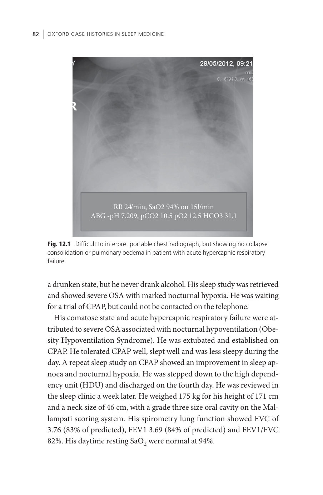
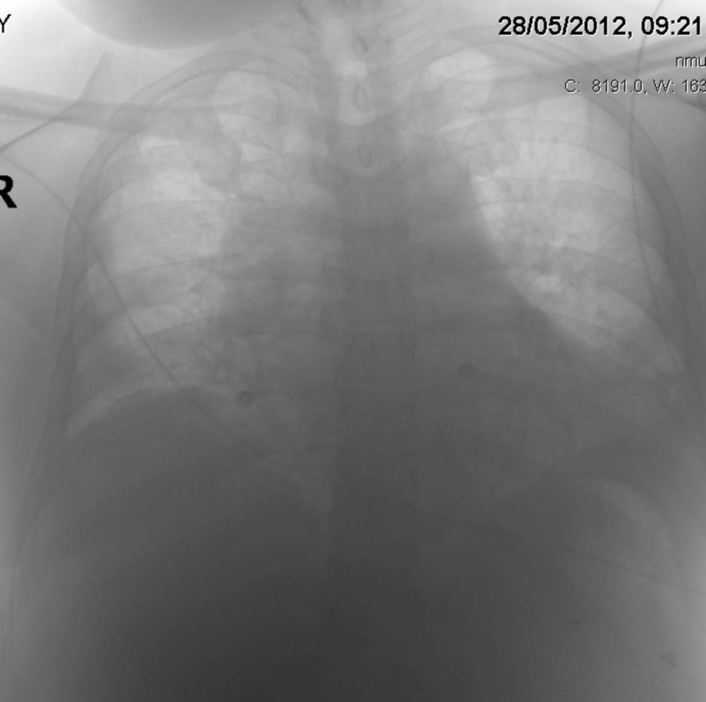
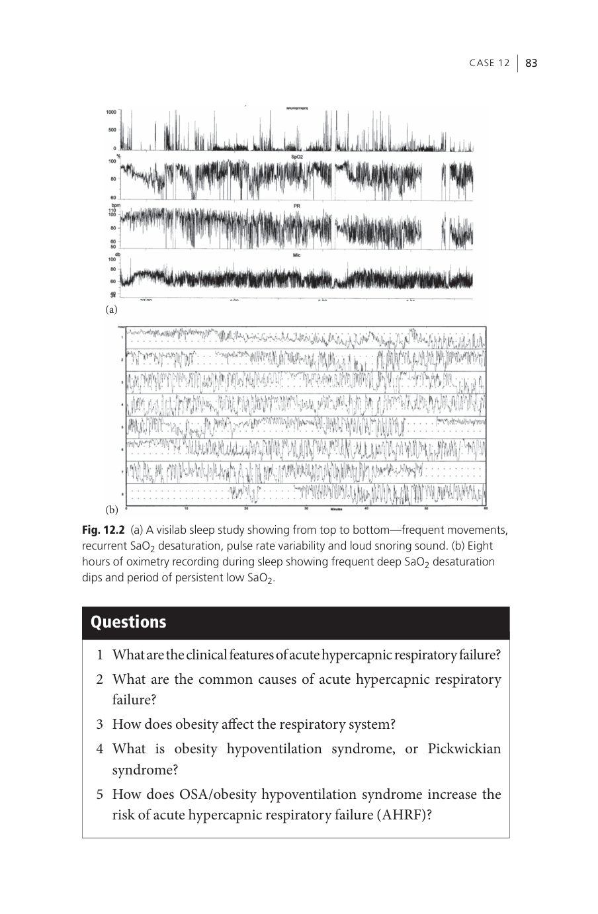
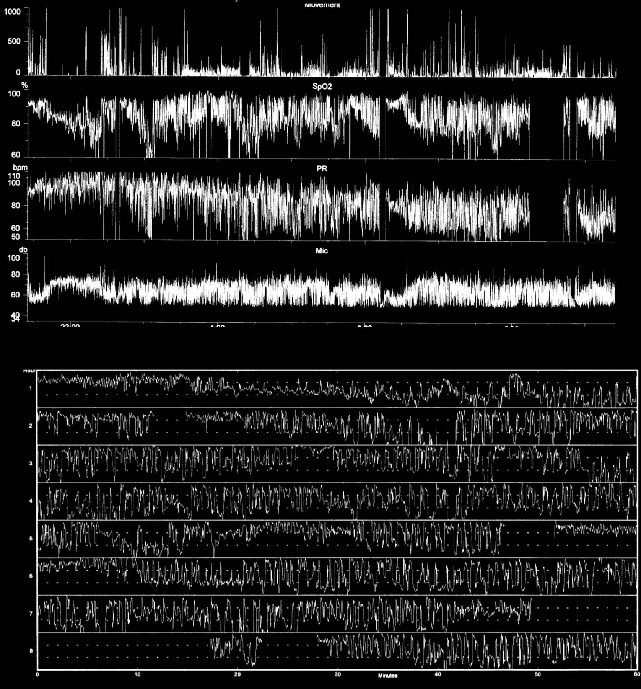
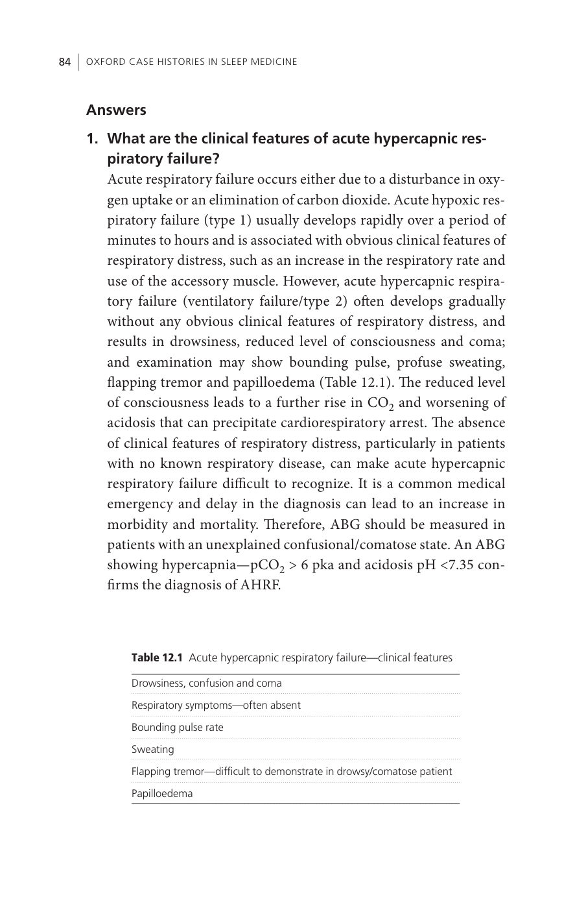
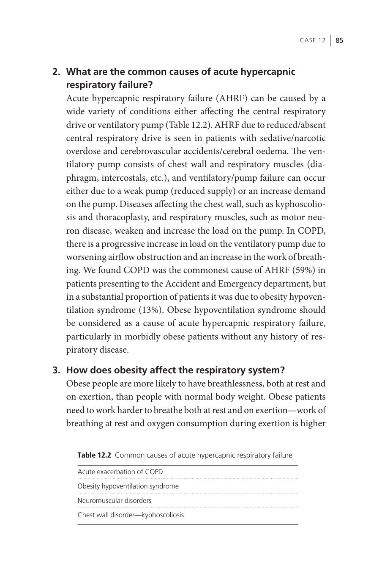

# Case 12 Collapsed in a café: acute respiratory failure

<!-- pdf-page: 94 -->

A 46-year-old morbidly obese man went to a café and ordered a breakfast. He collapsed and slumped on a table before breakfast arrived. Paramedics on the scene found him unresponsive and took to him to the Accident and Emergency as an ‘unwell adult’. His Glasgow Coma Scale (GCS) was 8, temperature 37oC, blood pressure 148/81 mmHg and respiratory rate 28/min. His plasma glucose was elevated at 12.3 mmol/l and other blood tests showed a mildly elevated white cell count of 13.6 and C-reactive protein (CRP) of 6 (normal >5), but urea, creatinine, electrolytes and liver function tests were are all normal. ECG showed normal sinus rhythm and troponin was normal. He received high flow oxygen at 15 l/min via a rebreathing mask and arterial blood gases (ABG) showed pH 7.209, pCO2 10.5 kPa, pO2 12.5 kPa and HCO3 31.1 mmol/l—­consistent with acute on chronic hypercapnic respiratory failure. His portable chest X-ray was difficult to interpret (Figure 12.1), but showed no evidence of collapse/consolidation or pulmonary oedema. He was intubated and ventilated, and a CT head scan performed on the way to the intensive therapy unit (ITU) was normal. A probable diagnosis of viral/bacterial meningoencephalitis was made and treated with acyclovir and cefotriaxone while awaiting further investigations.

### Case 12

### Collapsed in a café: acute

### respiratory failure

His mother was contacted, who informed that he had had speech and hearing impairments since birth, but was otherwise in good health and had had a sleep study for sleep apnoea done at another hospital a few weeks previously (Figure 12.2). She described that he had experienced breathing difficulties and choking during sleep for a number of years and was often sleepy during the daytime—he was found twice on the street by police in

<!-- pdf-page: 95 -->

Fig. 12.1 Difficult to interpret portable chest radiograph, but showing no collapse

consolidation or pulmonary oedema in patient with acute hypercapnic respiratory failure.

RR 24/min, SaO2 94% on 15l/min ABG -pH 7.209, pCO2 10.5 pO2 12.5 HCO3 31.1

a drunken state, but he never drank alcohol. His sleep study was retrieved and showed severe OSA with marked nocturnal hypoxia. He was waiting for a trial of CPAP, but could not be contacted on the telephone.

His comatose state and acute hypercapnic respiratory failure were attributed to severe OSA associated with nocturnal hypoventilation (Obesity Hypoventilation Syndrome). He was extubated and established on CPAP. He tolerated CPAP well, slept well and was less sleepy during the day. A repeat sleep study on CPAP showed an improvement in sleep apnoea and nocturnal hypoxia. He was stepped down to the high dependency unit (HDU) and discharged on the fourth day. He was reviewed in the sleep clinic a week later. He weighed 175 kg for his height of 171 cm and a neck size of 46 cm, with a grade three size oral cavity on the Mallampati scoring system. His spirometry lung function showed FVC of 3.76 (83% of predicted), FEV1 3.69 (84% of predicted) and FEV1/FVC 82%. His daytime resting SaO2 were normal at 94%.

<!-- pdf-page: 96 -->

Case 12 83

Fig. 12.2 (a) A visilab sleep study showing from top to bottom—frequent movements,

recurrent SaO2 desaturation, pulse rate variability and loud snoring sound. (b) Eight hours of oximetry recording during sleep showing frequent deep SaO2 desaturation dips and period of persistent low SaO2.

(a)

(b)

1 What are the clinical features of acute hypercapnic respiratory failure?

#### Questions

2 What are the common causes of acute hypercapnic respiratory

4 What is obesity hypoventilation syndrome, or Pickwickian

failure?

3 How does obesity affect the respiratory system?

5 How does OSA/obesity hypoventilation syndrome increase the

syndrome?

risk of acute hypercapnic respiratory failure (AHRF)?

<!-- pdf-page: 97 -->

#### Answers

#### 1. What are the clinical features of acute hypercapnic res­

#### piratory failure?

Acute respiratory failure occurs either due to a disturbance in oxygen uptake or an elimination of carbon dioxide. Acute hypoxic respiratory failure (type 1) usually develops rapidly over a period of minutes to hours and is associated with obvious clinical features of respiratory distress, such as an increase in the respiratory rate and use of the accessory muscle. However, acute hypercapnic respiratory failure (ventilatory failure/type 2) often develops gradually without any obvious clinical features of respiratory distress, and results in drowsiness, reduced level of consciousness and coma; and examination may show bounding pulse, profuse sweating, flapping tremor and papilloedema (Table 12.1). The reduced level of consciousness leads to a further rise in CO2 and worsening of acidosis that can precipitate cardiorespiratory arrest. The absence of clinical features of respiratory distress, particularly in patients with no known respiratory disease, can make acute hypercapnic respiratory failure difficult to recognize. It is a common medical emergency and delay in the diagnosis can lead to an increase in morbidity and mortality. Therefore, ABG should be measured in patients with an unexplained confusional/comatose state. An ABG showing hypercapnia—pCO2 > 6 pka and acidosis pH <7.35 confirms the diagnosis of AHRF.

Table 12.1 Acute hypercapnic respiratory failure—clinical features

Flapping tremor—difficult to demonstrate in drowsy/comatose patient

Drowsiness, confusion and coma

Respiratory symptoms—often absent

Bounding pulse rate

Sweating

Papilloedema

<!-- pdf-page: 98 -->

Case 12 85

#### 2. What are the common causes of acute hypercapnic

#### respiratory failure?

Acute hypercapnic respiratory failure (AHRF) can be caused by a wide variety of conditions either affecting the central respiratory drive or ventilatory pump (Table 12.2). AHRF due to reduced/­absent central respiratory drive is seen in patients with sedative/narcotic overdose and cerebrovascular accidents/cerebral oedema. The ventilatory pump consists of chest wall and respiratory muscles (diaphragm, intercostals, etc.), and ventilatory/pump failure can occur either due to a weak pump (reduced supply) or an increase demand on the pump. Diseases affecting the chest wall, such as kyphoscoliosis and thoracoplasty, and respiratory muscles, such as motor neuron disease, weaken and increase the load on the pump. In COPD, there is a progressive increase in load on the ventilatory pump due to worsening airflow obstruction and an increase in the work of breathing. We found COPD was the commonest cause of AHRF (59%) in patients presenting to the Accident and Emergency department, but in a substantial proportion of patients it was due to obesity hypoventilation syndrome (13%). Obese hypoventilation syndrome should be considered as a cause of acute hypercapnic respiratory failure, particularly in morbidly obese patients without any history of respiratory disease.

#### 3. How does obesity affect the respiratory system?

Obese people are more likely to have breathlessness, both at rest and on exertion, than people with normal body weight. Obese patients need to work harder to breathe both at rest and on exertion—work of breathing at rest and oxygen consumption during exertion is higher

Table 12.2 Common causes of acute hypercapnic respiratory failure

Acute exacerbation of COPD

Obesity hypoventilation syndrome

Neuromuscular disorders

Chest wall disorder—kyphoscoliosis

<!-- pdf-page: 99 -->

in obese patients. Many patients awaiting bariatric surgery report exertional dyspnoea. The load on the ventilatory pump increases due to anterior chest wall encasement with adipose tissue, and the pump becomes weaker due to fatty infiltration of the respiratory muscles. Furthermore, obese patients are more prone to developing respiratory problems, such as basal atelectasis, respiratory infections and hypoxia due to visceral abdominal obesity, particularly when confined to bed over prolonged periods because of impaired diaphragmatic movements, and ventilation at the lung bases and ventilation perfusion abnormalities.

#### 4. What is obesity hypoventilation syndrome, or

#### Pickwickian syndrome?

A few obese patients, usually those who are morbidly obese, have periods of profound hypoventilation during sleep and develop daytime hypercapnia (pCO2 > 6 kPa). The combination of a BMI of >30 and daytime hypercapnia reflecting nocturnal hypoventilation due to obesity in the absence of known causes of respiratory failure is diagnosed as obesity hypoventilation syndrome—previously known as Pickwickian syndrome. Most are morbidly obese and have severe OSA. Nocturnal hypoventilation is indicated by profound hypoxia during sleep with TST below SaO2 90% >30%, low mean SaO2 or episodes of prolonged desaturation—SaO2 < 88% for 5 minutes.

#### 5. How does OSA/obesity hypoventilation syndrome

#### increase the risk of AHRF?

Patients with undiagnosed OSA associated with hypoventilation are at risk of developing acute ventilatory failure. This may be triggered by an episode of lower respiratory tract infection, bronchospasm or heart failure. Excessive alcohol and benzodiazepine use can also precipitate acute ventilatory failure. This often results in acute admission due to unexplained acute hypercapnic respiratory failure. Many of these patients are admitted to the ITU for mechanical ventilation, resulting in a prolonged hospital stay and an increased risk of mortality. They often have multiple admissions to hospital due to respiratory illness. Early detection of OSA/obesity hypoventilation

<!-- pdf-page: 100 -->

Case 12 87

syndrome and treatment with CPAP can prevent multiple acute admissions with AHRF. Similarly, avoidance of alcohol and benzodiazepine, and prompt treatment of respiratory tract infections in patients known to have OSA/obesity hypoventilation syndrome, can prevent episodes of acute AHRF.

Acute hypercapnic/ventilatory respiratory failure is a common condi­

#### Learning points

tion and may present with drowsiness, reduced level of consciousness and coma without any respiratory symptoms/distress.

Obesity increases the demand on the ventilatory pump and can also

weaken the pump causing ventilatory failure—known as obesity hypoventilation syndrome/Pickwickian syndrome.

Most (>90%) patients with obesity hypoventilation syndrome (OHS)

OHS should be considered as a cause of acute ventilatory failure, par­

have OSA.

ticularly in morbidly obese patients with no known respiratory cause.

Early diagnosis and treatment of obesity hypoventilation prevents mor­

bidity and mortality associated with ventilatory failure.

Chakrabarti B, Calverley PM. Management of acute ventilatory failure. Postgrad Med J

#### Further reading

2006 Jul;82(969):438–45. Piper AJ, Grunstein RR. Obesity hypoventilation syndrome: mechanisms and manage­

ment. Am J Respir Crit Care Med 2011 Feb 1;183(3):292–8. Sampol G, Rodés G, Ríos J, Romero O, Lloberes P, Morell F. Acute hypercap­

nic respiratory failure in patients with sleep apneas. Arch Bronconeumol 2010 Sep;46(9):466–72.
