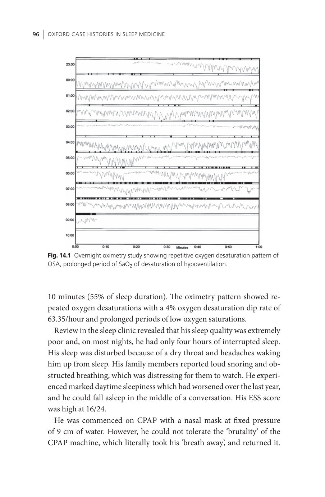
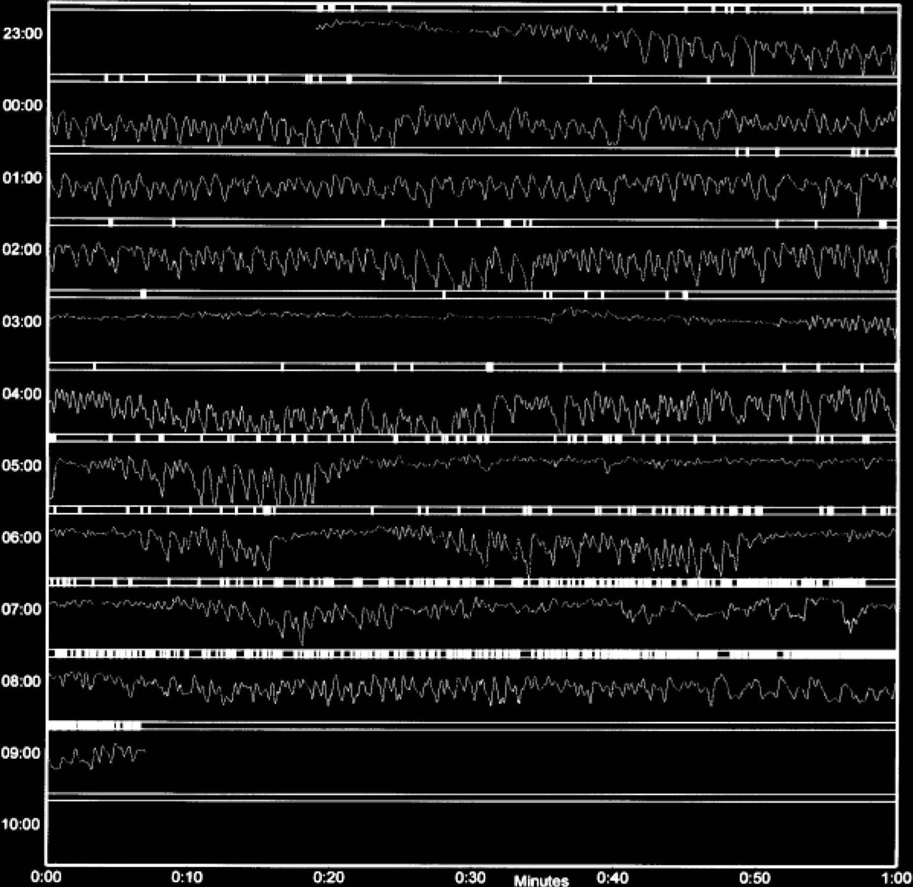

# Case 14 Neuropsychological impairment in a psychoanalyst with post-polio syndrome

<!-- pdf-page: 108 -->

### Case 14

### Neuropsychological impairment

### in a psychoanalyst with

### post-polio syndrome

A 66-year-old man, a non-smoker and wheelchair bound due to postpolio quadriparesis associated with kyphoscoliosis, was referred to the chest clinic for the management of a persistent cough associated with watery sputum of one-year duration. He had poliomyelitis in the 1950s affecting him at cervical cord level. Despite his functional disability due to quadriparesis, he remained active and in good health most of his life, working as a psychoanalyst, except for an episode of type 2 respiratory failure 20 years ago during a post-operative period following haemorrhoid surgery when he required ventilation for a few days. A sleep study at that stage showed no evidence of OSA or nocturnal hypoxia.

He had crackles at the left lung base with dullness on percussion of his chest. His chest X-ray showed scoliosis with volume loss at the right lung base, and a CT scan of the chest showed bronchiectasis with mild dilatation of bronchi in both lower lobes with a distorted lung shape due to quadriparesis. His lung function test showed marked pulmonary restriction with FEV1 1 litre (32% of predicted) and FVC of 1.1 (28% of predicted). However, his resting oxygen saturations were normal at 96%. He was advised to undergo postural drainage for bronchiectasis.

He also reported worsening oedema of his feet and ankles, despite being on diuretics, and headaches, particularly worse in the early morning. He was suspected to have nocturnal ventilatory problems and an overnight oximetry sleep study was performed (Figure 14.1). This showed marked nocturnal hypoxemia with mean SaO2 of 85.95% and TST spent below oxygen saturations of 88% (TST<88%) for 5 hours and

<!-- pdf-page: 109 -->

Fig. 14.1 Overnight oximetry study showing repetitive oxygen desaturation pattern of

OSA, prolonged period of SaO2 of desaturation of hypoventilation.

10 minutes (55% of sleep duration). The oximetry pattern showed repeated oxygen desaturations with a 4% oxygen desaturation dip rate of 63.35/hour and prolonged periods of low oxygen saturations.

Review in the sleep clinic revealed that his sleep quality was extremely poor and, on most nights, he had only four hours of interrupted sleep. His sleep was disturbed because of a dry throat and headaches waking him up from sleep. His family members reported loud snoring and obstructed breathing, which was distressing for them to watch. He experienced marked daytime sleepiness which had worsened over the last year, and he could fall asleep in the middle of a conversation. His ESS score was high at 16/24.

He was commenced on CPAP with a nasal mask at fixed pressure of 9 cm of water. However, he could not tolerate the ‘brutality’ of the CPAP machine, which literally took his ‘breath away’, and returned it.

<!-- pdf-page: 110 -->

Case 14 97

He remained symptomatic with markedly disturbed sleep and daytime tiredness. Attempts to adjust the CPAP pressure and CPAP mask were unsuccessful in improving his CPAP tolerance. He was commenced on BiPAP, which he was able to tolerate well, and he noticed an impressive improvement in sleep quality and daytime sleepiness, and a reduction in ankle swelling.

2 Describe the respiratory problems in patients with post-polio

#### Questions

1 What is post-polio syndrome?

3 How do you differentiate between nocturnal hypoventilation and

syndrome.

sleep apnoea as a cause of sleep disturbance in post-polio syndrome and does it affect management?

<!-- pdf-page: 111 -->

#### Answers

#### 1. What is post-polio syndrome?

A high proportion (75%) of patients who had polio during childhood, particularly requiring iron lung ventilation, develop further muscle weakness and fatigue after a latent period of 30 years due to a gradual deterioration of anterior horn cells (motor neurons) in the spinal cord. Further muscle weakness of the respiratory muscles often causes a respiratory problem.

#### 2. Describe the respiratory problems in patients with post-

polio syndrome. The weakness of the abdominal wall muscles (expiratory muscles) reduces the cough effort and sputum clearance and causes retention of sputum. This tends to prolong episodes of respiratory tract infections and make the patients more prone to bronchiectasis. Spinal muscle weakness causes/worsens kyphoscoliosis and further impairment of lung function.

The weakness of the inspiratory muscles—diaphragm and intercostal muscles—causes a reduction in vital capacity. During sleep, there is a further reduction in vital capacity due to the supine body position, reduction in the ventilatory drive and loss of extra diaphragmatic respiratory muscle tone during REM sleep. These ventilatory changes during sleep cause nocturnal hypoventilation. Patients with reduced vital capacity (<50%) are at risk of nocturnal hypoventilation. They may present with disturbed sleep, insomnia, anxiety about going to sleep, inability to breathe on lying flat (orthopnoea), choking episodes during sleep, night sweats, early morning headaches, daytime tiredness, and impaired memory and reduced concentration. Nocturnal hypoventilation is suggested by episodes of prolonged oxygen desaturations—SaO2 for less than 88% for five minutes on an overnight oximetry sleep study. Weakness of the pharyngeal muscles and residual effect of poliomyelitis on the brainstem respiratory centre makes them prone to sleep apnoea. The apnoea can be both obstructive and central, and is mainly seen during NREM. Recurrent episodes of apnoeas during sleep cause repetitive oxygen

<!-- pdf-page: 112 -->

Case 14 99

desaturation, disturbed sleep and daytime sleepiness. They rarely report breathlessness during the daytime because of reduced mobility and daytime resting SaO2 are normal. However, with a further increase in the weakness of respiratory muscles and a reduction in vital capacity, they develop daytime ventilatory failure and hypoxia.

#### 3. How do you differentiate between nocturnal

#### hypoventilation and sleep apnoea as a cause of sleep

#### disturbance in post-polio syndrome and does it affect

#### management?

Obstructive sleep apnoea causes a repetitive sawtooth pattern of desaturation compared to episodes of prolonged oxygen desaturation <88% lasting for five minutes or more due to nocturnal hypoventilation. It is important to establish the relative contribution of sleep apnoea and nocturnal hypoventilation to sleep disturbance and daytime symptoms in patients with post-polio syndrome to decide if they should be treated with CPAP or BiPAP. OSA patients who have reduced vital capacity of <50% are likely to have significant associated hypoventilation, and are less likely to respond to CPAP and to require BiPAP.

Detailed assessment of 35 patients with post-polio syndrome with sleep studies and arterial blood gases showed that more than 50% had OSA, and others had hypoventilation or a combination of hypoventilation with OSA. The latent period after onset of polio was 37 years before the problems described here were noted. Daytime sleepiness was a common symptom in these patients. Patients who had scoliosis or restricted lung function tests were more likely to have hypoventilation.

Patients with a history of childhood poliomyelitis are at risk of develop­

#### Learning points

ing post-polio syndrome after a latent period of 30 to 40 years.

Post-polio syndrome patients are at risk of developing respiratory prob­

lems due to the worsening of respiratory muscles weakness.

Disturbed sleep and daytime sleepiness in post-polio syndrome could be

due to OSA, nocturnal hypoventilation or a combination of the two.

<!-- pdf-page: 113 -->

OSA is mainly due to weakness of the upper airway muscles and re­

sponds well to CPAP.

Reduced vital capacity due to respiratory muscle weakness and ky­

phoscoliosis is the main cause of nocturnal hypoventilation, which can progress to diurnal hypoventilation and respiratory failure. This usually requires nocturnal BiPAP.

Dean AC, Graham BA, Dalakas M, Sato S. Sleep apnea in patients with postpolio syn­

#### Further reading

drome. Ann Neurol 1998 May;43(5):661–4. Howard RS. Poliomyelitis and the postpolio syndrome. BMJ 2005 Jun 4;330(7503):1314–

18. Review. Hsu AA, Staats BA. ‘Postpolio’ sequelae and sleep-related disordered breathing. Mayo

Clin Proc 1998 Mar;73(3):216–24.
