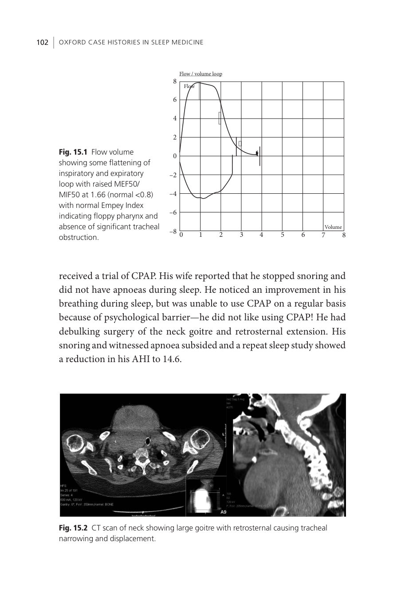
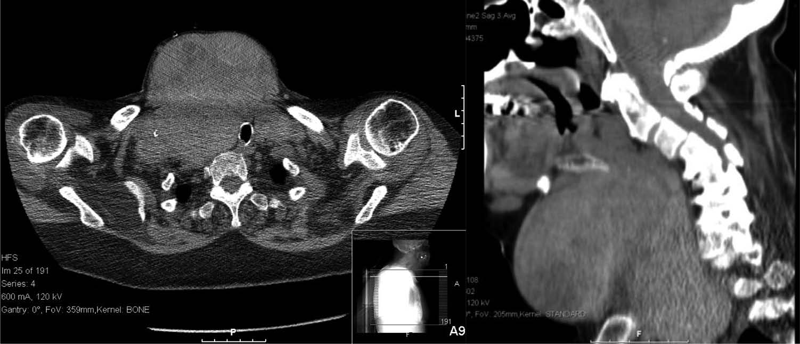
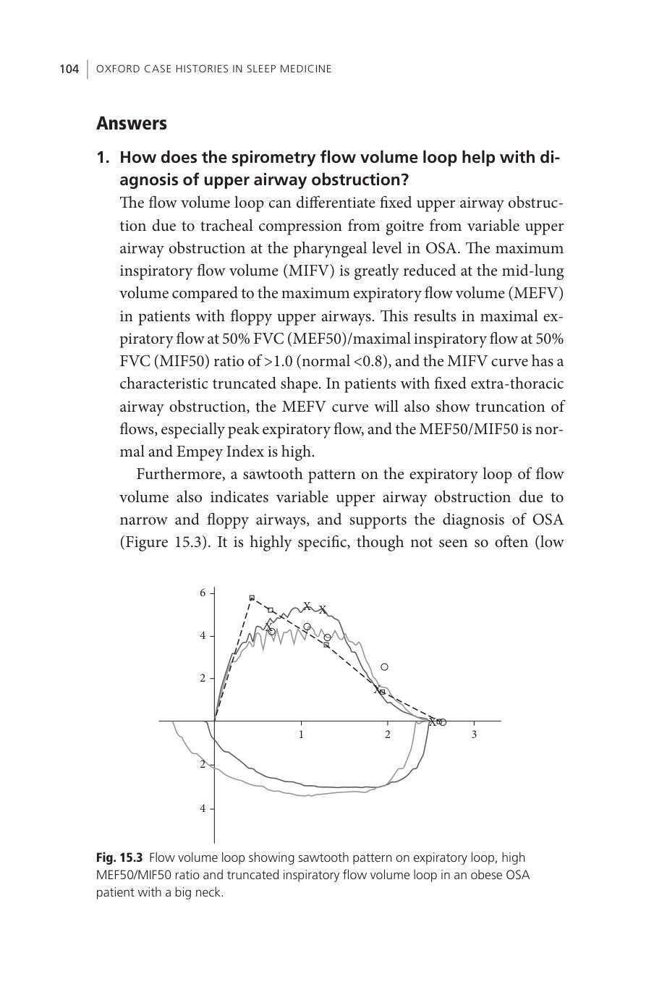
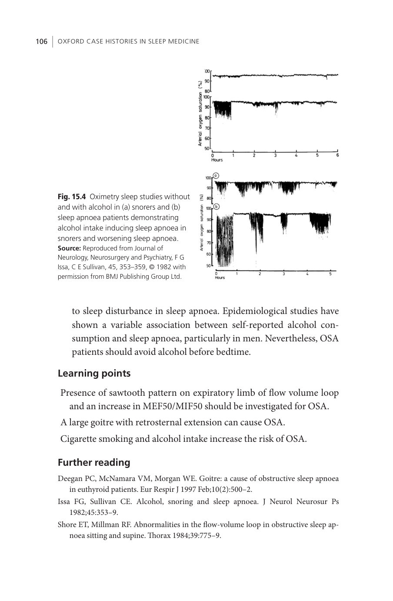
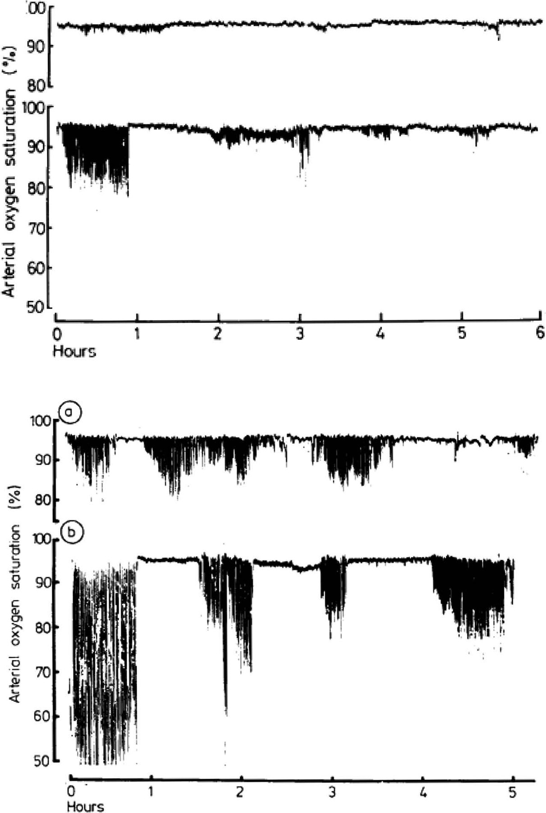

# Case 15 Nocturnal choking in a patient with a goitre and retrosternal extension

<!-- pdf-page: 114 -->

### Case 15

### Nocturnal choking in a patient

### with a goitre and retrosternal

### extension

A 70-year-old man with a long-standing goitre and retrosternal extension was referred to a sleep clinic by an endocrinologist. The patient’s wife reported that he snored very loudly and was audible even outside the bedroom, and she was worried about his frequent pauses in breathing and choking episodes. However, he slept well without any sleep disturbance. He woke up unrefreshed in the morning and felt sleepy during the daytime, but scored only 2/24 on the ESS. He was retired, smoked 30 cigarettes a day and drank four bottles of wine per week. He was obese, weighing 100 kg for his height of 176 cm with a BMI of 32.2. He had a visible goitre and his neck size at the cricoid cartilage was 47 cm. His oral cavity was narrow, with a Mallampati score of 4. Flow volume loop studies showed mild flattening of the inspiratory and expiratory loops and no sawtooth pattern on the expiratory flow loop. The Empey Index—ratio of FEV1 (ml/s) and PEFR (l/min)—was normal at 6.4 (normal <8–10), but the maximal expiratory flow at 50% FVC (MEF50)/maximal inspiratory flow at 50% FVC (MIF50) was raised at 1.66 (normal <0.8) (Figure 15.1). The CT scan of the neck showed a large goitre with retrosternal extension causing tracheal compression, narrowing and displacement (Figure 15.2). A sleep study confirmed severe OSA—AHI of 51.4 and SaO2 dip rate of 68.3/hour and mean SaO2 of 88.8%. The AHI consisted of 44% apnoea and 56% hypopnoea. The apnoeas were obstructive, with the longest apnoea lasting for 49.5 seconds and the mean duration of apnoeas was 17.4 seconds. The patient

<!-- pdf-page: 115 -->

Flow / volume loop

8

Flow

6

4

received a trial of CPAP. His wife reported that he stopped snoring and did not have apnoeas during sleep. He noticed an improvement in his breathing during sleep, but was unable to use CPAP on a regular basis because of psychological barrier—he did not like using CPAP! He had debulking surgery of the neck goitre and retrosternal extension. His snoring and witnessed apnoea subsided and a repeat sleep study showed a reduction in his AHI to 14.6.

2

Fig. 15.1 Flow volume

showing some flattening of inspiratory and expiratory loop with raised MEF50/ MIF50 at 1.66 (normal <0.8) with normal Empey Index indicating floppy pharynx and absence of significant tracheal obstruction.

0

–2

–4

–6

Volume

–8 0 1 2 3 4 5 6 7 8

Fig. 15.2 CT scan of neck showing large goitre with retrosternal causing tracheal

narrowing and displacement.

<!-- pdf-page: 116 -->

Case 15 103

#### Questions

1 How does the spirometry flow volume loop help with diagnosis of

upper airway obstruction?

2 Do thyroid problems cause or contribute to upper airway ob­

3 Are cigarette smoking and drinking alcohol risk factors for OSA?

struction in OSA?

<!-- pdf-page: 117 -->

#### Answers

#### 1. How does the spirometry flow volume loop help with di­

#### agnosis of upper airway obstruction?

The flow volume loop can differentiate fixed upper airway obstruction due to tracheal compression from goitre from variable upper airway obstruction at the pharyngeal level in OSA. The maximum inspiratory flow volume (MIFV) is greatly reduced at the mid-lung volume compared to the maximum expiratory flow volume (MEFV) in patients with floppy upper airways. This results in maximal expiratory flow at 50% FVC (MEF50)/maximal inspiratory flow at 50% FVC (MIF50) ratio of >1.0 (normal <0.8), and the MIFV curve has a characteristic truncated shape. In patients with fixed extra-thoracic airway obstruction, the MEFV curve will also show truncation of flows, especially peak expiratory flow, and the MEF50/MIF50 is normal and Empey Index is high.

Furthermore, a sawtooth pattern on the expiratory loop of flow volume also indicates variable upper airway obstruction due to narrow and floppy airways, and supports the diagnosis of OSA (Figure 15.3). It is highly specific, though not seen so often (low

Fig. 15.3 Flow volume loop showing sawtooth pattern on expiratory loop, high

MEF50/MIF50 ratio and truncated inspiratory flow volume loop in an obese OSA patient with a big neck.

6

X X

X

4

2

2

4

X

X

1 2 3

<!-- pdf-page: 118 -->

Case 15 105

sensitivity) in patients with OSA. Therefore, an incidental finding of a sawtooth pattern on the spirometry flow volume loop should prompt a diagnosis of OSA.

#### 2. Do thyroid problems cause or contribute to upper airway

#### obstruction in OSA?

Patients with a large goitre are at risk of OSA. The exact mechanisms are not known, but OSA is mainly seen in patients with very large goitres associated with tracheal narrowing or retrosternal extension. Venous obstruction due to retrosternal goitre may cause upper airway congestion and swelling, and a large goitre could interfere with upper airway muscle activity/action.

Patients with hypothyroidism are at an increased risk of OSA. They have a high prevalence (>25%) of OSA. Excessive deposition of mucopolysaccharides soft tissue around the pharynx and tongue (macroglossia) causes upper airway narrowing in patients with untreated hypothyroidism. Similarly, a reduced upper airway muscle tone due to hypotonia contributes to upper airway narrowing and collapsibility. Thyroxine replacement cures OSA in such patients.

#### 3. Are cigarette smoking and drinking alcohol risk factors

#### for OSA?

Cigarette smoking increases the risk of OSA through its effect on upper air inflammation. The inflamed upper airways are narrow and more collapsible. It is known that a current smoker has a higher prevalence of snoring and sleep apnoea than an ex- or non-smoker (Figure 15.4). Smoking-related small airway disease can worsen the effect of apnoeas on oxygen desaturation. Finally, COPD due to smoking increases the risk of ventilatory/respiratory failure in OSA (overlap syndrome).

Alcohol has been shown to precipitate OSA in snorers and worsen sleep apnoea, and increase the duration and severity of apnoeas and hypoxia in patients with OSA. The effect of alcohol on sleep apnoea is marked during the first hour of sleep after alcohol intake. This is mainly due to alcohol-induced hypotonia and respiratory depression. Alcohol-induced diuresis and nocturia may further contribute

<!-- pdf-page: 119 -->

to sleep disturbance in sleep apnoea. Epidemiological studies have shown a variable association between self-reported alcohol consumption and sleep apnoea, particularly in men. Nevertheless, OSA patients should avoid alcohol before bedtime.

Presence of sawtooth pattern on expiratory limb of flow volume loop

#### Learning points

and an increase in MEF50/MIF50 should be investigated for OSA.

A large goitre with retrosternal extension can cause OSA.

Cigarette smoking and alcohol intake increase the risk of OSA.

Deegan PC, McNamara VM, Morgan WE. Goitre: a cause of obstructive sleep apnoea

#### Further reading

in euthyroid patients. Eur Respir J 1997 Feb;10(2):500–2. Issa FG, Sullivan CE. Alcohol, snoring and sleep apnoea. J Neurol Neurosur Ps

1982;45:353–9. Shore ET, Millman RF. Abnormalities in the flow-volume loop in obstructive sleep ap­

noea sitting and supine. Thorax 1984;39:775–9.

