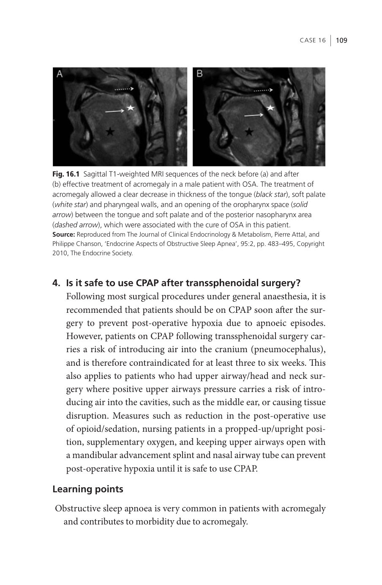
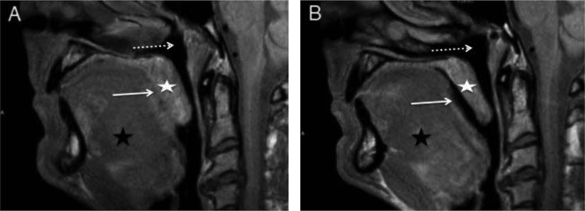

# Case 16 OSA persists despite removal of a pituitary tumour causing acromegaly

<!-- pdf-page: 120 -->

### Case 16

### OSA persists despite removal

### of a pituitary tumour causing

### acromegaly

A 65-year-old man with acromegaly was confirmed to have severe OSA when he presented with lethargy and sleepiness, and was treated with CPAP. He was compliant with CPAP and slept well, and did not have EDS (ESS score 5/24). He weighed 89.9 kg for his height of 165 cm (BMI 33) and his collar size was 40.2 cm. He had a transsphenoidal removal of pituitary macro adenoma six months later. He felt better with an improvement in the size of his hands, but he has some impairment of his sense of smell and taste after surgery. He also noticed that his hair was turning darker in colour. A repeat sleep study after pituitary surgery showed persistent sleep apnoea and he remained on CPAP.

1 How common is sleep apnoea in acromegaly patients?

#### Questions

3 Does cure of acromegaly improve or eliminate sleep apnoea?

2 What is the cause of OSA in acromegaly?

4 Is it safe to use CPAP after transsphenoidal surgery?

<!-- pdf-page: 121 -->

#### Answers

#### 1. How common is sleep apnoea in acromegaly patients?

Most patients with acromegaly have some degree of OSA. The prevalence varies from 27–100%—it tends to be more common in acromegaly patients with an active disease and elevated GH/IGF1 (growth hormone and insulin-like growth factor) levels than patients in remission. OSA is one of the main causes of fatigue and reduced quality of life in acromegaly. It increases the cardiovascular risk associated with acromegaly. Upper airway oedema due to transsphenoidal surgery in acromegaly patients with OSA can increase the risk of post-operative respiratory problems. Screening sleep study is advisable in all patients with acromegaly. Diagnosis and treatment of OSA with CPAP prior to pituitary surgery is likely to reduce peri-operative complications.

OSA in acromegaly is due to excessive soft tissue deposition of glycosaminoglycan causing a large tongue, hypertrophy of pharyngeal tissue (soft palate) and mucosal thickening of the upper airway. Associated craniofacial abnormalities, such as a protruding jaw, can cause upper airway narrowing—on jaw opening, the tongue base is driven back and narrows the upper airway. Some acromegaly patients are obese and have hypothyroidism contributing to OSA.

#### 2. What is the cause of OSA in acromegaly?

#### 3. Does cure of acromegaly improve or eliminate sleep

#### apnoea?

Treatment of acromegaly (surgical or medical) may lead to complete reversal of OSA, but in a substantial proportion (40%) of patients it persists. Excessive soft tissue deposition may regress after treatment of acromegaly (Figure 16.1), but the bony abnormalities persist. Similarly persistent obesity in some patients could account for lack of improvement in OSA after the surgery. Therefore, OSA patients should be re-evaluated after treatment of acromegaly. OSA is more likely to persist in obese acromegaly patients.

<!-- pdf-page: 122 -->

Case 16 109

#### 4. Is it safe to use CPAP after transsphenoidal surgery?

Following most surgical procedures under general anaesthesia, it is recommended that patients should be on CPAP soon after the surgery to prevent post-operative hypoxia due to apnoeic episodes. However, patients on CPAP following transsphenoidal surgery carries a risk of introducing air into the cranium (pneumocephalus), and is therefore contraindicated for at least three to six weeks. This also applies to patients who had upper airway/head and neck surgery where positive upper airways pressure carries a risk of introducing air into the cavities, such as the middle ear, or causing tissue disruption. Measures such as reduction in the post-operative use of opioid/sedation, nursing patients in a propped-up/upright position, supplementary oxygen, and keeping upper airways open with a mandibular advancement splint and nasal airway tube can prevent post-operative hypoxia until it is safe to use CPAP.

Obstructive sleep apnoea is very common in patients with acromegaly

#### Learning points

and contributes to morbidity due to acromegaly.

<!-- pdf-page: 123 -->

OSA improves with treatment of acromegaly in some patients, but may

persist in others.

CPAP should not be used following transsphenoidal surgery due to the

risk of pneumocephalus.

Davi’ MV, Dalle Carbonare L, Giustina A, Ferrari M, Frigo A, Lo Cascio V, Fran­

#### Further reading

cia G. Sleep apnoea syndrome is highly prevalent in acromegaly and only partially reversible after biochemical control of the disease. Eur J Endocrinol 2008 Nov;159(5):533–40. Kopelovich JC, de la Garza GO, Greenlee JD, Graham SM, Udeh CI, O’Brien EK. Pneu­

mocephalus with BiPAP use after transsphenoidal surgery. J Clin Anesth 2012 Aug;24(5):415–18.
