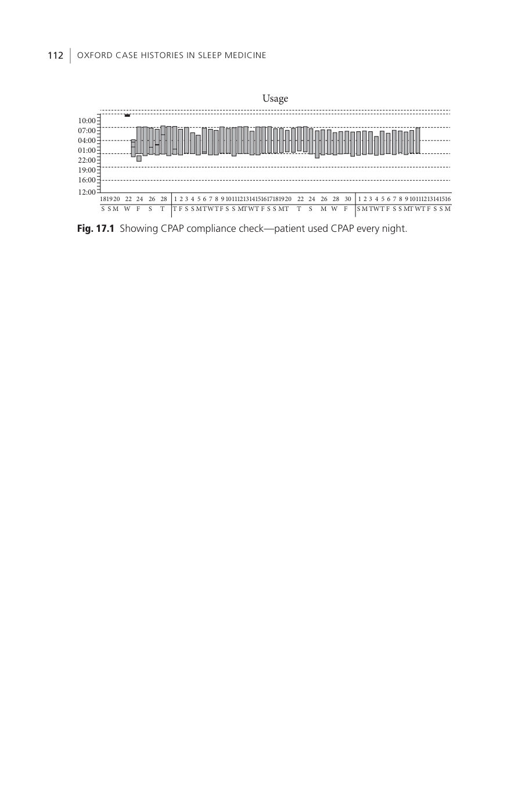

# Case 17 CPAP transformed my life

<!-- pdf-page: 124 -->

A 39-year-old bus driver was referred to a sleep clinic by her GP. She complained of sleepiness—usually while watching television, but more recently she was increasingly sleepy at the cinema. She did not have a regular bed partner, but her children heard her snore. She rated her ESS score at 12/24. She had a past medical history of anaemia, but otherwise was in good health. She worked as a bus driver and held a public service vehicle (PSV) driving licence. She denied ever having fallen asleep at the wheel of the bus. She was obese, with a BMI of 42, but examination otherwise was unremarkable. Her sleep study confirmed severe sleep apnoea (4% dip rate 40 events/hour, minimum SpO2 66%). She was commenced on CPAP at a fixed pressure of 12 cm of water via a nasal CPAP mask. CPAP compliance check with auto-titrating CPAP showed excellent compliance (Figure 17.1).

### Case 17

### CPAP transformed my life

At review in clinic, she said that she had never felt better. She had gone to the cinema with her daughter and, for the first time in ten years, she was able to stay awake right through the film. Her daughter no longer reported any snoring. Her ESS was now 6/24. In retrospect, she felt that she might have had sleep apnoea for ten years or more before seeking medical attention.

She informed the diving vehicle licensing agency (DVLA) of her diagnosis and, with the support of her employer, was re-deployed to a desk job until she was established on CPAP. She was reviewed in the clinic after she was established on CPAP and a medical report was sent to the DVLA. Her PSV licence was renewed and she remains under clinic review while she holds a PSV licence.

<!-- pdf-page: 125 -->

Usage

10:00

07:00 04:00 01:00 22:00 19:00 16:00 12:00 18 S S M M 1920 22 24 26 28 22 24 26 28 30 1 W F S T T T W W T F S S 2 3 4 5 6 7 8 9 10111213141516 1 2 3 4 5 6 7 8 9 10111213141516 17181920 F S S MT F S S MT T T W W W S M M M F F F S S S S S M T T T T

Fig. 17.1 Showing CPAP compliance check—patient used CPAP every night.

<!-- pdf-page: 126 -->

Case 17 113

#### Questions

1 What is the lag time for the diagnosis of sleep apnoea?

2 What opportunities are there for screening patients for sleep

3 What are the consequences of untreated sleep apnoea?

apnoea?

<!-- pdf-page: 127 -->

#### Answers

#### 1. What is the lag time for the diagnosis of sleep apnoea?

Patients who are diagnosed with sleep apnoea, often in retrospect, have had symptoms for many years (>10 years) before they come to medical attention and diagnosis. This is likely to occur for a variety of reasons. Patients are often unaware of their symptoms and may become habituated to sleepiness so that they no longer perceive it. It often takes concerns from a bed partner before medical assistance is sought.

During medical training, very little sleep medicine is taught within the curriculum. A recent survey of medical undergraduate teaching in the UK found that the median teaching for all aspects of sleep medicine (pathology, pharmacology and diagnostic evaluation) was 2.5 hours. Of the medical schools that responded to the survey, 13% had no teaching whatsoever in their syllabus. Similarly, there is little postgraduate teaching on sleep within the UK. It is therefore perhaps unsurprising that medical professionals themselves may have difficulties in recognizing the signs and symptoms of sleep apnoea. Even when patients present with clinical features of sleep apnoea, there may be poor recognition by the medical profession.

#### 2. What opportunities are there for screening patients for

#### sleep apnoea?

There are numerous opportunities for recognizing patients with undiagnosed sleep apnoea. Research suggests that, in the ten years prior to OSA diagnosis, patients with OSA made almost twice as many visits to healthcare professionals than age, gender and geographically matched controls. Thus, it seems that patients with OSA have more contact with health professionals than those without, providing opportunity for physicians and other professionals to recognize this common condition.

It is known that untreated OSA leads to an increase in hypertension and treating OSA with CPAP can reduce hypertension. Thus, both primary care and secondary physicians treating patients with hypertension who require more than two drugs for its treatment

<!-- pdf-page: 128 -->

Case 17 115

should specifically ask about symptoms of OSA and refer them to a sleep clinic if required.

Finally, there is a high prevalence of sleep apnoea in patients with type 2 diabetes mellitus. Often symptoms of OSA, such as sleepiness and nocturia, may be attributed to type 2 diabetes mellitus. However, this group of patients should be specifically asked about OSA symptoms. They are often reviewed annually by their GP or at a diabetic clinic, providing opportunities for referral for sleep investigations.

#### 3. What are the consequences of untreated sleep apnoea?

Patients with untreated sleep apnoea may present with ­un-refreshing sleep, daytime sleepiness and an inability to maintain normal daytime alertness. They may experience difficulties at work due to sleepiness and are at increased risk of motor vehicle accidents and industrial accidents.

Patients may also experience frequent nocturia. This is probably related to atrial dilatation occurring during apnoeas with resultant increased secretion of atrial naturetic peptide, although its presence is often attributed to other common comorbidities, such as diabetes.

Untreated sleep apnoea is associated with hypertension. This is mainly related to an increase in blood pressure during recurrent OSA. Thus, patients, especially those who require more than one anti-hypertensive agent, should be questioned about symptoms of sleep apnoea.

Patients with undiagnosed sleep apnoea may have significant issues after general anaesthesia due to loss of the usual arousal mechanisms as well as post-operative changes in lung physiology. While the effects are likely to depend on the site of surgery and the type of anaesthetic being used, current recommendations suggest that anaesthetists seeing patients at pre-assessment clinics should question relevant patients about symptoms of sleep apnoea. In addition, there may be a correlation between patients who are difficult to intubate and previously unrecognized sleep apnoea. This may be related to a narrow upper airway which may be associated with both scenarios. Anaesthetists may wish to consider referring such patients for formal sleep evaluation.

<!-- pdf-page: 129 -->

#### Learning points

There is a long delay between onset of symptoms of OSA and diagnosis

due to lack of awareness among the population and insufficient education in health professionals.

Undiagnosed and untreated OSA can lead to poor quality of life, re­

duced performance at work, driving-related accidents and an increase in cardiovascular risk.

CPAP is the most effective treatment for OSA and leads to resolution of

symptoms, an improvement in quality of life, and a reduction in risk of driving-related accidents and cardiovascular morbidity.

Ronald J et al. Health care utilisation in the 10 years prior to diagnosis in obstructive

#### Further reading

sleep apnoea syndrome patients. Sleep 1999;15:225–9. Urquhart DS et al. Survey of undergraduate sleep medicine teaching in UK medical

schools. Arch Dis Child 2012;97:90–1.
