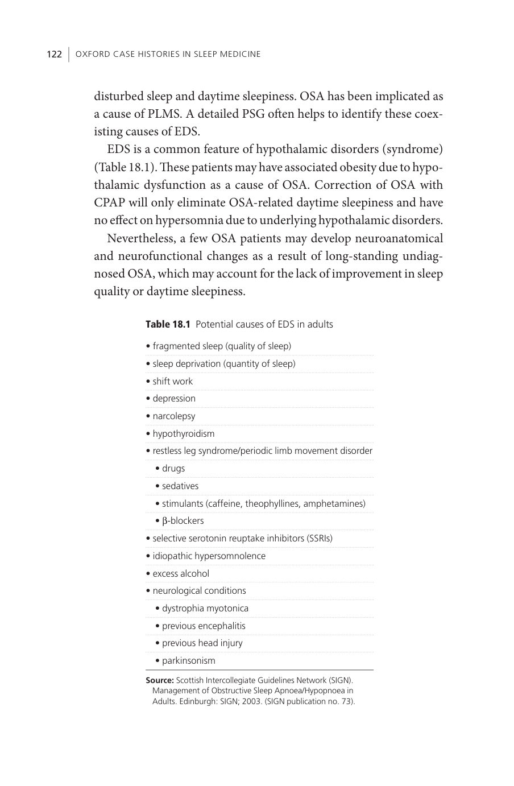

# Case 18 Persistent daytime sleepiness despite CPAP

<!-- pdf-page: 130 -->

### Case 18

### Persistent daytime sleepiness

### despite CPAP

A 58-year-old obese man of Indian origin, with a history of coronary artery disease, was suspected to have OSA by the cardiologist because of his symptoms of daytime somnolence and heavy snoring. He was extremely sleepy during the daytime and could nod off watching television, reading a book or sitting in a waiting area and even when talking to people. He frequently slept while travelling on a bus or train. Daytime sleepiness used to affect his work when he worked as a civil servant. He often felt sleepy while driving and reduced his driving to a few miles only for fear of having an accident—he pulled over for a rest when he felt sleepy. He scored 21/24 on the ESS. He snored very loudly and kept his wife awake, and she often slept in a separate room. His sleep was disturbed—he often woke himself up from his own snoring at night. He woke up unrefreshed and tired in the morning. He had put on weight gradually over the last few years. He was mildly obese, with a BMI of 30.91, collar size of 43.3 cm and grade 4 size oral cavity on the Mallampati scoring system. A visilab sleep study (overnight oximetry and audio-visual recording) confirmed OSA, with a SaO2 dip rate of 32.4 and mean SaO2 of 94%, and loud snoring up to 80db. The oxygen desaturation pattern was characteristic of OSA. He was titrated with CPAP at a fixed pressure of 9 cm of water via a nasal CPAP mask and a repeat sleep study on CPAP showed complete elimination of OSA—the SaO2 dip rate was 1.29 and mean SaO2 were 97.64. His wife noted a significant improvement in his sleep quality and he no longer snored on CPAP. She was also able to have a restful night’s sleep. He was less tired, but remained sleepy with an ESS score of 16 despite a good response to CPAP.

<!-- pdf-page: 131 -->

He was found to have mild anaemia, which was being investigated. He was very compliant with CPAP and reported using it every night for seven hours, and was happy to persist with treatment. He still felt very somnolent and his ESS score remained high at 21—he often dropped off to sleep sitting down in the evenings. Otherwise, daytime sleepiness did not affect his other daytime activities—he retired from his work and only drove to the local shops. He was not keen on taking the stimulant, modafinil, for his sleepiness.

<!-- pdf-page: 132 -->

Case 18 119

#### Questions

1 How common is persistent EDS despite CPAP in OSA?

2 What is the initial management of patients who report persistent

3 What is the next step in patients who have persistent EDS, despite

daytime sleepiness despite CPAP?

good objective demonstration of good CPAP compliance?

4 Are there any therapeutic options for persistent daytime

sleepiness?

<!-- pdf-page: 133 -->

#### Answers

#### 1. How common is persistent EDS despite CPAP in OSA?

Persistent daytime sleepiness despite CPAP is common; studies have found a prevalence of 20–40%. Management requires a careful systematic approach to identify and treat the causes of EDS.

EDS is one of the main presenting symptoms of OSA. The ESS remains the best tool available to assess the severity of EDS and response. An ESS score of <11 is considered normal, 11–14 mild, 15–18 moderate and >18 severe. The treatment of OSA with CPAP reduces the ESS score by an average of 2.9—much higher in patients with moderate to severe OSA than mild OSA.

#### 2. What is the initial management of patients who report

#### persistent daytime sleepiness despite CPAP?

It is important to assess an overall improvement in symptoms of OSA, including the elimination of snoring, improved sleep quality, waking up fresh in the morning and feeling less tired and sleepy during the daytime, rather than purely relying on a reduction in ESS.

It is not uncommon for some patients to report no or little change in ESS, despite an overall improvement in OSA symptoms. OSA patients have a high prevalence of depression and report tiredness and fatigue. It is important that fatigue and tiredness due to depression is not misinterpreted as daytime sleepiness.

Suboptimal compliance with CPAP is one of the common causes of persistent symptoms including daytime sleepiness. It has been shown that OSA patients need to use CPAP for at least four hours every night to notice an improvement in daytime sleepiness. Longer hours of CPAP use results in further improvement in daytime ­sleepiness—the more, the better. Missing CPAP even for a single night can lead to a rapid return of symptoms.

An improvement in OSA symptoms with CPAP is rapid, even after the first night’s use—patients may report waking up fresh and not sleepy. However, it may take up to four weeks for the maximum response and, in a few, it may be delayed up to three months. In

<!-- pdf-page: 134 -->

Case 18 121

some patients, a lack of immediate improvement in the symptoms with a burden of using CPAP affects compliance. An objective CPAP compliance may demonstrate suboptimal compliance as a cause of persistent daytime sleepiness. The compliance check may also detect air leakage from the nasal CPAP mask as a cause of reduced effectiveness. Air leakage due to a poor fitting CPAP mask, or mouth breathing that is noisy and uncomfortable, can further reduce CPAP compliance. However, some OSA patients remain excessively sleepy, despite good compliance with CPAP.

#### 3. What is the next step in patients who have persistent

#### EDS, despite good objective demonstration of good CPAP

#### compliance?

Persistent symptoms despite good CPAP compliance may be due to an insufficient fixed CPAP pressure. It is known that sleep apnoea varies in severity during the night in different body positions and sleep stages, and from night to night. A fixed CPAP pressure set based on a CPAP titration sleep study may not be sufficient to abolish OSA every night. A repeat sleep study on CPAP may help to detect persistent sleep apnoea on a fixed CPAP pressure. However, a single night sleep study may miss night-to-night variation in the sleep apnoea severity. A pragmatic approach may be to increase the CPAP pressure or use an auto-titrating CPAP. An auto-CPAP machine detects apnoea and varies the pressure required to eliminate apnoea.

In others, the lack of effectiveness of CPAP in improving daytime sleepiness may be due to co-existing conditions causing daytime sleepiness. OSA diagnosed on oximetry cannot distinguish between OSA and CSA as a cause of recurrent oxygen desaturations. In patients with mixed apnoeas, CPAP unmasks central apnoea—complex sleep apnoea. This can be detected with the help of a multichannel sleep study that includes respiratory monitoring during sleep. Patients with complex sleep apnoea have persistent apnoea and daytime sleepiness despite CPAP, and often require BiPAP.

A few patients with OSA have associated neurological conditions, such as periodic limb movement syndrome (PLMS), as a cause of

<!-- pdf-page: 135 -->

disturbed sleep and daytime sleepiness. OSA has been implicated as a cause of PLMS. A detailed PSG often helps to identify these coexisting causes of EDS.

EDS is a common feature of hypothalamic disorders (syndrome) (Table 18.1). These patients may have associated obesity due to hypothalamic dysfunction as a cause of OSA. Correction of OSA with CPAP will only eliminate OSA-related daytime sleepiness and have no effect on hypersomnia due to underlying hypothalamic disorders.

Nevertheless, a few OSA patients may develop neuroanatomical and neurofunctional changes as a result of long-standing undiagnosed OSA, which may account for the lack of improvement in sleep quality or daytime sleepiness.

Table 18.1 Potential causes of EDS in adults

• fragmented sleep (quality of sleep)

• sleep deprivation (quantity of sleep)

• shift work

• depression

• narcolepsy

• hypothyroidism

• drugs

• sedatives

• stimulants (caffeine, theophyllines, amphetamines)

• β-blockers

• selective serotonin reuptake inhibitors (SSRIs)

• idiopathic hypersomnolence

• excess alcohol

• neurological conditions

• dystrophia myotonica

• previous encephalitis

• previous head injury

• parkinsonism

Source: Scottish Intercollegiate Guidelines Network (SIGN).

Management of Obstructive Sleep Apnoea/Hypopnoea in Adults. Edinburgh: SIGN; 2003. (SIGN publication no. 73).

• restless leg syndrome/periodic limb movement disorder

<!-- pdf-page: 136 -->

Case 18 123

#### 4. Are there any therapeutic options for persistent daytime

#### sleepiness?

Modafinil is a central nervous system stimulant without the addictive properties of amphetamine, and promotes wakefulness. It can be a useful adjunct to CPAP in a dose of 200–400 mg in CPAP compliant patients with persistent daytime sleepiness (>6 hours/night). It also improves alertness and quality of life. It is generally well tolerated and, if taken before midday, does not affect night-time sleep. Headaches and nausea are the two most common side effects, and it should be used with caution in patients with hypertension and heart disease.

Armodafinil is a long-acting isomer of modafinil with a half-life of 10 to 15 hours, and has also been shown to be effective in improving daytime sleepiness.

Persistent daytime sleepiness despite CPAP treatment is common.

#### Learning points

Reduced CPAP compliance and effectiveness should be excluded by ob­

jective measurement of CPAP compliance and CPAP sleep study respectively before considering further management.

EDS is a common symptom and should be distinguished from fatigue

If EDS is due to depression, the side effects of drugs and metabolics

and tiredness.

OSA is often associated with neurological disorders such as PLMS and

should be considered.

narcolepsy—a PSG should be done to exclude these conditions.

Kay GG, Feldman N. Effects of armodafinil on simulated driving and self-report meas­

#### Further reading

ures in obstructive sleep apnea patients prior to treatment with continuous positive airway pressure. J Clin Sleep Med 2013 May 15;9(5):445–54. Management of obstructive sleep apnoea/hypopnoea in adults. A national clinical

guideline. Scottish Intercollegiate Guidelines Network (SIGN). 2003.
