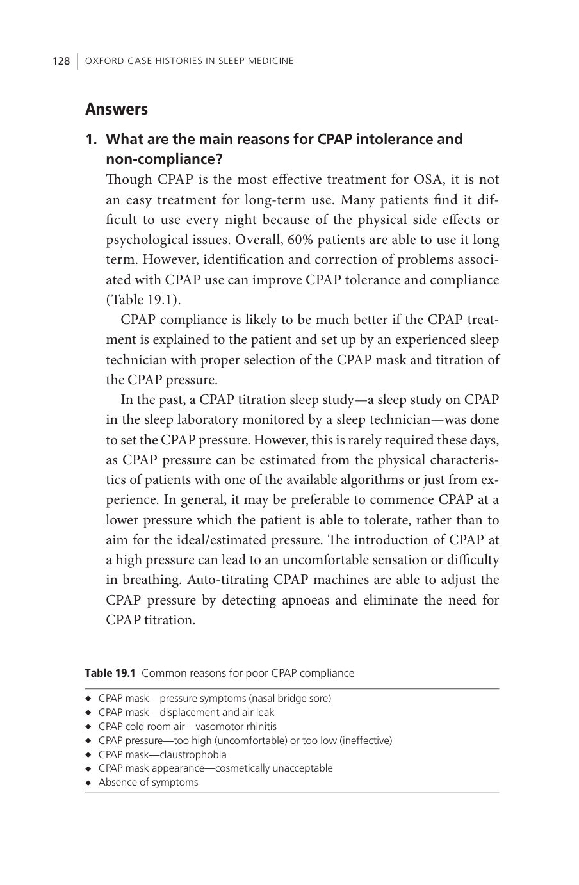

# Case 19 CPAP intolerance and non-compliance—treatment with MAS

<!-- pdf-page: 138 -->

### Case 19

### CPAP intolerance and

### non-compliance—treatment

### with MAS

A 36-year-old male accountant presented with long-standing snoring with a little sleep disturbance and daytime sleepiness five years ago. His sleep study confirmed OSA with an AHI of 25. In view of the asymptomatic nature of his OSA, he was treated with a custom-made MAS. He found the splint to be uncomfortable and ineffective in abolishing his snoring. It broke after a while and he stopped using it. Over the next few years, he gained weight and his snoring worsened. A repeat sleep study showed worsening of OSA with a SaO2 dip rate of 57.8 and mean SaO2 of 88.7%. He was treated with CPAP at a fixed pressure of 9 cm of water. His snoring and sleep apnoea completely subsided with the elimination of OSA—the SaO2 dip rate on CPAP was 0.5/hour with mean SaO2 of 97.4%. He benefited from CPAP and used it for a year, but did not like the prospect of being on it long term. He also experienced the side effects of persistent nasal blockage, despite nasal steroids, humidification of air and nasal surgery.

He was not obese and did attempt improve his fitness, but this had no effect on his snoring. He was not too keen on using an MAS again because of his past experience and the non-curative nature of the treatment. He was referred to an ENT surgeon who found that he had grade 2 hypertrophy of the tonsils, a lax soft palate, a prominent tongue pushing the epiglottis backward and 75% upper airway collapse at the oropharynx on Muller’s manoeuvre. He was arranged to have a sleep nasendoscopy with a plan for two-stage ENT surgery—tonsillectomy followed by laser assisted palatoplasty (LAUP). Meanwhile, he agreed to see a dentist

<!-- pdf-page: 139 -->

for another attempt at MAS. He was fitted with a custom-made MAS. He was able to tolerate MAS with the elimination of his snoring and an improvement in the dip rate to 15.5/hour. A further adjustment/advancement of the splint led to a reduction in the dip rate to 4.90/hour. He did not want to have surgery.

<!-- pdf-page: 140 -->

Case 19 127

#### Questions

1 What are the main reasons for CPAP intolerance and non-

compliance?

3 What is the role of MAS in the management of OSA?

2 Are there any curative treatments for OSA?

<!-- pdf-page: 141 -->

#### Answers

#### 1. What are the main reasons for CPAP intolerance and

#### non-compliance?

Though CPAP is the most effective treatment for OSA, it is not an easy treatment for long-term use. Many patients find it difficult to use every night because of the physical side effects or psychological issues. Overall, 60% patients are able to use it long term. However, identification and correction of problems associated with CPAP use can improve CPAP tolerance and compliance (Table 19.1).

CPAP compliance is likely to be much better if the CPAP treatment is explained to the patient and set up by an experienced sleep technician with proper selection of the CPAP mask and titration of the CPAP pressure.

In the past, a CPAP titration sleep study—a sleep study on CPAP in the sleep laboratory monitored by a sleep technician—was done to set the CPAP pressure. However, this is rarely required these days, as CPAP pressure can be estimated from the physical characteristics of patients with one of the available algorithms or just from experience. In general, it may be preferable to commence CPAP at a lower pressure which the patient is able to tolerate, rather than to aim for the ideal/estimated pressure. The introduction of CPAP at a high pressure can lead to an uncomfortable sensation or difficulty in breathing. Auto-titrating CPAP machines are able to adjust the CPAP pressure by detecting apnoeas and eliminate the need for CPAP titration.

◆ CPAP pressure—too high (uncomfortable) or too low (ineffective)

Table 19.1 Common reasons for poor CPAP compliance

◆ CPAP mask—pressure symptoms (nasal bridge sore)

◆ CPAP mask—displacement and air leak

◆ CPAP cold room air—vasomotor rhinitis

◆ CPAP mask—claustrophobia

◆ CPAP mask appearance—cosmetically unacceptable

◆ Absence of symptoms

<!-- pdf-page: 142 -->

Case 19 129

A poorly fitting nasal CPAP mask can cause a pressure sore over the nasal bridge and upper lip. This is more likely to occur if the mask head straps are pulled too tight. With an improvement in mask technology—comfort and a self-sealing mechanism—pressure sores are less of a problem now. Use of other types of CPAP masks, such as nasal cushions/pillows or full-face CPAP masks, may help to avoid pressure symptoms.

CPAP mask displacement during sleep can cause air leakage and a gushing noise. This not only disturbs the patient’s sleep, but makes it ineffective in delivering set CPAP pressure. It can be managed by securing the CPAP mask firmly with an adjustable CPAP mask and head straps, placing the CPAP machine nearer to the patient to avoid pulling on the CPAP tubing or using longer CPAP tubing.

CPAP prevents upper airway collapse by increasing upper airway pressure. However, to achieve an increase in upper airway pressure with a nasal CPAP mask, the mouth needs to be closed. Mouth breathers, either due to habitual mouth breathing or nasal obstruction, are likely to experience uncomfortable air leakage from the mouth. This can be prevented by using chin straps to keep the mouth closed during sleep, correction of nasal obstruction or using a full face mask covering both the mouth and nose.

One of the other main problems affecting CPAP tolerance is CPAP rhinitis. This is as a result of cold or dry room air causing reflex vasodilation of nasal mucosal (vasomotor rhinitis) causing nasal congestion and blockage. Poor-quality indoor room air (pollutants/ irritants/allergen) may exacerbate underlying allergic rhinitis. Ensuring that the room air is warm and clean, or using CPAP machines with an attached/inbuilt humidifier and heating system, can prevent vasomotor rhinitis. Nasal anticholinergic or steroid sprays can provide short-term relief from rhinitis. An ENT review is helpful in patients with persistent nasal congestion and blockage.

However, in a few patients, the reason for CPAP non-compliance is not due to any of these side effects, but due to a psychosocial barrier against CPAP. They find CPAP either cosmetically unacceptable

<!-- pdf-page: 143 -->

or feel claustrophobic. A careful explanation of the benefits of CPAP use, reassurance and use of a mild anxiolytic/sedative during the first few weeks of CPAP treatment may help. Cognitive Behavioural Therapy (CBT) may help, particularly in patients who feel claustrophobic with a CPAP mask.

In general, symptomatic patients with EDS are more likely to comply with CPAP than patients with few symptoms. However, a clear explanation regarding the long-term health benefits of CPAP may convince asymptomatic patients to comply with CPAP.

#### 2. Are there any curative treatments for OSA?

Weight loss is the only curative treatment for OSA in obese patients. Obstructive sleep apnoea, hypertension, diabetes mellitus and hyperlipidaemia subside in most patients following weight loss in morbidly obese patients with bariatric surgery. However, not all obese patients can or want to have bariatric surgery and the success rate of achieving long-term weight loss with non-surgical treatments, such as (very) low calorie diets and pharmacological treatment, is low. Moreover, many OSA patients are not obese. Treatment options in such patients are relatively limited even though patients often seek a surgical ‘cure’. Tracheostomy and uvulopalatopharyngoplasty (UPPP) was a mainstay of treatment for OSA until the early 1980s. Tracheostomy is extremely effective in treating OSA, but is not acceptable to most patients due to the long-term complications and problems. Systemic reviews have shown that the results of UPPP are inconsistent—a significant improvement in sleep apnoea was seen only in a few studies, 62% of patients reported side effects and many regretted having had surgery.

#### 3. What is the role of MAS in the management of OSA?

Bringing the lower jaw forward advances the tongue forward as well, and enlarges the upper airways and reduces the tendency to collapse. Mandibular advancement devices have been increasingly used as an alternative to CPAP in the treatment of OSA. Several randomized controlled trials comparing MASs with CPAP have shown that the splints are effective, though reduction in AHI is less than with CPAP,

<!-- pdf-page: 144 -->

Case 19 131

but preferred over CPAP. There are many different types of mandibular repositioning devices (MRD) for patients who are unable to tolerate CPAP. These devices are either commercially available or custom made by a dentist. They are fixed or adjustable. Commercially available fixed devices have been used for treatment of OSAH, but their effectiveness has not been confirmed in clinical trials. A recent trial showed that commercially available MRD was not effective and had a high failure rate compared to custom-made MRD. There is good evidence for the effectiveness of custom-made adjustable devices—clinical trials have shown a 40–70% reduction in the AHI. Both patient-adjusted and dentist-adjusted MRDs have been used to achieve maximum tolerable protrusion of the mandible. It is likely that a dentist-adjusted MRD will be more effective in reducing AHI, daytime sleepiness and snoring, and have fewer side effects than a patient-adjusted MRD.

We found about half of patients issued with a custom-made adjustable MAS used it regularly. The splint use was dependent on social circumstances as much as physical symptoms in patients with mild sleep apnoea. In more severe cases in patients with daytime symptoms, the splint was preferred to CPAP and compliance was better. Mild discomfort and excess salivation are common side effects during the early stages of use and occurred in about two-thirds of patients, rarely causing non-compliance.

NICE recommends an MAS for the treatment of mild sleep apnoea, but the recommendation on the exact type of device is not yet available.

CPAP tolerance and compliance can be improved by careful identifica­

#### Learning points

tion and correction of problems associated with CPAP use.

Weight loss can cure sleep apnoea, but surgical treatments for OSA are

MASs of an adjustable type are a useful alternative to CPAP, particularly

either ineffective or unacceptable.

in mild OSA.

<!-- pdf-page: 145 -->

#### Further reading

Franklin KA, Anttila H, Axelsson S, Gislason T, Maasilta P, Myhre KI, Rehnqvist N. Ef­

fects and side-effects of surgery for snoring and obstructive sleep apnea—a systematic review. Sleep 2009 Jan;32(1):27–36. Review. Gordon P, Sanders MH. Sleep.7: positive airway pressure therapy for obstructive sleep

apnoea/hypopnoea syndrome. Thorax 2005 Jan;60(1):68–75. Lim J, Lasserson TJ, Fleetham J, Wright J. Oral appliances for obstructive sleep apnoea.

Cochrane Database of Systematic Reviews 2006 Jan;25(1):CD004435.
