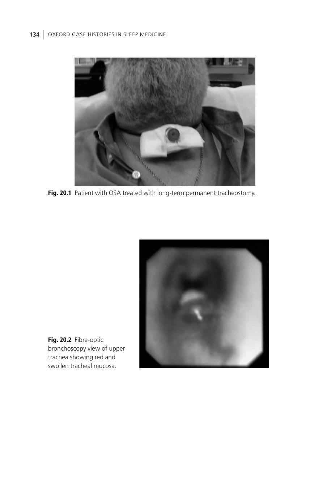
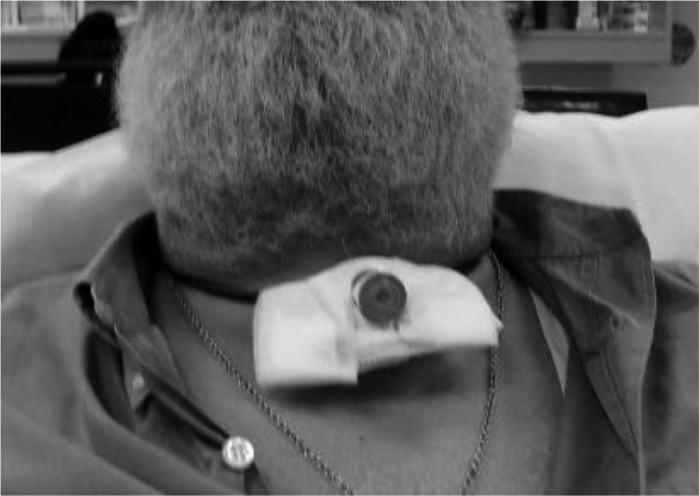
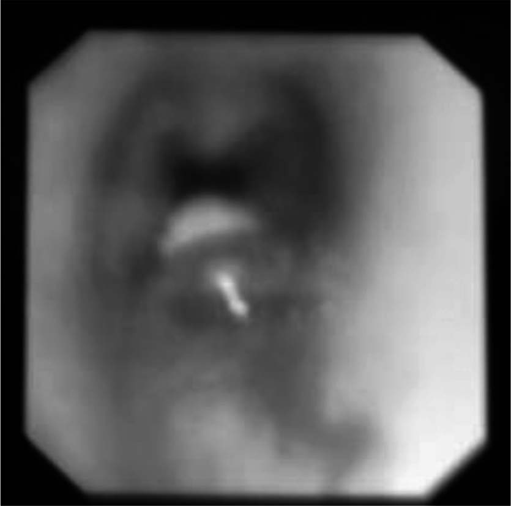
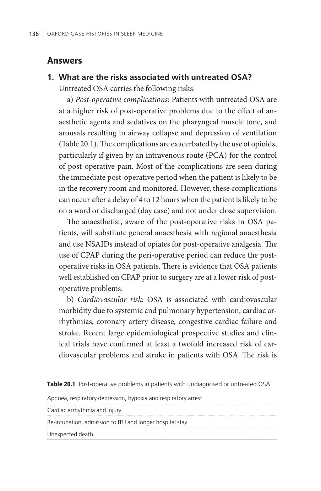

# Case 20 Will not use CPAP—ends up with tracheostomy

<!-- pdf-page: 146 -->

### Case 20

### Will not use CPAP—ends up

### with tracheostomy

A 53-year-old obese Greek Cypriot man was diagnosed to have OSA 13 years ago and was recommended treatment with CPAP. He could not tolerate CPAP and remained without any treatment for OSA. He underwent a planned tonsillectomy under general anaesthesia a year later. As a precaution, a pre-operative tracheostomy was performed. However, attempts to close his tracheostomy after surgery resulted in obstructive breathing during sleep and sleep disturbance. He slept very well with open tracheostomy and did not want his tracheostomy to be closed. He has remained on tracheostomy for the last 13 years for OSA. His wife provides tracheostomy care. He had recurrent lower respiratory infections. He was referred to a chest clinic recently because he coughed up fresh blood from the tracheostomy and mouth. He also reported weight loss of 5 kg. He was an ex-smoker of 5 pack year and had stopped smoking 14 years ago. An emergency ENT endoscopy via tracheostomy revealed no abnormality. His chest X-ray was normal. Bronchoscopy examination showed endotracheal mucosal swelling on the posterior tracheal wall due to granulation tissue (Figures 20.1 and 20.2). He has remained on tracheostomy for the last 13 years for OSA.

1 What are the risks associated with untreated OSA?

#### Questions

2 What are the pros and cons of tracheostomy for the treatment of

OSA?

<!-- pdf-page: 147 -->

Fig. 20.1 Patient with OSA treated with long-term permanent tracheostomy.

Fig. 20.2 Fibre-optic

bronchoscopy view of upper trachea showing red and swollen tracheal mucosa.

<!-- pdf-page: 148 -->

<!-- pdf-page: 149 -->

#### Answers

#### 1. What are the risks associated with untreated OSA?

Untreated OSA carries the following risks:

a) Post-operative complications: Patients with untreated OSA are at a higher risk of post-operative problems due to the effect of anaesthetic agents and sedatives on the pharyngeal muscle tone, and arousals resulting in airway collapse and depression of ventilation (Table 20.1). The complications are exacerbated by the use of opioids, particularly if given by an intravenous route (PCA) for the control of post-operative pain. Most of the complications are seen during the immediate post-operative period when the patient is likely to be in the recovery room and monitored. However, these complications can occur after a delay of 4 to 12 hours when the patient is likely to be on a ward or discharged (day case) and not under close supervision.

The anaesthetist, aware of the post-operative risks in OSA patients, will substitute general anaesthesia with regional anaesthesia and use NSAIDs instead of opiates for post-operative analgesia. The use of CPAP during the peri-operative period can reduce the postoperative risks in OSA patients. There is evidence that OSA patients well established on CPAP prior to surgery are at a lower risk of postoperative problems.

b) Cardiovascular risk: OSA is associated with cardiovascular morbidity due to systemic and pulmonary hypertension, cardiac arrhythmias, coronary artery disease, congestive cardiac failure and stroke. Recent large epidemiological prospective studies and clinical trials have confirmed at least a twofold increased risk of cardiovascular problems and stroke in patients with OSA. The risk is

Table 20.1 Post-operative problems in patients with undiagnosed or untreated OSA

Apnoea, respiratory depression, hypoxia and respiratory arrest

Cardiac arrhythmia and injury

Re-intubation, admission to ITU and longer hospital stay

Unexpected death

<!-- pdf-page: 150 -->

Case 20 137

closely associated with chronic intermittent hypoxia rather than the AHI. Treatment of OSA with CPAP, particularly in symptomatic/moderate to severe OSA patients, reduces cardiovascular risk.

c) Road traffic accidents (RTA): EDS is thought to be the second most common (20%) cause of RTAs after alcohol. OSA is one of the commonest causes of EDS and neurocognitive impairment and increases the risk of RTAs. Treatment of OSA reduces the risk of ­driving-related accidents. Patients should be made aware of the risk and their responsibility to inform the DVLA.

d) Mortality: An increased risk of death, mainly from cardiovascular causes, was noted among OSA patients when tracheostomy was the only available treatment. The deaths were prevented in patients who accepted tracheostomy for treatment of OSA. Recent large epidemiological studies in patients with OSA, particularly men with severe obstructive apnoea, have shown at least a twofold increase in the risk of death—mainly sudden deaths and cardiovascular deaths. Furthermore, OSA has been linked to death from cancer in a recent American study, showing that patients with severe OSA (AHI >30) had approximately a five times higher chance of dying from cancer.

#### 2. What are the pros and cons of tracheostomy for the

#### treatment of OSA?

Tracheostomy was the first treatment for OSA. It was based on the simple concept of bypassing the upper airway obstruction at the supraglottic region. It had one of the most dramatic effects of providing instant relief from OSA with restoration of normal sleep and elimination of daytime sleepiness. Tracheostomy also reduced the mortality rate due to OSA. No deaths occurred in patients treated with tracheostomy, while 10% of patients who were advised to use weight loss as treatment for OSA died of vascular death five years after diagnosis.

However, tracheostomy is associated with long-term problems and complications, such as lower respiratory infections, bleeding and tracheal stenosis. Tracheostomy may have a role in a few selective patients as an interim measure.

<!-- pdf-page: 151 -->

#### Learning points

Untreated OSA increases post-operative problems. Some of these can

be serious and life-threatening.

OSA patients have a higher cardiovascular co-morbidity, which adds to

OSA itself at least doubles the risk of cardiovascular disease, particu­

the post-operative risk of OSA.

larly in men with severe OSA. The risk appears mainly to be due to chronic intermittent hypoxia.

Similarly, OSA patients have approximately a twofold increase in the

risk of death from sudden death, cardiovascular causes and cancer.

CPAP is the most effective treatment for OSA and should be the first

choice of treatment, but may be the only option for CPAP-intolerant patients.

Adebola O, Adesanya AO, Lee W, Greilich NB, Joshi GP. Perioperative management of

#### Further reading

obstructive sleep apnea. Chest 2010;138(6):1489–98. Herder C, Schmeck J, Appelboom DJK, Vries D. Risks of general anaesthesia in people

with obstructive sleep apnoea. BMJ 2004;329:955–9.
