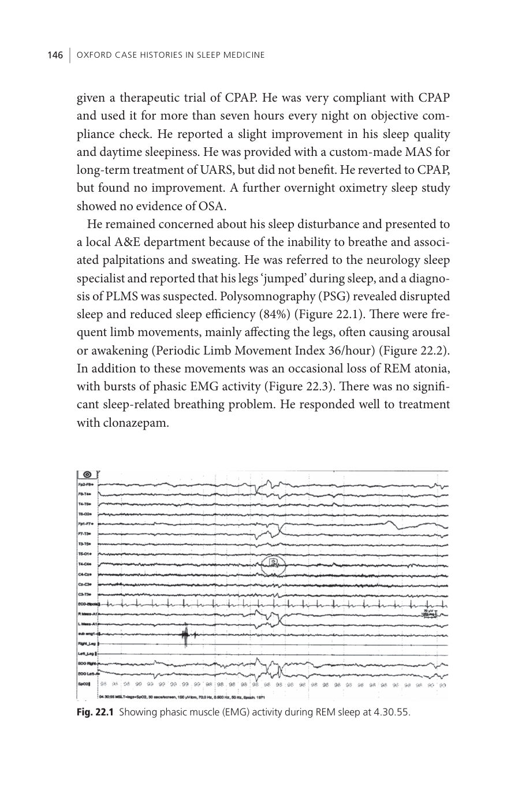
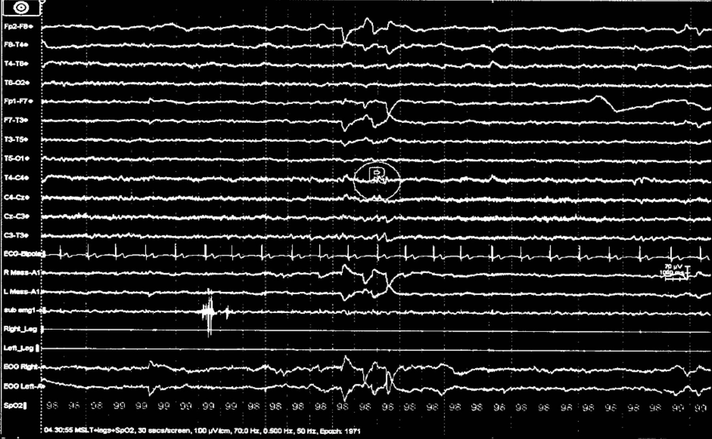
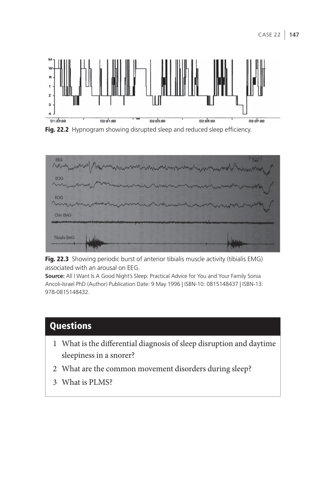
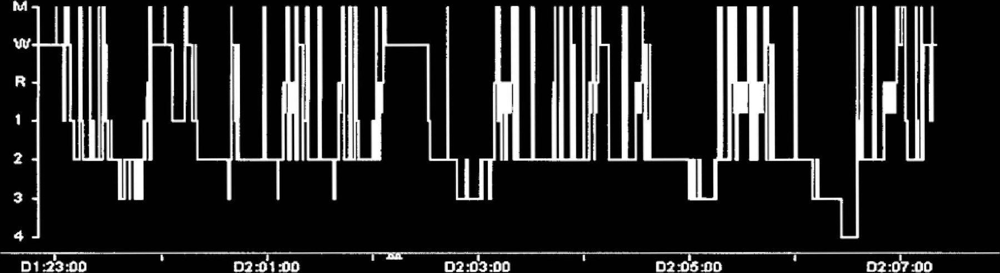
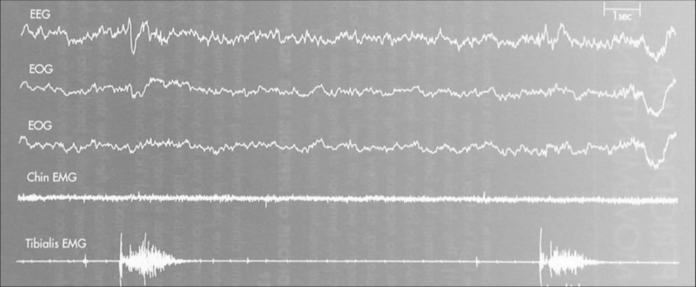

# Case 22 Sleep disturbance and daytime sleepiness persists in a snorer despite CPAP—Periodic Limb Movement Syndrome

<!-- pdf-page: 158 -->

### Case 22

### Sleep disturbance and daytime

### sleepiness persists in a snorer

### despite CPAP—Periodic Limb

### Movement Syndrome

A 67-year-old male retired civil engineer was referred to the sleep clinic by an ENT surgeon because of concern that his sleep disturbance may precipitate another heart attack. He had persistent nasal obstruction, despite correction of his deviated nasal septum. His sleep study showed a few oxygen desaturations, and sleep nasendoscopy (midazolam induced sleep) found obstruction at the palatal level with oxygen desaturation to 79%. He had had a recent heart attack and was waiting for a trial of CPAP. He reported having disturbed sleep for at least five years—he woke up from his sleep every five minutes sweating associated with palpitations and a dry throat. He felt extremely tired in the morning and excessively sleepy during the daytime. He invariably slept during train journeys. He snored loudly according to his wife, who also noticed witnessed apnoeas for at least a year. He was of normal body weight (BMI 24.9) and neck size (39 cm), and, despite reported EDS, his ESS score was normal at 8/24. A repeat overnight home oximetry sleep study showed no evidence of OSA. There were no characteristic SaO2 desaturation dips with a normal SaO2 dip rate of 3.1/hour and normal mean SaO2 of 94.3%. He slept well during the sleep study.

He was suspected to have upper airway resistance syndrome (UARS) in view of the history of loud snoring associated with sleep disturbance and daytime sleepiness, but had a normal oximetry sleep study and was

<!-- pdf-page: 159 -->

given a therapeutic trial of CPAP. He was very compliant with CPAP and used it for more than seven hours every night on objective compliance check. He reported a slight improvement in his sleep quality and daytime sleepiness. He was provided with a custom-made MAS for long-term treatment of UARS, but did not benefit. He reverted to CPAP, but found no improvement. A further overnight oximetry sleep study showed no evidence of OSA.

He remained concerned about his sleep disturbance and presented to a local A&E department because of the inability to breathe and associated palpitations and sweating. He was referred to the neurology sleep specialist and reported that his legs ‘jumped’ during sleep, and a diagnosis of PLMS was suspected. Polysomnography (PSG) revealed disrupted sleep and reduced sleep efficiency (84%) (Figure 22.1). There were frequent limb movements, mainly affecting the legs, often causing arousal or awakening (Periodic Limb Movement Index 36/hour) (Figure 22.2). In addition to these movements was an occasional loss of REM atonia, with bursts of phasic EMG activity (Figure 22.3). There was no significant sleep-related breathing problem. He responded well to treatment with clonazepam.

Fig. 22.1 Showing phasic muscle (EMG) activity during REM sleep at 4.30.55.

<!-- pdf-page: 160 -->

Case 22 147

Fig. 22.2 Hypnogram showing disrupted sleep and reduced sleep efficiency.

Fig. 22.3 Showing periodic burst of anterior tibialis muscle activity (tibialis EMG)

associated with an arousal on EEG. Source: All I Want Is A Good Night’s Sleep: Practical Advice for You and Your Family Sonia Ancoli-Israel PhD (Author) Publication Date: 9 May 1996 | ISBN-10: 0815148437 | ISBN-13: 978-0815148432.

1 What is the differential diagnosis of sleep disruption and daytime

#### Questions

2 What are the common movement disorders during sleep?

sleepiness in a snorer?

3 What is PLMS?

<!-- pdf-page: 161 -->

#### Answers

#### 1. What is the differential diagnosis of sleep disruption and

#### daytime sleepiness in a snorer?

Snoring is extremely common, and sleep disturbance and daytime sleepiness in a snorer are often due to OSA. The oximetry sleep study in a symptomatic OSA patient often shows a characteristic repetitive oxygen desaturation pattern. However, a normal oximetry sleep study in a patient with suspected OSA cannot rule out UARS. It requires demonstration of snoring/upper airway resistance-related arousals on a PSG or a pragmatic approach of a therapeutic trial of CPAP.

However, a negative screening sleep study in a sleepy snorer and failure of response to a therapeutic trial of CPAP should lead to consideration of another diagnosis. Abnormal/frequent movements during sleep due to neurological disorders, such as periodic limb movement disorders, can cause sleep disruption and arousals. It is not uncommon for OSA and PLMS to coexist. It has been suggested that treatment of OSA with CPAP may precipitate unmasking of underlying PLMS. These patients have persistent daytime sleepiness, despite treatment of OSA with CPAP. Therefore, PLMS should be considered as a possible cause of persistent daytime sleepiness in OSA.

#### 2. What are the common movement disorders during sleep?

The movement disorders during sleep can be due to a trivial cause, such as muscle jerks (hypnic jerks at sleep onset) or paralysis on awakening (sleep paralysis). However, they can be manifestations of serious underlying neurological disorders, such as Parkinson’s disease, dementia or PLMS. During REM sleep there is complete muscle atonia; however, abnormal muscle activity during sleep can cause sleep talking, teeth grinding (bruxism) or sleep walking (somnambulism) in patients with REM sleep disorders.

PLMS, also known as nocturnal myoclonus, is a relatively common movement disorder during sleep and affects 4% of adults. It has a much higher prevalence in the elderly, especially females (11%). It

#### 3. What is PLMS?

<!-- pdf-page: 162 -->

Case 22 149

causes characteristic repetitive flexion/extension movement of limbs during sleep, mainly legs (kicking) every 30 seconds or so, lasting for about 2–3 seconds. Each movement results in the brain or body waking up, with resultant sleep disruption and fragmentation. Anterior tibialis muscle EMG recording on PSG provides confirmation of the diagnosis (Figure 22.3). A typical pattern of repetitive leg kicking movements can also be seen on video recording (particularly on fast forwarding) during sleep. The description of the state of the bed sheets by the patient or partner of the movements during sleep may also provide a clue to the diagnosis. However, most patients are unaware of kicking their legs during sleep, but wake up unrefreshed from their sleep and feel sleepy during the daytime. Some of these patients may have associated neurological disorders, such as Parkinson’s disease or narcolepsy. Similarly, factors such as shift work, exercise prior to sleep, use of benzodiazepine hypnotics, coffee drinking and snoring can increase the risk of PLMS.

PLMS can cause symptoms similar to OSA in a snorer, coexist with

#### Learning points

OSA or be unmasked by the treatment of OSA with CPAP.

Clues to diagnosis may be provided by the partner’s report of being

kicked during sleep or the state of the bed sheets in the morning.

The stereotypical repetitive periodic kicking movements are seen on

sleep video recording and PSS demonstrating leg movements associated with arousals, which provide confirmation of the diagnosis.

PLMS is a common condition and responds well to clonazepam in most

Merlino G, Gigli GL. Sleep-related movement disorders. Neurol Sci 2012 Jun;33(3):

patients.

#### Further reading

491–513. Walters AS. Clinical identification of the simple sleep-related movement disorders.

Chest 2007 Apr;131(4):1260–6. Review.
