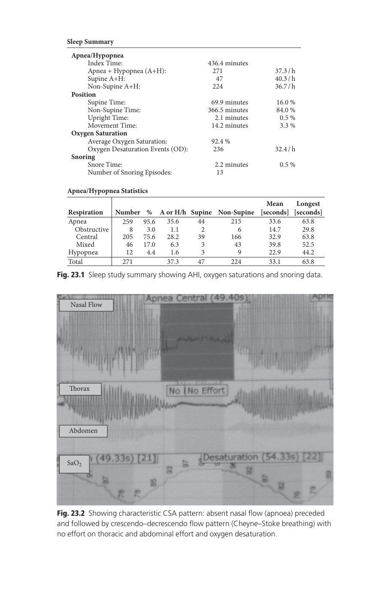
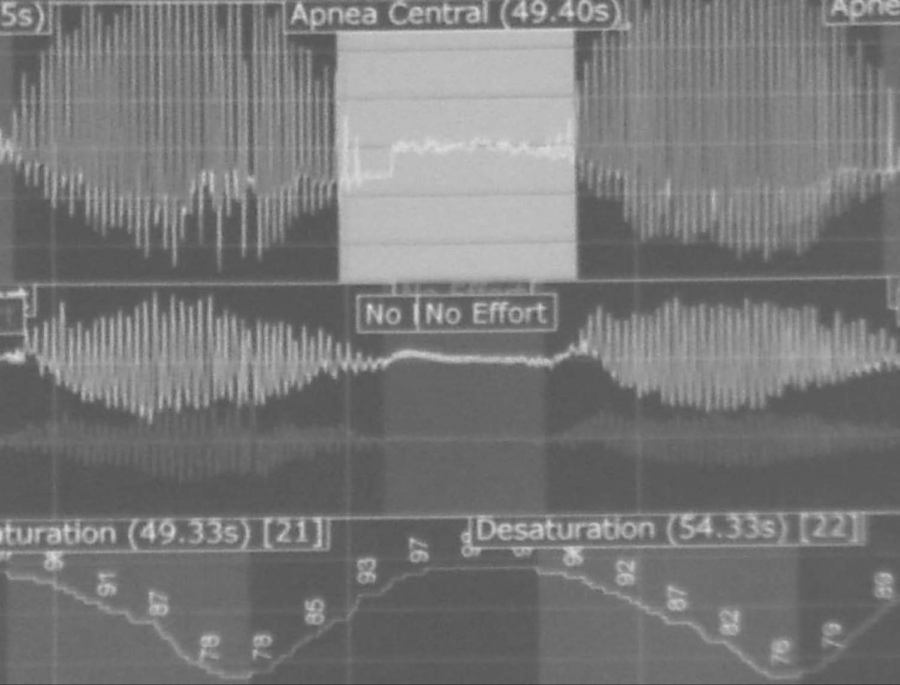

# Case 23 Worrying pauses in breath without choking and snoring— Central Sleep Apnoea

<!-- pdf-page: 164 -->

### Case 23

### Worrying pauses in breath

### without choking and snoring—

### Central Sleep Apnoea

A 70-year-old newspaper editor’s wife was concerned about pauses in his breath for two months. She did not hear him snore or have any choking episodes. He reported no sleep disturbance, but it was not refreshing. He felt tired and sleepy during the daytime. He had coronary artery bypass graft surgery three years ago and refractory congestive cardiac failure due to ischaemic cardiomyopathy and mitral regurgitation requiring cardiac resynchronization therapy (CRT) (implantable cardioverter defibrillator (ICD) with pacing capabilities (CRT-D)) two years ago. He reported a history of paroxysmal nocturnal dyspnoea that had improved with treatment of his heart failure. He had clinical features of congestive cardiac failure. He was a normal body weight of 73 kg for his height of 171 cm and neck size of 15.

His sleep study showed frequent episodes of central OSA, with an AHI of 37.3 (Figure 23.1). Airflow pattern was of crescendo–decrescendo breathing followed by prolonged apnoea and absent thoracoabdominal movements during apnoea (Cheyne–Stokes/periodic breathing) (Figure 23.2). The longest apnoea was for 64 seconds without thoracoabdominal movements/respiratory effort (central apnoeas). The apnoeas were associated with frequent oxygen desaturation, the SaO2 dip rate was high at 32.4/hour and mean SaO2 of 92.4, and a TST <90% of 28%. AHI consisted of 76% central apnoeas, 3% of obstructive apnoea and 17% mixed apnoeas. He was fitted with a nasal CPAP mask and received a trial of auto-CPAP. His wife reported no change in his apnoeas during sleep, despite good compliance with CPAP, and the patient noticed

<!-- pdf-page: 165 -->

Sleep Summary

Apnea/Hypopnea

Index Time: 436.4 minutes Apnea + Hypopnea (A+H): 271 37.3 /h Supine A+H: 40.3 /h 47 Non-Supine A+H: 36.7 /h 224

Position

Supine Time: 69.9 minutes 16.0 % Non-Supine Time: 366.5 minutes 84.0 % Upright Time: 2.1 minutes 0.5 % Movement Time: 3.3 % 14.2 minutes

Oxygen Saturation

Average Oxygen Saturation: 92.4 % Oxygen Desaturation Events (OD): 32.4 /h 236

Snoring

13 Snore Time: 2.2 minutes 0.5 %

Number of Snoring Episodes:

Fig. 23.1 Sleep study summary showing AHI, oxygen saturations and snoring data.

Apnea/Hypopnea Statistics

Respiration Apnea Obstructive Central Mixed Hypopnea Total

A or H/h 35.6 1.1 28.2 6.3 1.6 37.3

Number 259 8 205 46 12 271

% 95.6 3.0 75.6 17.0 4.4

Mean [seconds] 33.6 14.7 32.9 39.8 22.9 33.1

Longest [seconds] 63.8 29.8 63.8 52.5 44.2 63.8

Supine 44 2 39 3 3 47

Non-Supine 215 6 166 43 9 224

Fig. 23.2 Showing characteristic CSA pattern: absent nasal flow (apnoea) preceded

and followed by crescendo–decrescendo flow pattern (Cheyne–Stoke breathing) with no effort on thoracic and abdominal effort and oxygen desaturation.

Nasal Flow

Torax

Abdomen

SaO2

<!-- pdf-page: 166 -->

Case 23 153

no change in his sleep quality and daytime symptoms. A sleep study on CPAP confirmed persistent CSA. Therefore, he was treated with servoventilation, which resulted in complete elimination of apnoeas during sleep with an improvement in sleep quality, daytime tiredness and sleepiness.

#### Questions

1 What is CSA?

2 How does heart failure cause CSA?

3 How do you treat CSA?

<!-- pdf-page: 167 -->

#### Answers

#### 1. What is CSA?

CSA occurs when the brain fails to send an appropriate signal to the respiratory muscles to breathe. Patients with CSA make no effort to breathe during apnoea, as opposed to OSA when the brain sends much stronger signals to the respiratory muscle to breathe to overcome obstruction to the upper airway.

CSA is much less common than OSA, but can cause sleep disturbance and chronic intermittent hypoxia similar to OSA. Typical patients with CSA have witnessed apnoeas, but without any snoring or choking episodes. The recurrent apnoeas during sleep cause recurrent oxygen desaturation, and poor sleep quality and unrefreshing sleep. They also differ in physical characteristics from OSA patients and are of normal body weight and neck size, craniofacial appearance and oral cavity size. Furthermore, CSA is often seen in older men (>65 years) who have associated heart or cerebrovascular disease.

A characteristic type of breathing pattern—a gradual increase in breathing effort and rate followed by a decrease (crescendo–decrescendo) and complete cessation of breath (apnoea)—is known as Cheyne–Stokes respiration (CSR)/periodic breathing. The typical cycle of crescendo–decrescendo breathing followed by apnoea lasts for 30 seconds. Three such consecutive cycles with AHI of >5 for a 10-minute period of crescendo–decrescendo breathing is sufficient for the diagnosis of CSA. These patients have unstable respiratory drive. The common causes of this type of CSA include congestive cardiac failure, high altitude and cerebrovascular disorders.

CSA should be distinguished from ‘pseudo CSA’ in patients with respiratory muscle weakness/paralysis with OSA. They are unable to move their chest or abdomen (absent thoracoabdominal movement) during apnoeas and it is recorded as CSA. Monitoring of changes in intrathoracic pressure during respiration with an oesophageal balloon can help with accurate differentiation between CSA and OSA in patients with muscle weakness.

<!-- pdf-page: 168 -->

Case 23 155

A few patients with OSA have a mixed pattern of CSA and OSA. Treatment with CPAP unmasks CSA and the sleep remains fragmented. This type of apnoea is known as ‘complex sleep apnoea’ and defined as more than five central sleep apnoeas per hour on CPAP. It is obvious that this group of patients will not respond to CPAP and may contribute to CPAP non-compliance.

CSA of CSR is most commonly seen in patients with congestive heart failure—40–50% of heart failure patients may have such a breathing pattern. The CSA in patients with congestive heart failure is thought to be due to cerebral hypoxia and long circulatory time leading to elevated hypercapnic ventilatory response and an unstable ventilatory control system (enhanced loop gain). They tend to have faster breathing (hyperventilation) and hypocapnia during the daytime; however, hypocapnia as a result of hyperventilation during sleep reduces respiratory drive, leading to apnoeas. CSR due to CSA increases morbidity and mortality due to congestive cardiac failure. These patients often have advanced congestive cardiac failure and are on maximum medical treatment. Correction of CSR–CSA can not only improve their sleep quality, daytime fatigue and tiredness, but also their outcome. This is also seen in patients who have had a stroke or chronic renal failure.

#### 2. How does heart failure cause CSA?

Various different types of treatments have been attempted in patients with CSA from respiratory stimulants, such as theophylline, acetazolamide, oxygen and ventilatory devices.

#### 3. How do you treat CSA?

In patients with primary CSA or CSA due to high altitude, respiratory stimulants such as acetazolamide and theophylline may be effective in improving sleep quality and apnoea. Often these measures fail, and treatment with oxygen and CPAP is required.

Theophylline increases adenosine levels and stimulates respiration. Although it has been shown to reduce CSA in small trials, it is not used often due to its narrow therapeutic margin and side effects.

<!-- pdf-page: 169 -->

Acetazolamide is a mild diuretic and, through its effect in inducing mild metabolic acidosis, stimulates respiration. It has been shown to improve CSA associated with high altitude.

In patients with CSA of the CSR type, optimization of heart failure treatment improves CSA. However, they are often on maximum medical treatment and on a waiting list for heart transplant. Overnight oxygen improves their sleep quality and periodic breathing in some of these patients—the exact mechanism of how oxygen works is not clear. CPAP if often effective and should be considered as an initial treatment option. CPAP improves sleep quality, nocturnal hypoxia, left ventricular function and exercise tolerance. Long-term CPAP can reduce the need for cardiac transplantation and the risk of mortality. However, in some patients, CSA, though improved, persists despite CPAP. These patients may benefit from BiPAP ventilation. A new type of ventilatory support device called adaptive servo-ventilation (ASV) measures the patient’s flow (apnoea) and adjusts the delivery of pressure, abolishing apnoeas. This method of treatment has been shown to be more effective in suppressing CSA than CPAP. It should be considered in patients who show no or suboptimal response to CPAP.

Suspect CSA as a cause of witnessed apnoeas in patients with no history

#### Learning points

Overnight oximetry sleep study cannot distinguish between CSA and

of snoring or choking episodes during sleep.

OSA—simultaneous measurement of thoracoabdominal movement is required.

Advanced heart failure is one of the most common causes of CSA. These

patients have characteristic waxing and waning breathing followed by apnoeas—known as periodic breathing/CSR.

Most patients with CSA of the CSR type can be treated with CPAP.

Malhotra A, Owens RL. What is central sleep apnea? Respir Care 2010;55(9):1168–78.

However, a few require ASV.

#### Further reading
