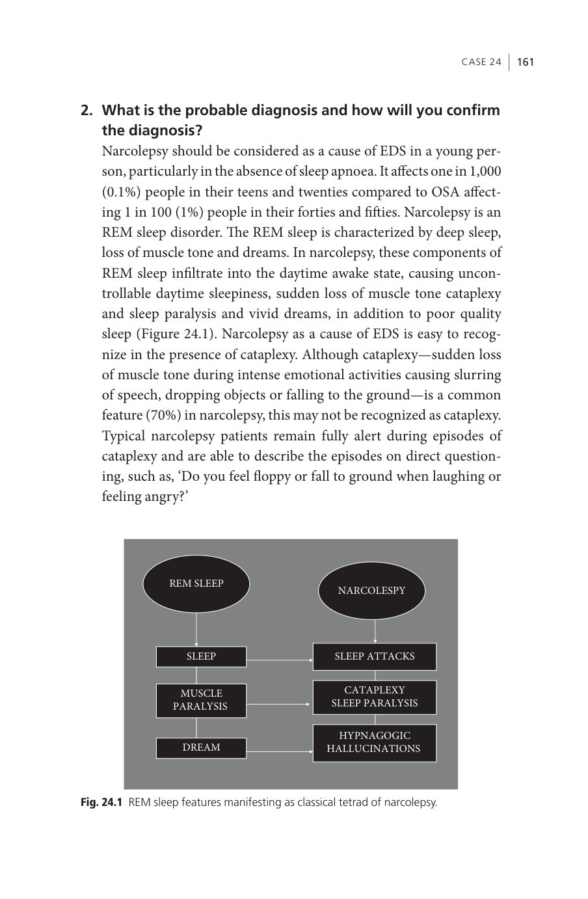

# Case 24 Irresistible daytime sleepiness in a young obese woman

<!-- pdf-page: 170 -->

### Case 24

### Irresistible daytime sleepiness

### in a young obese woman

A 28-year-old office worker was referred by her GP because of longstanding snoring and a two-year history of waking up regularly at night and excessive sleepiness during the daytime at work. She could not control her sleepiness and slept at work for about 30 minutes every day. Previously, her job involved working irregular hours in a shift over a period of four years. Her father was diagnosed to have OSA and was on CPAP treatment at a sleep clinic. She had a tonsillectomy and adenoidectomy at 1 year of age.

She has had a long-standing battle with her obesity and managed to lose only 15 kg with stringent dieting and orlistat (xenical) tablets. She was on a waiting list for bariatric surgery. Her periods were irregular. She had poorly controlled asthma and continued to smoke one cigarette a day.

Review in the sleep clinic confirmed that she was excessively sleepy during the daytime, affecting her work; the ESS score was high at 16/24. Her sleep was disturbed; she went to bed at 10.30 in the evening and took a variable amount of time to fall asleep, and woke up three hours later followed by fragmented sleep until 7.00 in the morning. The description of her snoring was atypical, and it was more noisy and heavy breathing than snoring. There was no history of witnessed apnoea. She was obese with a BMI of 47, but maintained her neck size at 39 cm. An overnight oximetry sleep study was normal, with a normal mean SaO2 of 95.5% and a dip rate of 0.4/hour.

Her clinical picture could not be explained on the basis of OSA.

<!-- pdf-page: 171 -->

#### Questions

1 What will you do next?

2 What is the probable diagnosis and how will you confirm the

diagnosis?

3 What is the cause of narcolepsy?

4 How do you treat narcolepsy?

<!-- pdf-page: 172 -->

<!-- pdf-page: 173 -->

#### Answers

#### 1. What will you do next?

Patients with clinical features of OSA but no evidence of OSA on a sleep study should be reassessed for an alternative diagnosis.

The patient in this case appeared to have typical features of OSA: a history of snoring, sleep disruption and EDS, morbid obesity and a family history of OSA.

However, the apparent snoring was due to heavy and noisy breathing, probably as a result of poorly controlled asthma. Snoring is due to variable upper airway obstruction during sleep and is easy to recognize. However, in the absence of a clear description from a bed partner or family member, inspiratory stridor due to laryngeal or tracheal obstruction or expiratory wheezing due to bronchial obstruction in asthma and COPD may be confused with snoring.

Sleep disturbance due to OSA is easy to recognize if it is associated with a history of witnessed apnoeas or a history of waking up gasping for breath, choking or having a dry mouth. However, in the absence of a history of respiratory disturbance during sleep, the sleep disturbance could be due to other causes.

Obesity is one of the main risk factors for OSA but, despite a high prevalence of obesity (25%), the prevalence of OSA is 1–4%. This is because the effect of obesity is modulated by neck obesity and associated increased floppiness of the upper airways. Premenopausal obese women are relatively protected from OSA because of the sparing of the neck from fat deposition and the effect of reproductive hormones on upper airway muscle tone.

On direct enquiry, the patient gave a history consistent with cataplexy: that her legs gave way and she collapsed to the ground when she laughed, cried or got angry. Her arm and leg muscles felt weak when she burst out laughing whilst typing at work or got angry with the children at home. She collapsed twice and hurt her leg laughing while her dog pulled on the lead. She did not have sleep paralysis or hypnagogic hallucinations.

<!-- pdf-page: 174 -->

Case 24 161

#### 2. What is the probable diagnosis and how will you confirm

#### the diagnosis?

Narcolepsy should be considered as a cause of EDS in a young person, particularly in the absence of sleep apnoea. It affects one in 1,000 (0.1%) people in their teens and twenties compared to OSA affecting 1 in 100 (1%) people in their forties and fifties. Narcolepsy is an REM sleep disorder. The REM sleep is characterized by deep sleep, loss of muscle tone and dreams. In narcolepsy, these components of REM sleep infiltrate into the daytime awake state, causing uncontrollable daytime sleepiness, sudden loss of muscle tone cataplexy and sleep paralysis and vivid dreams, in addition to poor quality sleep (Figure 24.1). Narcolepsy as a cause of EDS is easy to recognize in the presence of cataplexy. Although cataplexy—­sudden loss of muscle tone during intense emotional activities causing slurring of speech, dropping objects or falling to the ground—is a common feature (70%) in narcolepsy, this may not be recognized as cataplexy. Typical narcolepsy patients remain fully alert during episodes of cataplexy and are able to describe the episodes on direct questioning, such as, ‘Do you feel floppy or fall to ground when laughing or feeling angry?’

Fig. 24.1 REM sleep features manifesting as classical tetrad of narcolepsy.

REM SLEEP NARCOLESPY

SLEEP

MUSCLE PARALYSIS

DREAM

SLEEP ATTACKS

CATAPLEXY SLEEP PARALYSIS

HYPNAGOGIC HALLUCINATIONS

<!-- pdf-page: 175 -->

A family history of narcolepsy and the presence of a narcolepsyassociated gene, such as HLADR2, provides further support to the diagnosis. However, confirmation of the diagnosis requires a detailed PSG and measurement of daytime sleepiness with a multiple sleep latency test to demonstrate quick onset of sleep (reduced sleep latency) and entering into REM sleep straightaway (sleep onset REM).

Her EDS and cataplexy were suggestive of narcolepsy. She was prescribed modafinil (provigil) to help her daytime sleepiness. This helped her to stay awake at work until 3.00 in the afternoon, but she felt sleepy afterwards. Her blood test for the narcolepsy-associated HLA gene was negative. The neurologist agreed that her clinical picture was in keeping with a diagnosis of narcolepsy, though negative HLA was unusual, particularly in narcolepsy associated with cataplexy. In view of her marked obesity, EDS and irregular periods, an MRI head scan was performed to exclude primary hypothalamic disorder. A PSG and MSLT confirmed the diagnosis of narcolepsy. Her cataplexy was treated with clomipramine.

The cause of narcolepsy is not known, but brain (hypothalamus) neuropetide hypocretin levels are low.

#### 3. What is the cause of narcolepsy?

The exact cause of narcolepsy is not known, but research over the last decade has shown that hypocretin (excitatory neuropeptide involved in the regulation of muscle tone) levels are low in the hypothalamus and cerebrospinal fluid (CSF). Hypocretin deficiency is thought to cause obesity as well. Rarely, narcolepsy associated with marked obesity and other endocrine dysfunction can be due to an anatomical lesion affecting the hypothalamus, such as craniopharyngioma. A normal MRI brain scan in our patient who had narcolepsy associated with obesity and irregular periods excluded such a lesion.

Modafinil, a brain stimulant which improves daytime sleepiness, and clomipramine, a tricyclic antidepressant which controls cataplexy.

#### 4. How do you treat narcolepsy?

Modafinil is a short-acting CNS (central nervous system) stimulant with a low risk of dependence and improves daytime sleepiness

<!-- pdf-page: 176 -->

Case 24 163

for about four hours. Thus, taken twice a day at 8.00 a.m. and 12.00 noon can restore daytime alertness and function. It is safe except in patients with poorly controlled hypertension and reduced effectiveness of the oral contraceptive pill. Clomipramine, a tricyclic antidepressant, is the mainstay in the treatment of cataplexy and mainly works by suppressing REM sleep.

For clinical features of OSA, but no evidence in the sleep study: reassess

#### Learning points

Uncontrollable daytime sleepiness affecting work in a young woman

clinical features for an alternative diagnosis!

The cause of narcolepsy is not known, but brain (hypothalamus) neuro­

with no OSA: is it due to narcolepsy?

Modafinil, a brain stimulant which improves daytime sleepiness, and

peptide hypocretin levels are low.

clomipramine, a tricyclic antidepressant which controls cataplexy.

Ahmed I, Thorpy M. Clinical features, diagnosis and treatment of narcolepsy. Clin

#### Further reading

Chest Med 2010 Jun;31(2):371–81. Review.

<!-- pdf-page: 177 -->

<!-- pdf-page: 178 -->

## Snoring and OSA: Role

## of dental and ENT

## surgeons

### Section 2
