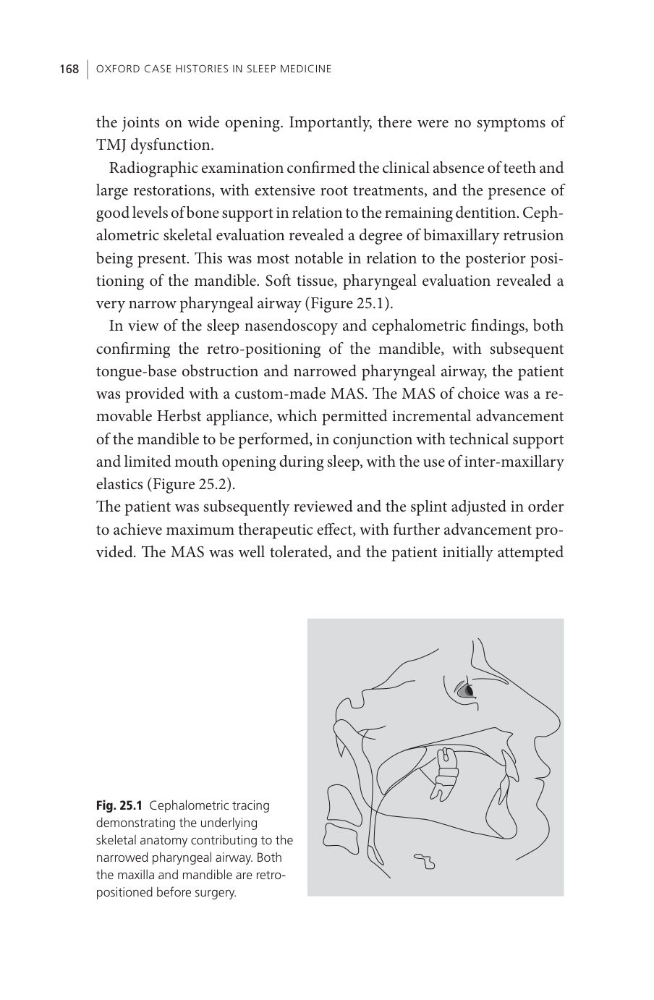
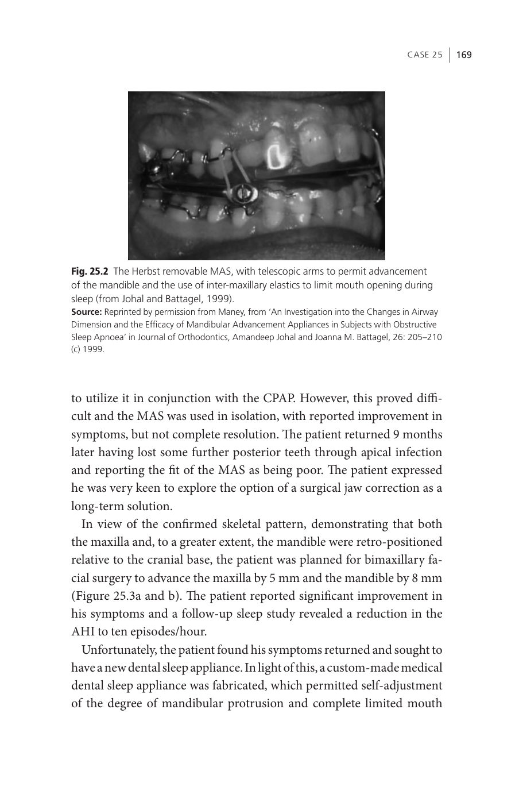
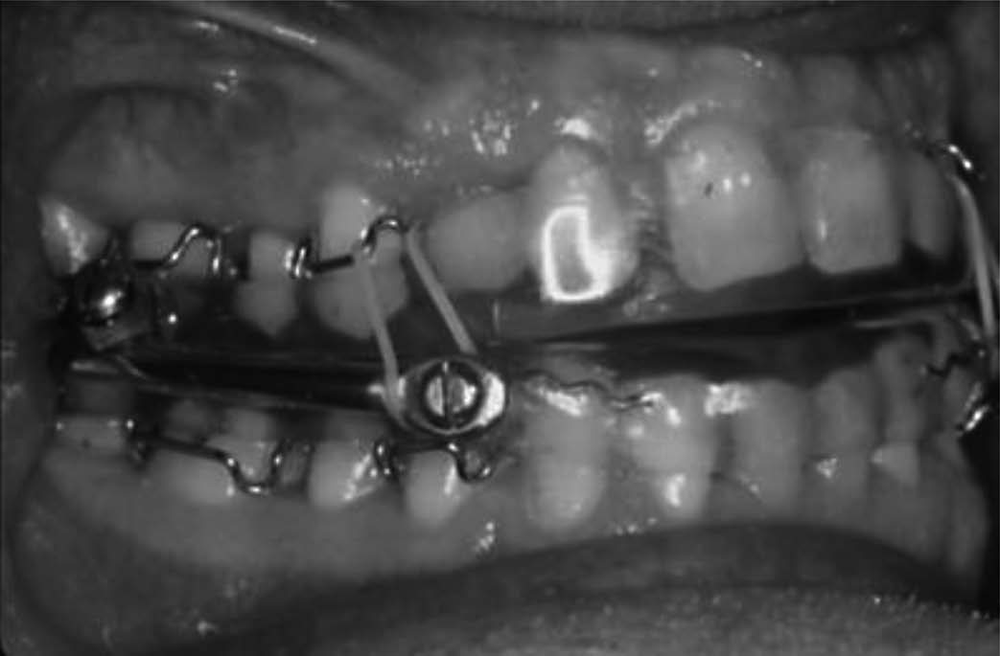
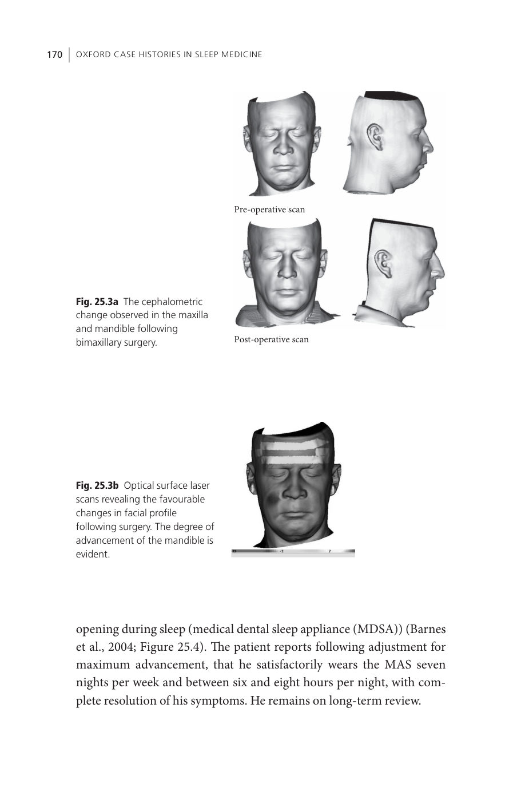
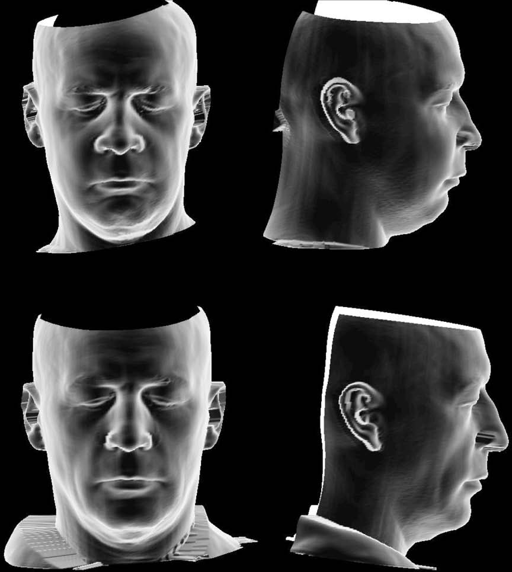
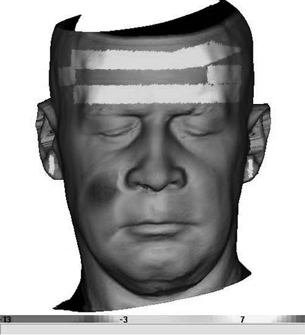
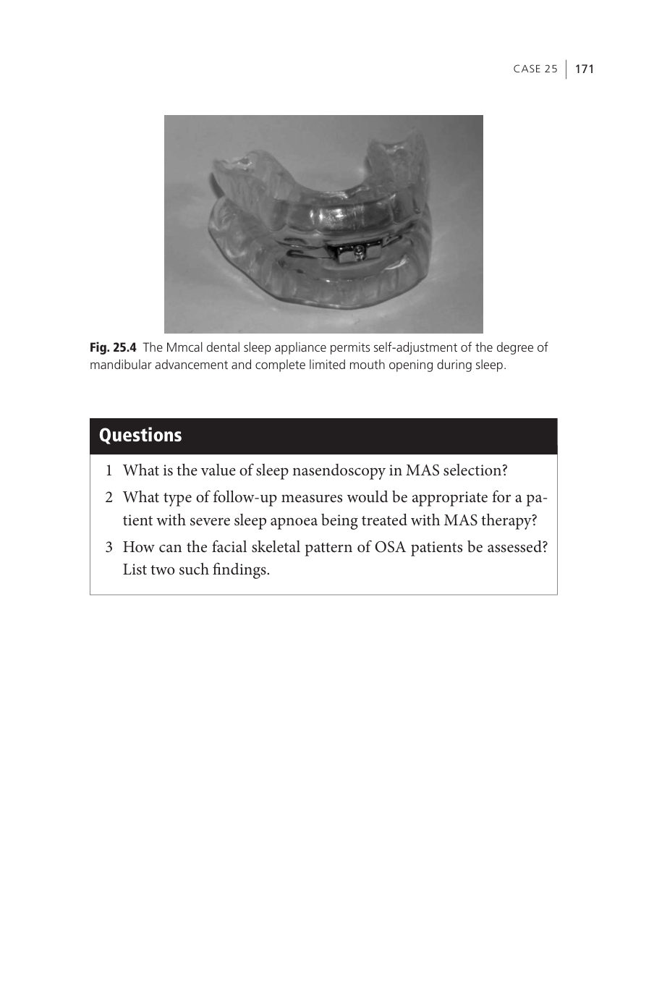
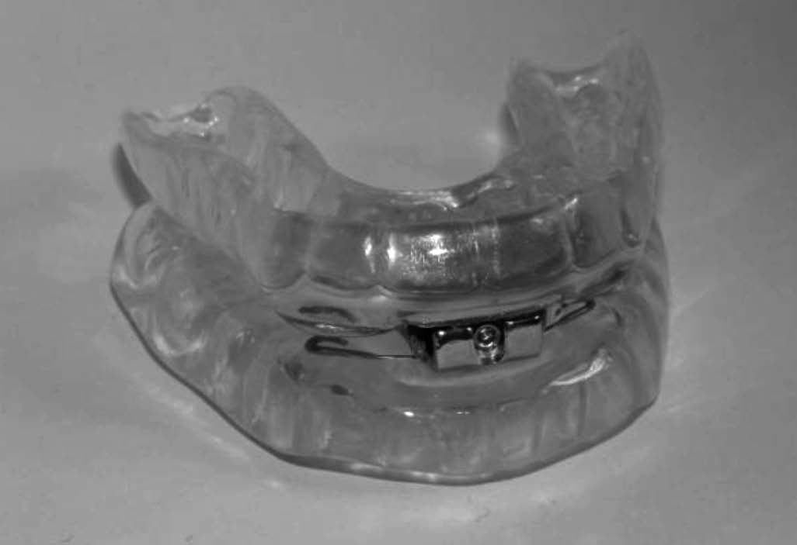

# Case 25 Contribution of facial skeletal pattern to sleep apnoea

<!-- pdf-page: 180 -->

### Case 25

### Contribution of facial skeletal

### pattern to sleep apnoea

A 44-year-old male reported EDS and unrefreshing sleep. He was a shift worker, but felt that his sleep was poor and he woke up feeling unrefreshed and tired, which in turn made daytime functioning very difficult. His wife was unable to tolerate the snoring and they slept separately.

The patient was originally referred by his GP for a sleep assessment to a respiratory sleep service and diagnosed to have severe OSA on overnight PSG—his AHI was recorded as 65.5/per hour. An evaluation of his daytime sleepiness using ESS revealed excessive hypersomnia, with a score of 23 (maximum score 24). The patient’s BMI revealed that he was obese (BMI = 33 kg/m2). As a result, the patient was initially treated with an intelligent form of CPAP, but found tolerance to be difficult and that his symptoms persisted. As a result, he was seen by an ENT surgeon for further evaluation. The patient underwent a sleep nasendoscopy examination, which revealed predominately base of tongue obstruction to be taking place during the induced-phase of sleep (Pringle and Croft, 1993). This was also observed to improve when the mandible was postured forward (Johal et al., 2005).

The patient was subsequently referred to an orthodontist for specialist care in relation to the provision of an MAS.

Clinical examination revealed the patient was partially dentate in both jaws, with a number of teeth missing from his posterior dentition. There were a number of bridges present to replace the absent teeth. The periodontal health of the dentition was good, with no signs of active inflammation. Assessment of the temporomandibular joints (TMJ) revealed a good range of movement, with bilateral clicking of

<!-- pdf-page: 181 -->

the joints on wide opening. Importantly, there were no symptoms of TMJ dysfunction.

Radiographic examination confirmed the clinical absence of teeth and large restorations, with extensive root treatments, and the presence of good levels of bone support in relation to the remaining dentition. Cephalometric skeletal evaluation revealed a degree of bimaxillary retrusion being present. This was most notable in relation to the posterior positioning of the mandible. Soft tissue, pharyngeal evaluation revealed a very narrow pharyngeal airway (Figure 25.1).

In view of the sleep nasendoscopy and cephalometric findings, both confirming the retro-positioning of the mandible, with subsequent tongue-base obstruction and narrowed pharyngeal airway, the patient was provided with a custom-made MAS. The MAS of choice was a removable Herbst appliance, which permitted incremental advancement of the mandible to be performed, in conjunction with technical support and limited mouth opening during sleep, with the use of inter-maxillary elastics (Figure 25.2). The patient was subsequently reviewed and the splint adjusted in order to achieve maximum therapeutic effect, with further advancement provided. The MAS was well tolerated, and the patient initially attempted

Fig. 25.1 Cephalometric tracing

demonstrating the underlying skeletal anatomy contributing to the narrowed pharyngeal airway. Both the maxilla and mandible are retropositioned before surgery.

<!-- pdf-page: 182 -->

Case 25 169

Fig. 25.2 The Herbst removable MAS, with telescopic arms to permit advancement

of the mandible and the use of inter-maxillary elastics to limit mouth opening during sleep (from Johal and Battagel, 1999). Source: Reprinted by permission from Maney, from ‘An Investigation into the Changes in Airway Dimension and the Efficacy of Mandibular Advancement Appliances in Subjects with Obstructive Sleep Apnoea’ in Journal of Orthodontics, Amandeep Johal and Joanna M. Battagel, 26: 205–210 (c) 1999.

to utilize it in conjunction with the CPAP. However, this proved difficult and the MAS was used in isolation, with reported improvement in symptoms, but not complete resolution. The patient returned 9 months later having lost some further posterior teeth through apical infection and reporting the fit of the MAS as being poor. The patient expressed he was very keen to explore the option of a surgical jaw correction as a long-term solution.

In view of the confirmed skeletal pattern, demonstrating that both the maxilla and, to a greater extent, the mandible were retro-positioned relative to the cranial base, the patient was planned for bimaxillary facial surgery to advance the maxilla by 5 mm and the mandible by 8 mm (Figure 25.3a and b). The patient reported significant improvement in his symptoms and a follow-up sleep study revealed a reduction in the AHI to ten episodes/hour.

Unfortunately, the patient found his symptoms returned and sought to have a new dental sleep appliance. In light of this, a custom-made medical dental sleep appliance was fabricated, which permitted ­self-adjustment of the degree of mandibular protrusion and complete limited mouth

<!-- pdf-page: 183 -->

opening during sleep (medical dental sleep appliance (MDSA)) (Barnes et al., 2004; Figure 25.4). The patient reports following adjustment for maximum advancement, that he satisfactorily wears the MAS seven nights per week and between six and eight hours per night, with complete resolution of his symptoms. He remains on long-term review.

Fig. 25.3a The cephalometric

change observed in the maxilla and mandible following bimaxillary surgery.

Fig. 25.3b Optical surface laser

scans revealing the favourable changes in facial profile following surgery. The degree of advancement of the mandible is evident.

Pre-operative scan

Post-operative scan

<!-- pdf-page: 184 -->

Case 25 171

Fig. 25.4 The Mmcal dental sleep appliance permits self-adjustment of the degree of

mandibular advancement and complete limited mouth opening during sleep.

1 What is the value of sleep nasendoscopy in MAS selection?

#### Questions

2 What type of follow-up measures would be appropriate for a pa­

tient with severe sleep apnoea being treated with MAS therapy?

3 How can the facial skeletal pattern of OSA patients be assessed?

List two such findings.

<!-- pdf-page: 185 -->

#### Answers

#### 1. What is the value of sleep nasendoscopy in MAS

#### selection?

The sleep nasendoscopy permits a dynamic evaluation of the pharyngeal airway, in a state that ‘mimics’ sleep and permits an assessment of the site of collapse and the effect on both the airway collapse and snoring whilst performing simulated mandibular advancement.

#### 2. What type of follow-up measures would be appropriate

#### for a patient with severe sleep apnoea being treated

#### with MAS therapy?

Subjective measures: daytime sleepiness (ESS); impact on snoring and compliance measure.

Objective measures: follow-up sleep study with the MAS in situ.

#### 3. How can the facial skeletal pattern of OSA patients be

assessed? List two such findings. A cephalogram is indicated and subsequent analysis may reveal: maxillary retrusion; mandibular retrusion; reduced intermaxillary space; reduced anterior cranial base length.

CPAP remains the gold standard treatment of choice in patients with

#### Learning points

severe obstructive sleep apnoea hypopnoea syndrome (OSAHS). Unfortunately, tolerance can be low. MAS therapy has now an increasingly recognized role and is the alternative method of choice in those patients who fail to tolerate CPAP therapy.

It is important that patients with OSAHS are appropriately followed up

to ensure therapeutic success in the form of an overnight sleep study and subjective questionnaires.

Patients wishing to be considered for maxilla-facial surgery to address

their OSASH should demonstrate an underlying skeletal discrepancy, and in particular mandibular retro-positioning. The use of an MAS to show improvement in symptoms permits a better prediction of surgical outcome. Long-term benefits of surgery may not be sustained.

<!-- pdf-page: 186 -->

Case 25 173

MAS therapy can be considered in conjunction with CPAP therapy to

ensure greater therapeutic effect and may permit lower CPAP pressures to be used.

Barnes M, McEvoy RD, Banks S, Tarquinio N, Murray CG, Vowles N, Pierce RJ. Effi­

#### Further reading

cacy of positive airway pressure and oral appliance in mild to moderate obstructive sleep apnea. Am J Respir Crit Care Med 2004;170(6):656–64. Johal, A, Arya D, Winchester LJ et al. The effect of a mandibular advancement splint in

subjects with sleep-related breathing disorders. Br Dent J 2005;199(9):591–6. Johal, A, Battagel JM. An investigation into the changes in airway dimension and the

efficacy of mandibular advancement appliances in subjects with Obstructive Sleep Apnoea. Br J Orthod 1999;26:205–10. Pringle MB, Croft CB. A grading system for patients with obstructive sleep apnoea

based on sleep nasendoscopy. Clin Otolaryngol 1993;18:480–4.
