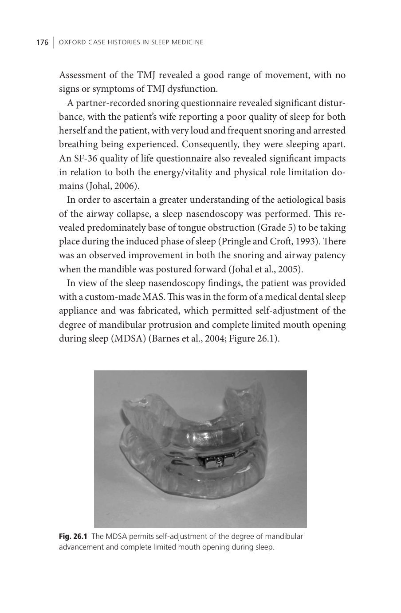
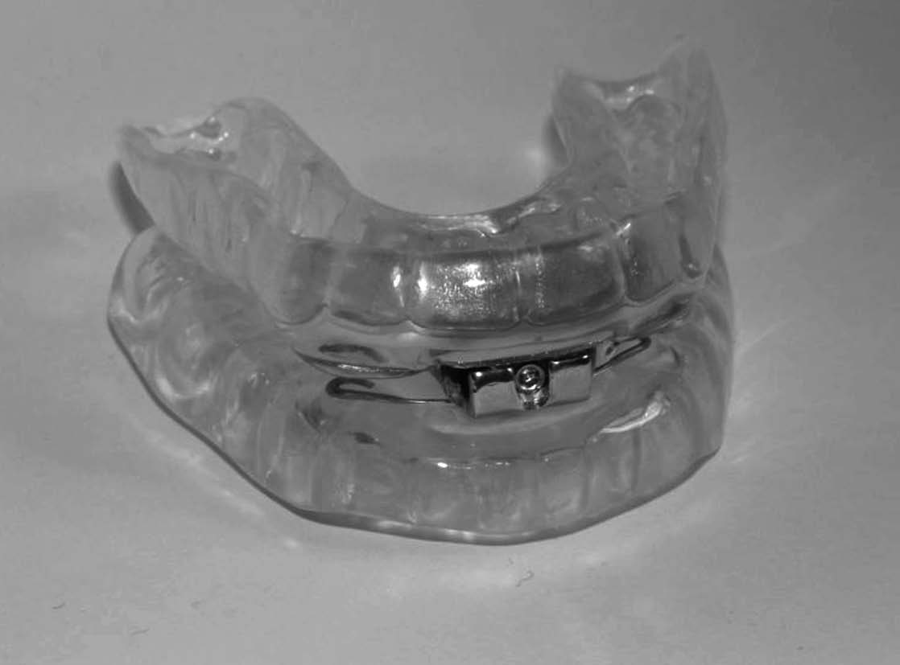

# Case 26 MAS therapy for severe OSAHS

<!-- pdf-page: 188 -->

### Case 26

### MAS therapy for severe OSAHS

A 31-year-old, otherwise fit and healthy male presented having being diagnosed with severe OSA. His principle complaints were loud disruptive snoring, which was adversely affecting his marriage, and the constant feeling of being tired and drained of energy to the extent that he was no longer able to concentrate at work. The patient compared the feeling to waking up in the morning having drunk two bottles of red wine the night before. He had seen his GP, who had prescribed him antidepressants and referred him for a sleep assessment. The overnight sleep study revealed severe OSA, and the AHI was recorded as 64.5/per hour. An evaluation of his daytime sleepiness using ESS revealed excessive hypersomnia, with a score of 16 (maximum score 24). The patient’s BMI was within normal limits (BMI = 25.3 kg/m2). An initial ENT consultation resulted in the patient undergoing a nasal septoplasty and being prescribed a steroid nasal spray, from which he obtained little benefit. He was subsequently prescribed n-CPAP, which he used intermittently for three years, with reported difficulties tolerating the mask and only limited symptomatic relief.

The patient felt he could no longer continue with the CPAP therapy and found his way to me at the Department of Orthodontics, Institute of Dentistry, Queen Mary College, London by means of an Internet search for specialist care in relation to the provision of an MAS.

Clinical examination revealed the patient was fully dentate in both jaws, with only first premolars missing in all quadrants, following orthodontic treatment. The patient had a Class III incisor relationship with a reduced overjet (2 mm) and overbite (1.5 mm). Periodontal health of the dentition was very good, with no signs of any active inflammation.

<!-- pdf-page: 189 -->

Assessment of the TMJ revealed a good range of movement, with no signs or symptoms of TMJ dysfunction.

A partner-recorded snoring questionnaire revealed significant disturbance, with the patient’s wife reporting a poor quality of sleep for both herself and the patient, with very loud and frequent snoring and arrested breathing being experienced. Consequently, they were sleeping apart. An SF-36 quality of life questionnaire also revealed significant impacts in relation to both the energy/vitality and physical role limitation domains (Johal, 2006).

In order to ascertain a greater understanding of the aetiological basis of the airway collapse, a sleep nasendoscopy was performed. This revealed predominately base of tongue obstruction (Grade 5) to be taking place during the induced phase of sleep (Pringle and Croft, 1993). There was an observed improvement in both the snoring and airway patency when the mandible was postured forward (Johal et al., 2005).

In view of the sleep nasendoscopy findings, the patient was provided with a custom-made MAS. This was in the form of a medical dental sleep appliance and was fabricated, which permitted self-adjustment of the degree of mandibular protrusion and complete limited mouth opening during sleep (MDSA) (Barnes et al., 2004; Figure 26.1).

Fig. 26.1 The MDSA permits self-adjustment of the degree of mandibular

advancement and complete limited mouth opening during sleep.

<!-- pdf-page: 190 -->

Case 26 177

Following adjustment for maximum advancement, the patient reported that he satisfactorily wore the MAS seven nights per week for between six and eight hours per night. The patient reported how the appliance had ‘transformed his life’ and went on to say ‘he had finally experienced his first night of proper sleep, waking in the morning feeling he had been born again’. Follow-up questionnaires demonstrated a very impressive improvement in his symptoms, including his partner’s evaluation of his snoring, which she reported had completely resolved, and perhaps more importantly they were sharing the same bedroom. The ESS score was seen to reduce from 16 to 6. A follow-up overnight sleep study, undertaken with the MAS in place, revealed a significant improvement in the AHI score, reducing from 64.5 to 12.0 per hour. In addition, there was a significant reported improvement in relation to both the energy/vitality and physical role limitation domains.

1 What severity of OSA is recommended for the treatment with

He remains on long-term review.

#### Questions

2 Name two reported benefits of using the MDSA.

MAS therapy as a first-line choice?

<!-- pdf-page: 191 -->

#### Answers

#### 1. What severity of OSA is recommended for the treatment

#### with MAS therapy as a first-line choice?

Patients with mild OSA, and moderate OSA patients if a preference for an MAS is expressed.

2. Name two reported benefits of using the MDSA.

It permits self-adjustment of the degree of mandibular advancement and complete limited mouth opening during sleep.

The value of a customized MAS in terms of sustained use and pa­

#### Learning points

tient comfort has been demonstrated over and above that achieved with cheaper ‘boil and bite’ prefabricated versions available via the Internet.

It is important that patients with moderate to severe OSAHS are appro­

priately followed up to ensure therapeutic success in the form of an overnight sleep study and subjective questionnaires.

Barnes M, McEvoy RD, Douglas R, et al. Efficacy of positive airway pressure and oral

#### Further reading

appliance in mild to moderate obstructive sleep apnea. Am J Respir Crit Care Med 2004;170:656–64. Johal A. Health-related quality of life in patients with sleep disordered breathing: effect

of mandibular advancement appliances. J Prosthetic Dentistry 2006;96:298–302. Johal A, Arya D, Winchester LJ et al. The effect of a mandibular advancement splint in

subjects with sleep-related breathing disorders. Br Dent J 2005;199(9):591–6. Pringle MB, Croft CB. A grading system for patients with obstructive sleep apnoea

based on sleep nasendoscopy. Clin Otolaryngol 1993;18:480–4.
