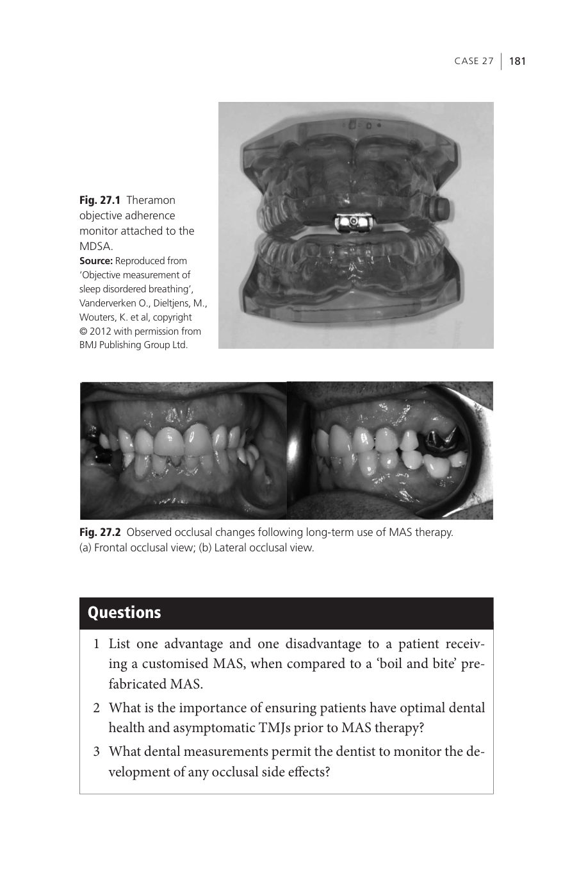
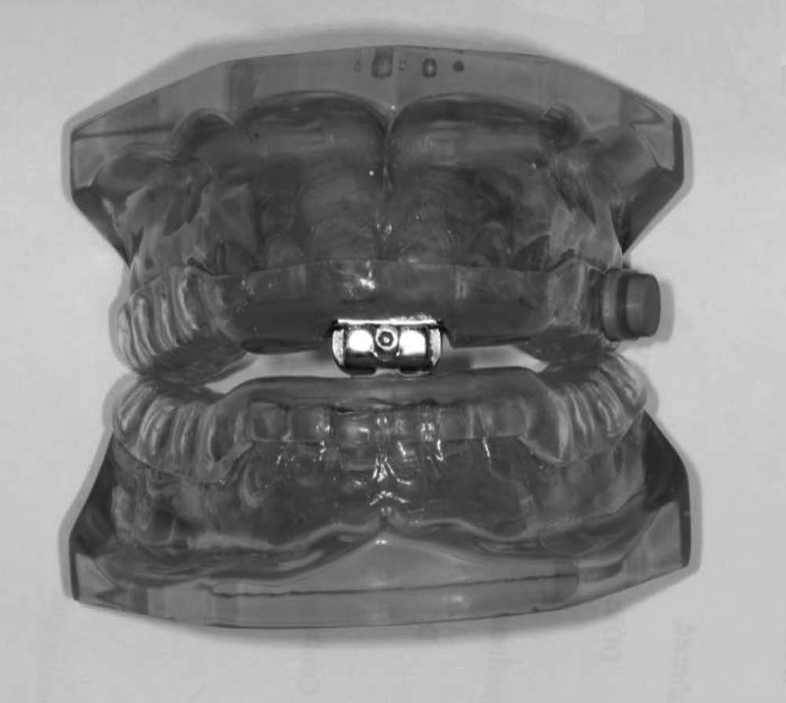
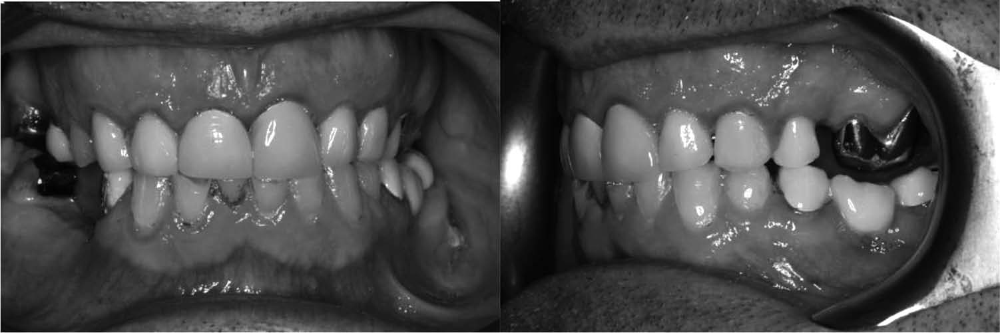

# Case 27 Effectiveness, compliance and side effects of MAS therapy

<!-- pdf-page: 192 -->

### Case 27

### Effectiveness, compliance

### and side effects of MAS therapy

A 33-year-old, otherwise fit and healthy male presented having being diagnosed with moderately severe OSA. His principle complaints were loud, disruptive snoring, which resulted in him and his wife sleeping in separate bedrooms and was adversely affecting his marriage, and daytime tiredness. He had seen his GP, who referred him for a sleep assessment at the ENT hospital. The overnight sleep study revealed moderate OSA, and an AHI was recorded as 20 per hour. An evaluation of his daytime sleepiness using ESS revealed excessive hypersomnia, with a score of 17 (maximum score 24). The patient’s BMI was within normal limits (BMI = 25.9 kg/m2). Sleep nasendoscopy revealed a sustained multi-segmental collapse of the pharyngeal airway (Grade 4) to be taking place during the induced phase of sleep (Pringle and Croft, 1993). There was an observed improvement in both the snoring and airway patency when the mandible was postured forward (Johal et al., 2005). Examination also revealed significant septal deviation and the patient underwent a septoplasty.

The patient was subsequently referred to the Department of Orthodontics, Institute of Dentistry, Queen Mary College, London for specialist care in relation to the provision of an MAS.

Clinical examination revealed the patient was fully dentate in both jaws, with the exception of the following teeth: first premolars and third molars in the maxilla, and second premolars in the mandible as a result of orthodontic treatment. The patient had a Class II division 1 incisor relationship with an increased overjet (5 mm) and overbite (4 mm). Periodontal health of the dentition was very good, with no signs of any active inflammation. Assessment of the TMJ revealed a good range of movement, with no signs or symptoms of TMJ dysfunction.

<!-- pdf-page: 193 -->

A partner-recorded snoring questionnaire revealed significant disturbance, with the patient’s wife reporting a poor quality of sleep for both herself and the patient, with very loud and frequent snoring. Consequently, they were sleeping apart. An SF-36 quality of life questionnaire also revealed significant impacts in relation to the energy/vitality domain (Johal, 2006).

Treatment: In view of the sleep nasendoscopy findings, the patient was provided with a custom-made mandibular advancement splint (MAS). This was in the form of a medical dental sleep appliance and was fabricated, which permitted self-adjustment of the degree of mandibular protrusion and complete limited mouth opening during sleep (MDSA) (Barnes et al., 2004). Following adjustment for maximum advancement, the patient reported that he satisfactorily wore the MAS seven nights per week and for approximately six hours per night. The patient reported significant improvement in his symptoms. Follow-up questionnaires demonstrated a very impressive improvement in his symptoms. In the partner’s evaluation of his snoring, she reported a marked improvement, with mild to moderate snoring occurring on an occasional basis. The ESS score was seen to reduce from 17 to 10. A follow-up overnight sleep study, undertaken with the MAS in place, revealed a significant improvement in the AHI score, reducing from 20 to 9.0 per hour. In addition, there was a reported improvement in relation to the energy/ vitality domain of the SF-36 quality of life questionnaire.

The residual snoring is likely to be arising from soft palate involvement, but the patient is not keen to undergo any pharyngeal surgery, as he and his partner are happy with the present outcome. An objective evaluation of the patient’s long-term (11 years) compliance with MAS therapy was undertaken, using a microsensor thermometer (Figure 27.1) and revealed a high degree of use (seven days per week and an average of seven hours per night).

A known long-term side effect of continued use of MAS therapy is changes observed in the occlusion. These effects are evident in the patient’s occlusion, with a reduction in the overjet (2 mm) and overbite (1 mm) observed (Figure 27.2).

He remains on long-term review.

<!-- pdf-page: 194 -->

Case 27 181

Fig. 27.2 Observed occlusal changes following long-term use of MAS therapy.

(a) Frontal occlusal view; (b) Lateral occlusal view.

1 List one advantage and one disadvantage to a patient receiv­

#### Questions

ing a customised MAS, when compared to a ‘boil and bite’ pre-fabricated MAS.

2 What is the importance of ensuring patients have optimal dental

health and asymptomatic TMJs prior to MAS therapy?

3 What dental measurements permit the dentist to monitor the de­

velopment of any occlusal side effects?

<!-- pdf-page: 195 -->

#### Answers

#### 1. List one advantage and one disadvantage to a patient re­

#### ceiving a customized MAS, when compared to a ‘boil and

bite’ pre-fabricated MAS. Advantage: improved fit and comfort (and compliance).

Disadvantage: requires a dentist to undertake mouldings of the teeth and consequently is more expensive.

#### 2. What is the importance of ensuring patients have

#### optimal dental health and asymptomatic TMJs prior to

#### MAS therapy?

Optimal dental health ensures that the MAS will be better retained (if the teeth are firm), minimizes the risk of tooth movement from continued use and minimizes risk of tooth loss (if the periodontal health is less than optimal).

Symptomatic TMJs will only become more exacerbated and painful if the mandible is advanced to address the sleep-related breathing disorder.

#### 3. What dental measurements permit the dentist to

#### monitor the development of any occlusal side effects?

The overjet and overbite.

It is important that informed consent is obtained and that the patient is

#### Learning points

made aware of the possibility of occlusal changes taking place following sustained use of their MAS.

Ensure the patient has optimal dental and periodontal health in the ab­

Barnes M, R McEvoy RD, Banks S, Tarquinio N, Murray CG, Vowles N, Pierce RJ. Effi­

sence of any TJD prior to constructing an MAS.

#### Further reading

cacy of positive airway pressure and oral appliance in mild to moderate obstructive sleep apnea. Am J Respir Crit Care Med 2004; 170(6):656–64. Johal, A. Health-related quality of life in patients with sleep disordered breathing: Effect

of mandibular advancement appliances. J Prosthetic Dentistry 2006;96:298–302.

<!-- pdf-page: 196 -->

Case 27 183

Johal A, Battagel JM, Kotecha BT. Sleep nasendoscopy: a diagnostic tool for predict­

ing treatment success with mandibular advancement splints in obstructive sleep apnoea. Eur J Orthod 2005;27(6):606–614. Pringle MB, Croft CB. A grading system for patients with obstructive sleep apnoea

based on sleep nasendoscopy. Clin Otolaryngol 1993;18:480–4. Vanderverken O, Dieltjens M, Wouters K, De Baker W, Van de Heyning P. Braem M.

Objective measurement of sleep disordered breathing. Thorax 2013;68:91–6.
