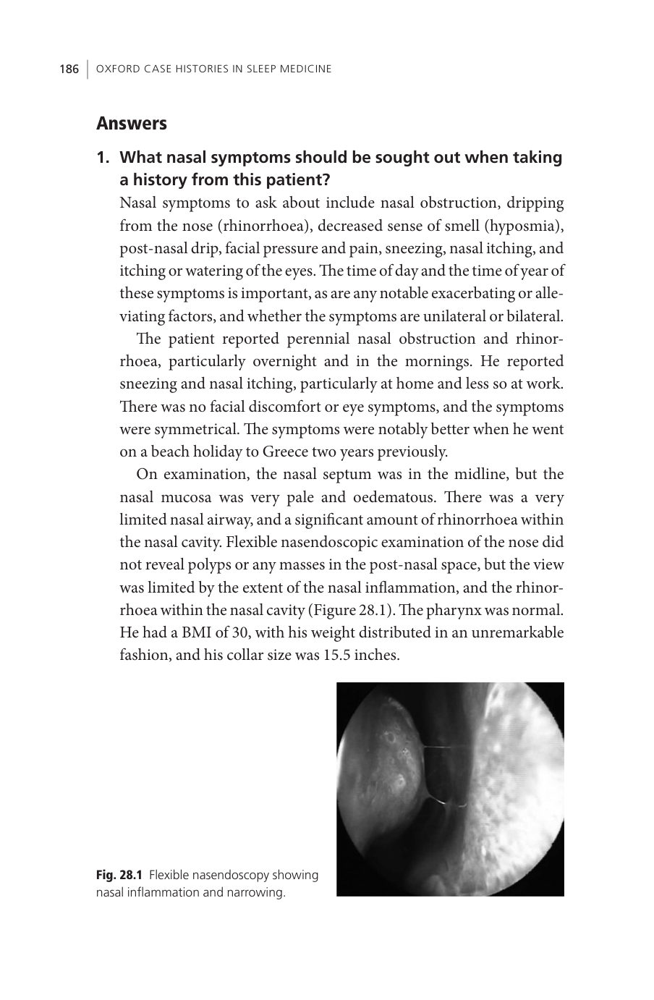
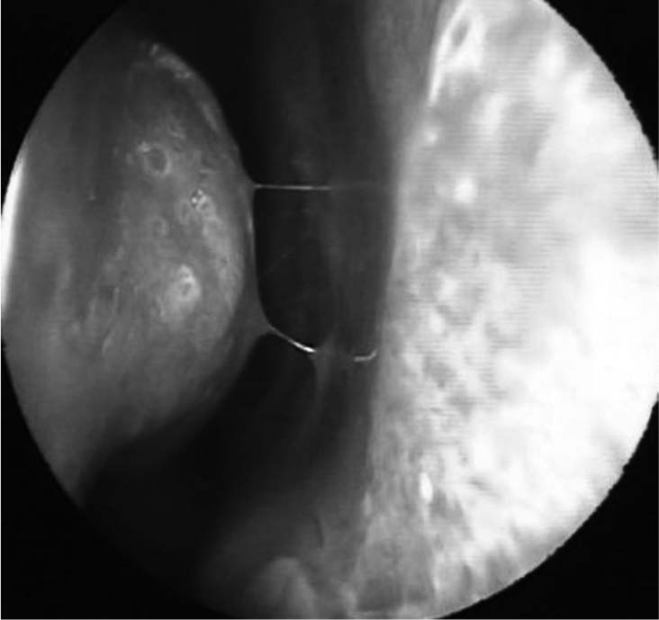
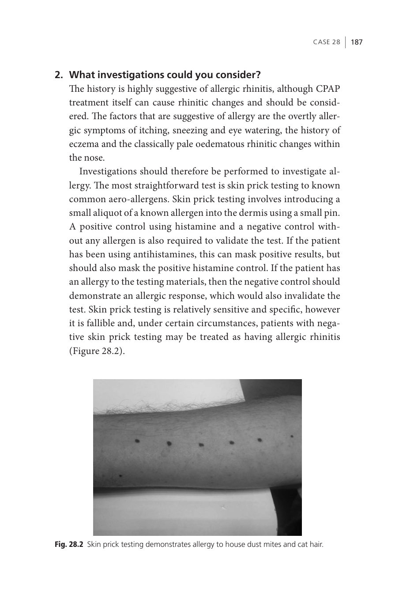
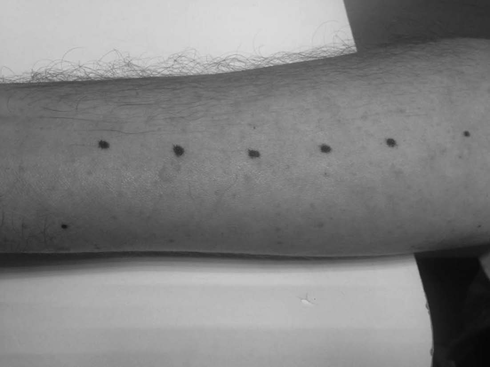

# Case 28 Allergic rhinitis

<!-- pdf-page: 198 -->

A 45-year-old man was treated for severe OSA (AHI of 65) with overnight auto-pressure-adjusted CPAP for six months. He underwent a difficult course of treatment, and never tolerated the CPAP well. He had a BMI of 30. His ESS score was 15, which was improved marginally, having had a score of 17 before the start of CPAP treatment. He was using a full face mask, having had a history of significant bilateral nasal obstruction noted at the time of fitting a nasal CPAP mask. He reported long-standing nasal obstruction, and had previously undergone surgery on his nose, although he was not certain of the nature of that surgery. He had a past medical history of eczema, but was otherwise well. He worked as a shopkeeper. He was a non-smoker. There was no family history of nasal problems of which he was aware.

### Case 28

### Allergic rhinitis

1 What nasal symptoms should be sought out when taking a history

#### Questions

3 What steps would you recommend for allergen avoidance?

from this patient?

2 What investigations could you consider?

4 What pharmacological alternatives are there?

5 Why might the ESS be reduced?

<!-- pdf-page: 199 -->

#### Answers

#### 1. What nasal symptoms should be sought out when taking

#### a history from this patient?

Nasal symptoms to ask about include nasal obstruction, dripping from the nose (rhinorrhoea), decreased sense of smell (hyposmia), post-nasal drip, facial pressure and pain, sneezing, nasal itching, and itching or watering of the eyes. The time of day and the time of year of these symptoms is important, as are any notable exacerbating or alleviating factors, and whether the symptoms are unilateral or bilateral.

The patient reported perennial nasal obstruction and rhinorrhoea, particularly overnight and in the mornings. He reported sneezing and nasal itching, particularly at home and less so at work. There was no facial discomfort or eye symptoms, and the symptoms were symmetrical. The symptoms were notably better when he went on a beach holiday to Greece two years previously.

On examination, the nasal septum was in the midline, but the nasal mucosa was very pale and oedematous. There was a very limited nasal airway, and a significant amount of rhinorrhoea within the nasal cavity. Flexible nasendoscopic examination of the nose did not reveal polyps or any masses in the post-nasal space, but the view was limited by the extent of the nasal inflammation, and the rhinorrhoea within the nasal cavity (Figure 28.1). The pharynx was normal. He had a BMI of 30, with his weight distributed in an unremarkable fashion, and his collar size was 15.5 inches.

Fig. 28.1 Flexible nasendoscopy showing

nasal inflammation and narrowing.

<!-- pdf-page: 200 -->

Case 28 187

#### 2. What investigations could you consider?

The history is highly suggestive of allergic rhinitis, although CPAP treatment itself can cause rhinitic changes and should be considered. The factors that are suggestive of allergy are the overtly allergic symptoms of itching, sneezing and eye watering, the history of eczema and the classically pale oedematous rhinitic changes within the nose.

Investigations should therefore be performed to investigate allergy. The most straightforward test is skin prick testing to known common aero-allergens. Skin prick testing involves introducing a small aliquot of a known allergen into the dermis using a small pin. A positive control using histamine and a negative control without any allergen is also required to validate the test. If the patient has been using antihistamines, this can mask positive results, but should also mask the positive histamine control. If the patient has an allergy to the testing materials, then the negative control should demonstrate an allergic response, which would also invalidate the test. Skin prick testing is relatively sensitive and specific, however it is fallible and, under certain circumstances, patients with negative skin prick testing may be treated as having allergic rhinitis (Figure 28.2).

Fig. 28.2 Skin prick testing demonstrates allergy to house dust mites and cat hair.

<!-- pdf-page: 201 -->

Common aero-allergens include grass pollens, tree pollens, fungi, house dust mites, and pet hair, such as from cats and dogs. Less common allergens that may be seen in urban populations include cockroach droppings. His perennial history of allergic symptoms deteriorating overnight at home is most suggestive of a house dust mite allergy. There are recognized patterns of seasonal allergy that will vary dependent on the country, and to some extent the region in which you practise.

Alternatives to skin prick testing include blood tests for allergenspecific IgE, such as the radioallergosorbent test (RAST testing) which can identify allergens when skin prick testing may not be possible, for example, due to concerns over anaphylaxis, lack of specific allergens or if the patient has taken an antihistamine. RAST testing is less accurate than skin prick testing, with false positive results being relatively more common. Furthermore, the correlation between the extent of a response and clinical symptoms is less strong with RAST tests than with skin prick tests.

Further tests could include an objective measure of nasal patency, such as nasal inspiratory peak flows, rhinomanometry or acoustic rhinometry. Equally, in patients with less overtly allergic symptoms, CT imaging of the sinuses could be considered. Systemic allergic responses can be assessed with serum IgE levels and vitamin D can also be considered, as deficiency may exacerbate rhinitis.

#### 3. What steps would you recommend for allergen

#### avoidance?

Allergen avoidance is the first and most important step in the treatment of allergic rhinitis. Avoidance should concentrate on each of the identified stimuli. First, exposure to cat hair should be reduced. If the patient has a cat, then it may be possible for the pet to be rehomed. If this is not possible, then regular cleaning, and limits to areas in which the pet is kept, may be beneficial. Specifically, excluding the pet from the bedroom and indoor carpeted living areas is recommended.

House dust mite allergen exposure may be reduced by a number of factors in the bedroom and throughout the house. In the bedroom, cushions and mattresses can be covered with allergen-proof

<!-- pdf-page: 202 -->

Case 28 189

covers. Bedding and soft toys should be regularly washed at high temperatures (>60°C). Books, soft toys and thick curtains can also store dust mites and can be removed, with curtains being replaced by blinds. Throughout the house, but particularly in the bedroom, carpets can be replaced by hard floors. Any carpets in the household, and also furniture, should be hoovered regularly. Lastly, lowering indoor ­humidity—using air conditioning in the summer, and central heating in winter—can also help symptoms.

Grass and tree pollen allergens may be avoided by limiting time spent in grassy or wooded areas during the seasons in which that allergy is most prevalent. Fungal allergies may be managed similarly to the house dust mite allergy. Identifying triggers to the allergic symptoms may help identify avoidance tactics.

The patient already had hard floors, did not have a cat and regularly washed his sheets. He felt he had limited his exposure as much as he could. He asked about medications that may help him.

#### 4. What pharmacological alternatives are there?

Different nasal medications may be effective in controlling different nasal allergic symptoms.

It is important to note that both the underlying sleep disordered breathing and the difficulty tolerating nasal CPAP may be manifestations of the nasal obstruction. Nasal obstruction is most effectively treated with topical nasal steroid. This may be in the form of sprays, such as fluticasone or mometasone, or in the form of drops. Drops may provide a much higher dose of topical steroid; however, some medications, such as betamethasone, may have significant systemic absorption, and protracted courses should be avoided. Topical steroids may also be effective for rhinorrhoea.

Systemic steroid is highly effective at treating these symptoms, but is contraindicated by its side effects. Nevertheless, patients with rheumatological disease may use steroids for other indications.

More allergic symptoms can be controlled with systemic antihistamines, such as cetirizine or loratadine. A topical antihistamine, azelastine, is effective for breakthrough symptoms. Rhinorrhoea can be treated with topical ipratropium bromide.

<!-- pdf-page: 203 -->

Fluticasone nasal drops and oral cetirizine controlled the patient’s nasal and allergic symptoms very effectively. A further sleep study demonstrated that his severe OSA had significantly improved, with an AHI of 18. He continued to use his CPAP, and was able to change his full face mask for a nasal mask. His compliance improved significantly. He felt significantly less somnolent with an ESS score of 3.

There are three reasons that the ESS may be reduced. The most obvious is the improved CPAP compliance. This may be due to the ability to use a nasal mask, or the improved nasal patency independent of the mask. Second, the AHI falling to a third of the previous level will mean that sleep quality is improved, even during periods when the CPAP is not used. Lastly, allergic rhinitis causes fatigue, and successfully treating the allergy may lead to a significant decrease in daytime somnolence independent of sleep quality. It is important to note possible confounding factors when assessing a patient’s somnolence. Other conditions that may lead to fatigue and daytime somnolence include anaemia, rheumatological disease, chronic infections and some malignancies.

#### 5. Why might the ESS be reduced?

The nasal airway is vital for efficient ventilation during sleep, and should

#### Learning points

be assessed in patients with sleep-disordered breathing.

Diagnoses of allergic rhinitis are principally clinical, with skin prick

Management of allergic rhinitis depends initially on allergen avoid­

testing being a useful adjunct.

Brozek JL, Bousquet J, Baena-Cagnani CE et al. Allergic rhinitis and its impact on

ance, and subsequent pharmacotherapy.

#### Further reading

asthma (ARIA) guidelines: 2010 revision (Global Allergy and Asthma European Network) J Allergy Clin Immunol 2010 Sep;126(3):466–76. Kotecha B. The nose, snoring and obstructive sleep apnoea. Rhinology 2011 Aug;49(3):

259–63.
