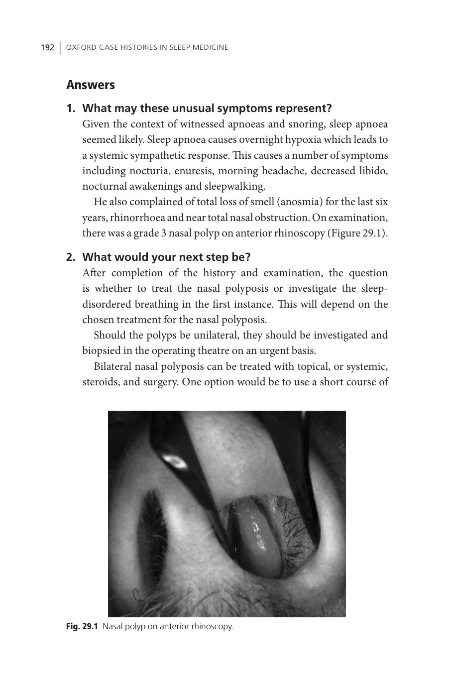
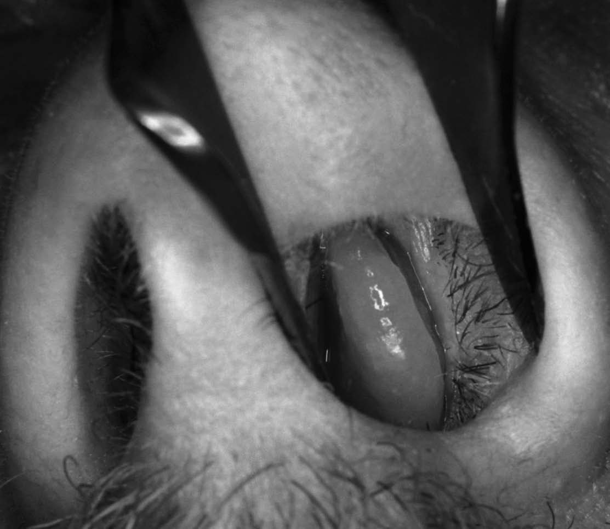
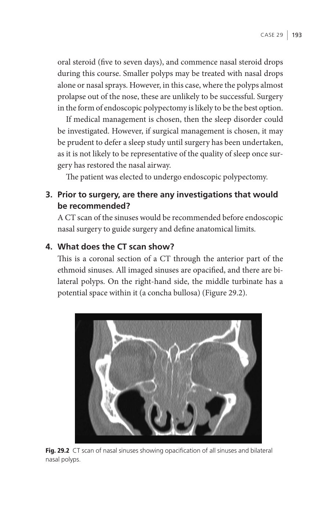
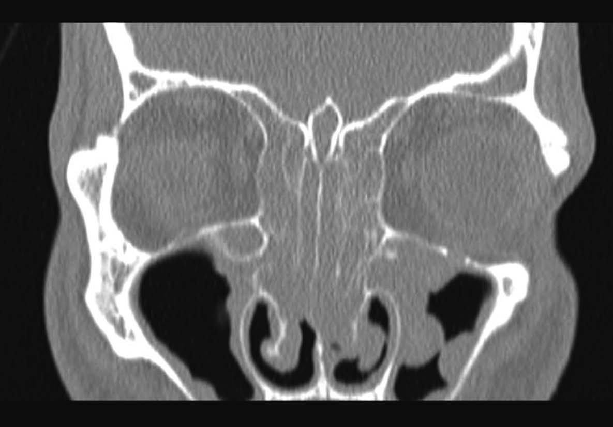

# Case 29 Nasal polyposis

<!-- pdf-page: 204 -->

A 43-year-old gentleman was referred to the ENT clinic by his GP, as his wife had been complaining of worsening snoring and had witnessed frequent apnoeas of 5–10 seconds. He had a past medical history of asthma. He had significant daytime somnolence. He complained of a number of unusual symptoms including nocturia, decreased libido and sleepwalking.

### Case 29

### Nasal polyposis

3 Prior to surgery, are there any investigations that would be

#### Questions

1 What may these unusual symptoms represent?

2 What would your next step be?

6 Why does nasal obstruction lead to sleep-disordered breathing in

recommended?

4 What does the CT scan show?

5 What are nasal polyps?

patients who mouth breathe comfortably when awake?

<!-- pdf-page: 205 -->

#### Answers

#### 1. What may these unusual symptoms represent?

Given the context of witnessed apnoeas and snoring, sleep apnoea seemed likely. Sleep apnoea causes overnight hypoxia which leads to a systemic sympathetic response. This causes a number of symptoms including nocturia, enuresis, morning headache, decreased libido, nocturnal awakenings and sleepwalking.

He also complained of total loss of smell (anosmia) for the last six years, rhinorrhoea and near total nasal obstruction. On examination, there was a grade 3 nasal polyp on anterior rhinoscopy (Figure 29.1).

After completion of the history and examination, the question is whether to treat the nasal polyposis or investigate the sleep-disordered breathing in the first instance. This will depend on the chosen treatment for the nasal polyposis.

#### 2. What would your next step be?

Should the polyps be unilateral, they should be investigated and biopsied in the operating theatre on an urgent basis.

Bilateral nasal polyposis can be treated with topical, or systemic, steroids, and surgery. One option would be to use a short course of

Fig. 29.1 Nasal polyp on anterior rhinoscopy.

<!-- pdf-page: 206 -->

Case 29 193

oral steroid (five to seven days), and commence nasal steroid drops during this course. Smaller polyps may be treated with nasal drops alone or nasal sprays. However, in this case, where the polyps almost prolapse out of the nose, these are unlikely to be successful. Surgery in the form of endoscopic polypectomy is likely to be the best option.

If medical management is chosen, then the sleep disorder could be investigated. However, if surgical management is chosen, it may be prudent to defer a sleep study until surgery has been undertaken, as it is not likely to be representative of the quality of sleep once surgery has restored the nasal airway.

The patient was elected to undergo endoscopic polypectomy.

#### 3. Prior to surgery, are there any investigations that would

#### be recommended?

A CT scan of the sinuses would be recommended before endoscopic nasal surgery to guide surgery and define anatomical limits.

This is a coronal section of a CT through the anterior part of the ethmoid sinuses. All imaged sinuses are opacified, and there are bilateral polyps. On the right-hand side, the middle turbinate has a potential space within it (a concha bullosa) (Figure 29.2).

#### 4. What does the CT scan show?

Fig. 29.2 CT scan of nasal sinuses showing opacification of all sinuses and bilateral

nasal polyps.

<!-- pdf-page: 207 -->

The patient underwent endoscopic polypectomy, and his symptoms improved greatly. A sleep study demonstrated only mild OSA, with an AHI of 6.2.

Nasal polyps are polypoidal lumps of tissue comprised nasal mucosa. Their exact aetiology is unknown, although they are associated with a number of medical conditions, such as asthma, cystic fibrosis and Kartagener’s syndrome.

#### 5. What are nasal polyps?

#### 6. Why does nasal obstruction lead to sleep-disordered

#### breathing in patients who mouth breathe comfortably

#### when awake?

During ventilation at rest, the nasal airway has less resistance than the oral airway. This is particularly marked during sleep, when relaxation of the pharyngeal and glossal musculature leads to a reduction in the retroglossal airway. This makes it relatively much less efficient to mouth breathe. Thus, nasal obstruction has a disproportionately large effect on the efficiency of ventilation during sleep.

Nasal polyposis characteristically leads to hyposmia, rhinorrhoea and

#### Learning points

subsequently nasal obstruction. Facial pain or pressure are unusual symptoms in this population.

In bilateral nasal polyposis, CT scanning is only routinely used to guide

The mainstay of management of nasal polyposis is topical steroids.

a planned surgical procedure.

Short courses of systemic steroids and polypectomy are adjuncts to topical steroid treatment.

Craig TJ, Ferguson BJ, Krouse JH. Sleep impairment in allergic rhinitis, rhinosinusitis,

#### Further reading

and nasal polyposis. Am J Otolaryngol 2008 May–Jun;29(3): 209–17. Fokkens WJ, Lund VJ, Mullol J, et al. EPOS 2012: European position paper on rhinosi­

nusitis and nasal polyps 2012. Rhinology 2012 Mar;50(1):1–12.
