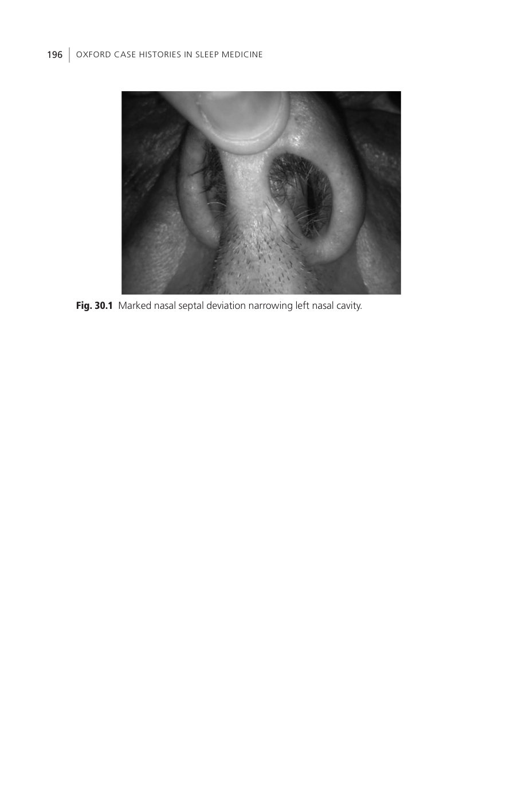
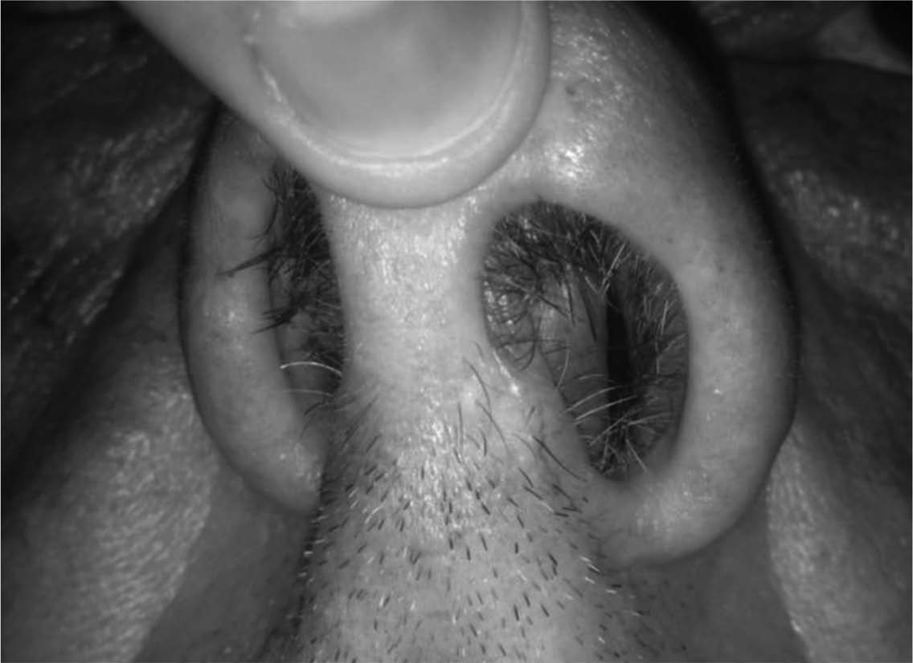

# Case 30 Septoplasty

<!-- pdf-page: 208 -->

A 52-year-old man presented at clinic to talk about his CPAP. He had been treated for OSA with CPAP for 18 months. He initially used a nasal mask; however, the pressure was too high to be comfortable, and he changed to a full face mask. He found the face mask very uncomfortable to use, as it was pressing on his face around the mouth, and he was having leaks around this area.

### Case 30

### Septoplasty

Ever since an injury in his thirties, he had had nasal blockage, more on the left side than the right. He had no other nasal symptoms. He had grade 1 tonsils, and generally floppy pharyngeal mucosa. His Mallampati grade is 3, and he had a BMI of 36. His neck collar size was 18.5 inches.

Examination of the nose revealed a septum that was grossly deviated to the left side (Figure 30.1). The left inferior turbinate appeared oedematous and enlarged, but the nasal mucosa was otherwise normal.

1 Does the mucosa on the left inferior turbinate indicate underlying

#### Questions

6 Is septoplasty likely to have any long-lasting effect on the under­

rhinitis?

2 What investigations could be considered?

3 Is his BMI a contraindication to surgery?

4 What are the complications of surgery?

5 Are there alternatives?

lying sleep-disordered breathing?

<!-- pdf-page: 209 -->

Fig. 30.1 Marked nasal septal deviation narrowing left nasal cavity.

<!-- pdf-page: 210 -->

<!-- pdf-page: 211 -->

#### Answers

#### 1. Does the mucosa on the left inferior turbinate indicate

#### underlying rhinitis?

It is possible that this mucosa indicates underlying rhinitis. The inferior turbinate on the left may represent a significant proportion of the viewable nasal mucosa should visualization of the nose be limited by the septal deflection and the inferior turbinate. Nasal endoscopy could help to bypass this.

However, it is more likely that the inferior turbinate is enlarged as a result of the increased airflow on this side associated with the septal deflection. This is very commonly seen with significant septal deflections, and does not indicate an underlying rhinitic process.

#### 2. What investigations could be considered?

It is important to quantify the extent to which he is using his CPAP. The length and frequency of CPAP use is recorded by many CPAP devices. Furthermore, the required CPAP pressures can be reviewed. Some CPAP devices will autoset the pressure, and these parameters can be downloaded from the device; this will give an objective measure of the difficulties with the CPAP treatment.

Nasal patency can be assessed using nasal inspiratory peak flow measurements; however, these are predominantly used to assess the result of treatment.

The relative patency of each side can be assessed using acoustic rhinometry; however, this is only rarely used in clinical practice, and usually an assessment based on clinical examination is sufficient. Mladina has proposed a grading system for septal deviation; however, once again, this is infrequently used in clinical practice.

Septoplasty surgery was recommended, and the patient indicated a willingness to undergo any procedure that may aid his use of CPAP.

His BMI of 36 was a relative contraindication to surgery. In this case, the benefits were sufficiently great for this to be overlooked. The

#### 3. Is his BMI a contraindication to surgery?

<!-- pdf-page: 212 -->

Case 30 199

rationale for this being a contraindication was the relatively higher incidence of peri-operative and post-operative complications.

#### 4. What are the complications of surgery?

Complications of septoplasty include infection, bleeding, septal perforation (which may lead to nasal crusting, epistaxis or even a ‘saddle’ deformity of the external nose), a loss of support of the nasal tip with a consequent impingement of the external nasal valve, failure to improve the nasal airway, numbness of the teeth and anosmia. General anaesthetic complications of surgery such as venous thromboembolism should also be considered.

Alternatives to septoplasty include medical and other surgical treatments. Topical nasal steroid may lead to some improvement in nasal patency. This would be particularly relevant if there were significant rhinitic changes within the nose. However, CPAP rhinitis is something to consider, and given the small side effect profile of topical nasal steroids, they would be a reasonable conservative measure.

#### 5. Are there alternatives?

Surgical alternatives include reduction of the inferior turbinates, particularly on the unaffected side of the nose. This carries relatively less complications; however, it is much less likely to be successful in the long term, and may lead to scarring/adhesions/synechiae in the nose. If the external nasal pyramid is deviated, then to correct the septal deflection may require septorhinoplasty.

The patient underwent septoplasty, and was able to use his CPAP effectively and comfortably. His compliance increased notably, and his daytime somnolence decreased. He is maintained on CPAP treatment.

#### 6. Is septoplasty likely to have any long-lasting effect on

#### the underlying sleep-disordered breathing?

It is unlikely, but possible, that septoplasty in itself will ‘cure’ the OSA. A small proportion of patients with OSA can be definitively treated with nasal surgery. A larger proportion of patients with snoring can be definitively treated with nasal surgery, although this group still

<!-- pdf-page: 213 -->

forms a minority of patients who snore. It is much more common for nasal complaints to be part of a clinical syndrome of OSA and, in these cases, treating the nasal complaint will not take the OSA away, but may potentiate the treatment of OSA with CPAP.

Contralateral enlargement of the inferior turbinate is frequently seen in

#### Learning points

Nasal obstruction can make it difficult to tolerate CPAP treatment.

septal deviation.

In patients with nasal obstruction, it is important to consider rhinitis

Georgalas C. The role of the nose in snoring and obstructive sleep apnoea: an update.

prior to surgery for structural nasal obstruction.

#### Further reading

Eur Arch Otorhinolaryngol 2011 Sep;268(9):1365–73. Poirier J, George C, Rotenberg B. The effect of nasal surgery on nasal continuous posi­

tive airway pressure compliance. Laryngoscope 2014 Jan;124(1):317–19.
