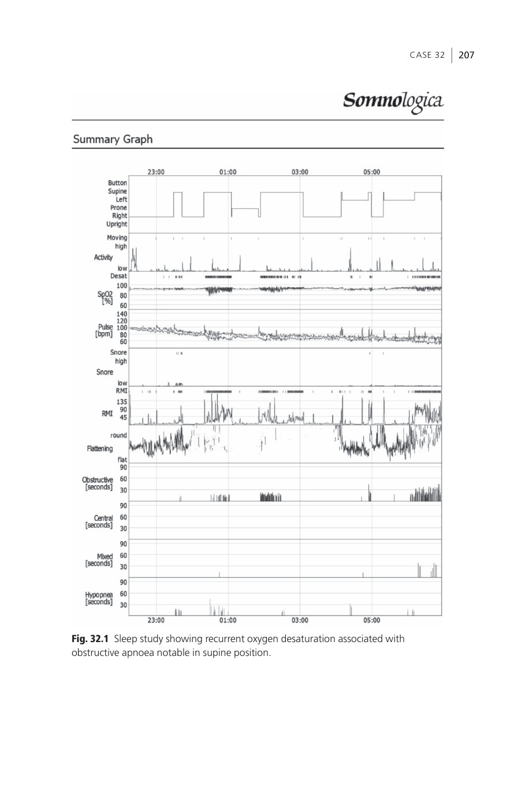
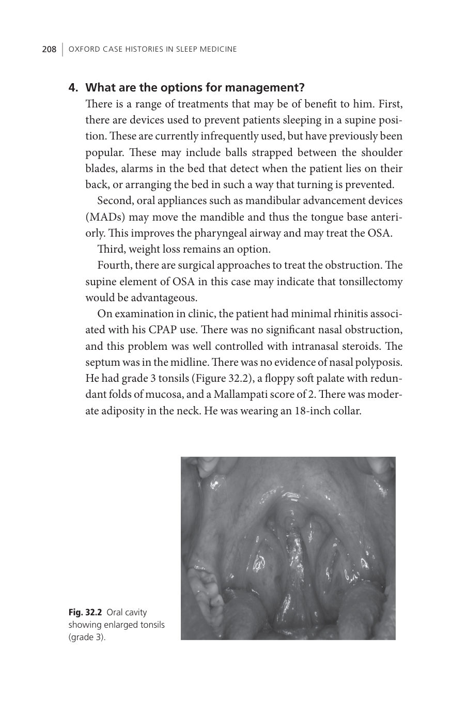
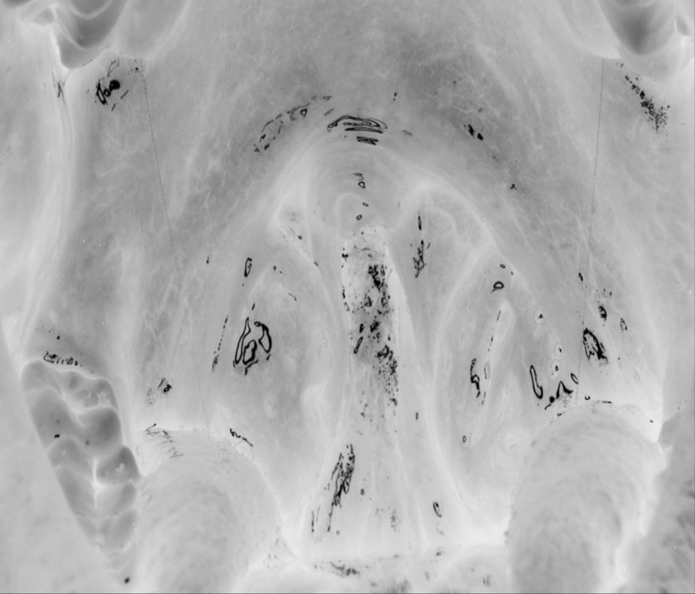

# Case 32 Laser Assisted Uvulopalatoplasty (LAUP)/tonsillectomy

<!-- pdf-page: 218 -->

### Case 32

### Laser Assisted Uvulopalatoplasty

### (LAUP)/tonsillectomy

A 42-year-old man with OSA had been treated with a CPAP machine at 17 cm of water using a nasal mask for the last two years, but had poor compliance with treatment. He was unable to tolerate wearing the mask for any length of time, and found the high pressure gave him a suffocating feeling and forced air out of his mouth. He had a BMI of 33. He was known to be hypertensive, for which he took lisinopril.

1 Approximately what proportion of patients prescribed CPAP do

#### Questions

2 What measures could you try with the patient to attempt to im­

not use the treatment?

5 Which investigations could help assess this patient to see if there

prove his compliance with CPAP?

3 What does his sleep study show?

4 What are the options for management?

6 What are the potential disadvantages of surgical management in

is a relevant surgical approach?

cases similar to this?

<!-- pdf-page: 219 -->

#### Answers

#### 1. Approximately what proportion of patients prescribed

#### CPAP do not use the treatment?

The term ‘CPAP compliance’ generally refers to use of the CPAP mask on four or more nights per week for four or more hours each night. Approximately 60–70% of patients prescribed CPAP reach this level of CPAP use.

#### 2. What measures could you try with the patient to attempt

#### to improve his compliance with CPAP?

You could try to increase his motivation by advising him of the effect of untreated OSA on his health—notably the increased risk of cardiac disease and stroke (especially in the context of his hypertension). You could also advise him of the benefits to his quality of life—less daytime somnolence, less nocturia, improved libido, and better memory and concentration.

You could give him advice about the use and care of the mask, and advise him to try a full face mask.

You could try to change his CPAP pressures to see if the AHI could be decreased sufficiently with lower pressures. Furthermore, an auto-pressure set CPAP device could be used.

You could advise him to lose weight, as that may decrease his CPAP pressure requirement and possibly mean he would not need CPAP. Medications such as orlistat may help with this.

You could ask him about nasal rhinitic symptoms. CPAP rhinitis can be treated with intranasal steroid.

Despite best efforts, the patient was still unable to use his CPAP regularly. He had significant daytime somnolence, and asked about his options.

He was diagnosed with OSA two years ago, at which time this was his sleep study:

This demonstrates OSA with a notable supine (positional) component (Figure 32.1).

#### 3. What does his sleep study show?

<!-- pdf-page: 220 -->

Case 32 207

Fig. 32.1 Sleep study showing recurrent oxygen desaturation associated with

obstructive apnoea notable in supine position.

<!-- pdf-page: 221 -->

#### 4. What are the options for management?

There is a range of treatments that may be of benefit to him. First, there are devices used to prevent patients sleeping in a supine position. These are currently infrequently used, but have previously been popular. These may include balls strapped between the shoulder blades, alarms in the bed that detect when the patient lies on their back, or arranging the bed in such a way that turning is prevented.

Second, oral appliances such as mandibular advancement devices (MADs) may move the mandible and thus the tongue base anteriorly. This improves the pharyngeal airway and may treat the OSA.

Third, weight loss remains an option. Fourth, there are surgical approaches to treat the obstruction. The supine element of OSA in this case may indicate that tonsillectomy would be advantageous.

On examination in clinic, the patient had minimal rhinitis associated with his CPAP use. There was no significant nasal obstruction, and this problem was well controlled with intranasal steroids. The septum was in the midline. There was no evidence of nasal polyposis. He had grade 3 tonsils (Figure 32.2), a floppy soft palate with redundant folds of mucosa, and a Mallampati score of 2. There was moderate adiposity in the neck. He was wearing an 18-inch collar.

Fig. 32.2 Oral cavity

showing enlarged tonsils (grade 3).

<!-- pdf-page: 222 -->

Case 32 209

#### 5. Which investigations could help assess this patient to see

#### if there is a relevant surgical approach?

Whilst clinically it sounds as though the patient’s obstruction is most likely to be arising from his tonsils and soft palate, this can be investigated by a number of methods. These include sedation/sleep nasendoscopy, acoustic analysis of snoring, use of an ‘apnoeagraph’ pressure catheter and imaging of the upper respiratory tract.

After undergoing sleep nasendoscopy, which confirmed inspiratory collapse in the palatal and oropharyngeal area, the patient underwent tonsillectomy and LAUP. A sleep study performed eight weeks post-operatively showed that the AHI had fallen from 20/hr to 5.6/hr.

#### 6. What are the potential disadvantages of surgical

#### management in cases similar to this?

These operations carry significant risks; 5% of patients undergoing tonsillectomy have post-operative bleeding leading to readmission, and 1% undergo further surgery to stop this bleeding. These operations are very painful, and have a lower success rate than CPAP treatment in reducing episodes of apnoea. Other operative risks include the risk of infection, damage to the teeth, nasal regurgitation, a globus sensation and complications associated with anaesthesia.

Whilst tonsils do not regrow, it is possible that over a long period of time the laxity of the soft palate may increase, and in a proportion of patients undergoing surgical management of their OSA, symptoms may recur.

Tonsillar hypertrophy may cause significant airway obstruction during

#### Learning points

Methods to assess the anatomy of obstruction in OSA include drug-

sleep-related pharyngeal relaxation.

induced sleep nasendoscopy, apnoeagraph devices and imaging of the upper airway.

Surgical management in the oropharynx is usually reserved for those

patients who have been non-compliant with CPAP therapy.

<!-- pdf-page: 223 -->

#### Further reading

Borek RC, Thaler ER, Kim C et al. Quantitative airway analysis during drug-induced

sleep endoscopy for evaluation of sleep apnea. Laryngoscope 2012 Nov;122(11): 2592–9. Sawyer AM, Gooneratne NS, Marcus CL et al. A systematic review of CPAP adherence

across age groups: clinical and empiric insights for developing CPAP adherence interventions. Sleep Med Rev 2011 Dec;15(6): 343–56.
