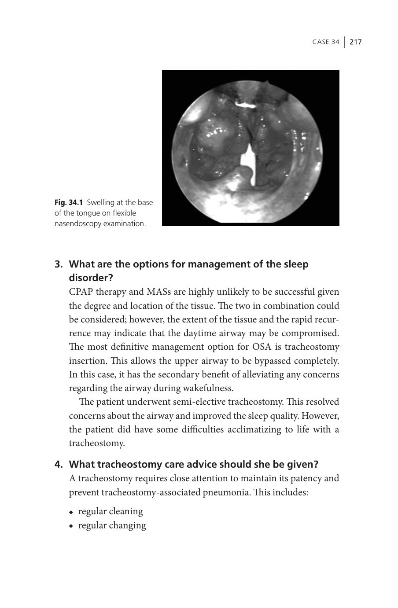
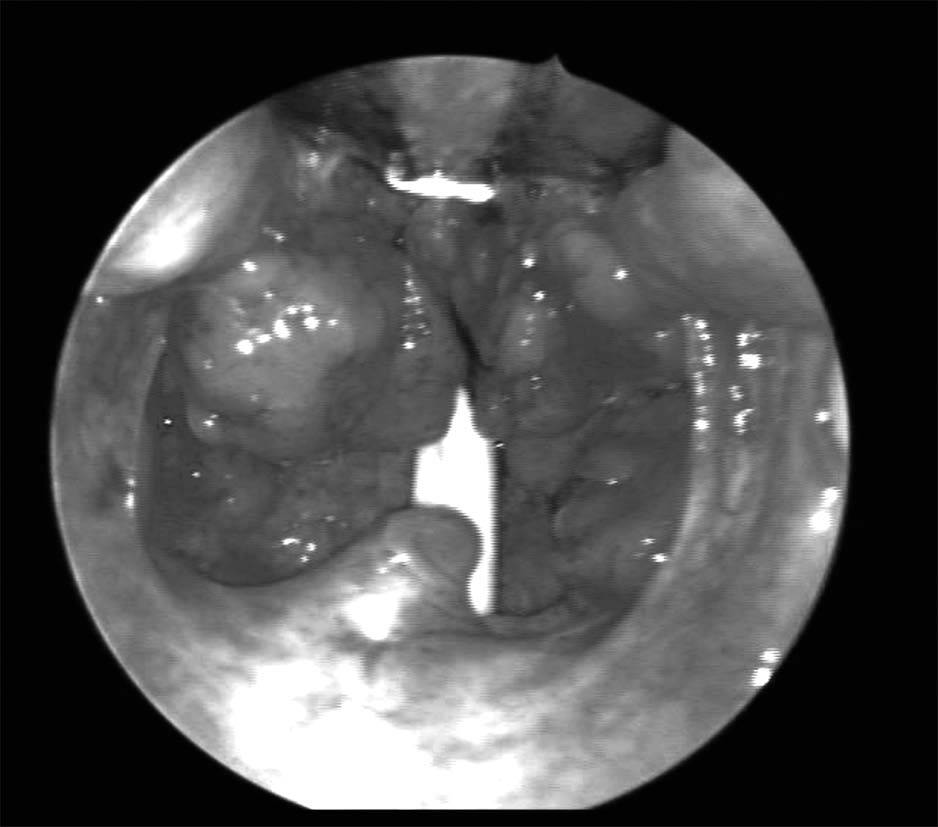
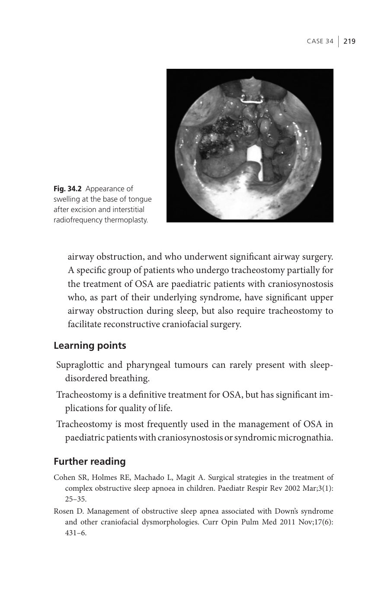
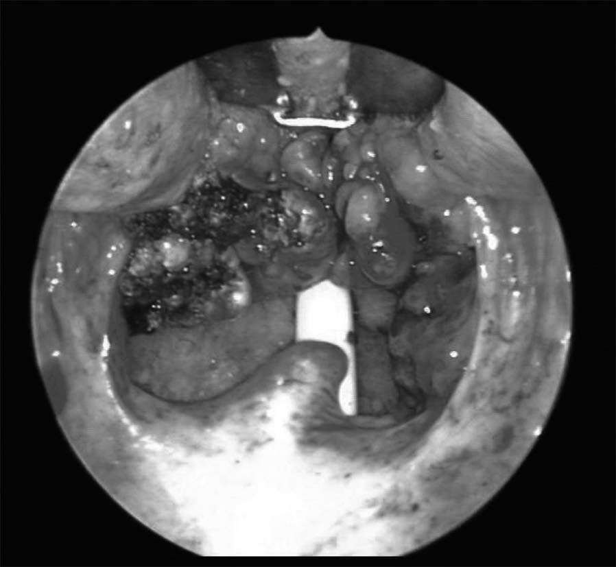

# Case 34 Tracheostomy

<!-- pdf-page: 228 -->

A 52-year-old female patient presented to her GP with a ‘globus’ or foreign body feeling in the throat accompanied by snoring and witnessed disordered breathing overnight.

### Case 34

### Tracheostomy

3 What are the options for management of the sleep disorder?

#### Questions

1 Which of these symptoms is more concerning?

2 What is the next stage for her management?

4 What tracheostomy care advice should she be given?

5 What are the potential complications of tracheostomy?

<!-- pdf-page: 229 -->

#### Answers

#### 1. Which of these symptoms is more concerning?

Globus sensation is a common symptom characterized by a feeling of there being a foreign body within the throat. It is not associated with head and neck cancer, and is not thought as a ‘red flag’ symptom which would warrant urgent referral to head and neck cancer services. Causes include conditions such as gastro-oesophageal reflux disease (GORD) (or laryngo-pharyngo reflux (LPR)). Sleep-disordered breathing is an indicator of OSA, a common condition with severe health consequences, as discussed throughout this book.

On examination, the base of the tongue was clearly swollen, and was visible in the oropharynx. There was no lymphadenopathy in the neck. She was referred to a head and neck cancer unit for investigation of this gross swelling of the tongue base.

On review in secondary care, the tongue base hypertrophy was visualized on flexible nasendoscopy. There was a very limited oropharyngeal airway. A sleep study demonstrated moderately severe OSA with an AHI of 20.

#### 2. What is the next stage for her management?

The oropharynx had the following appearance:

An unexplained tongue swelling had been identified, and this needed to be addressed on an urgent basis (Figure 34.1). Whilst her symptomatology was not suggestive of cancer, this examination finding was quite suggestive. A biopsy should be undertaken prior to consideration of the management of the sleep disorder.

A large excision of a proportion of the excess tissue was undertaken. The histological diagnosis was lymphoid hyperplasia. This is a rare condition characterized by ongoing proliferation of lymphoid tissue. In this case, lymphoid tissue within the tongue base was leading to upper airway obstruction. Subsequent to the excision, the tissue rapidly recurred.

<!-- pdf-page: 230 -->

Case 34 217

#### 3. What are the options for management of the sleep

Fig. 34.1 Swelling at the base

of the tongue on flexible nasendoscopy examination.

#### disorder?

CPAP therapy and MASs are highly unlikely to be successful given the degree and location of the tissue. The two in combination could be considered; however, the extent of the tissue and the rapid recurrence may indicate that the daytime airway may be compromised. The most definitive management option for OSA is tracheostomy insertion. This allows the upper airway to be bypassed completely. In this case, it has the secondary benefit of alleviating any concerns regarding the airway during wakefulness.

The patient underwent semi-elective tracheostomy. This resolved concerns about the airway and improved the sleep quality. However, the patient did have some difficulties acclimatizing to life with a tracheostomy.

#### 4. What tracheostomy care advice should she be given?

A tracheostomy requires close attention to maintain its patency and prevent tracheostomy-associated pneumonia. This includes:

◆ regular cleaning

◆ regular changing

<!-- pdf-page: 231 -->

◆ use of an inner cannula

◆ suctioning

◆ humidification

◆ protection when outside.

#### 5. What are the potential complications of tracheostomy?

In the short term, a tracheostomy insertion is associated with risks of infection, bleeding and damage to surrounding structures, including bleeding from the thyroid gland and very rarely paralysis of the vocal cords. Whilst the tracheostomy is in position, the patient may experience swallowing difficulties, and the voice may require the use of particular attachments for the tracheostomy, and may be weaker than it would be otherwise. The long-term complications need to be considered. These range from difficulty in removing the tracheostomy tube (known as decannulation), an increased risk of pneumonia, scarring and fistulation—both tracheo-cutaneous fistulae, and also fistulation into the great vessels, such as tracheo-innominate fistulation. This is a rare, but almost invariably fatal complication. Tracheostomy can lead to tracheal stenosis.

She was able to maintain her tracheostomy care, but found that she had a weak voice with her tracheostomy in situ, and wanted to explore an option to reverse the use of the tracheostomy. Further excision and interstitial radiofrequency thermotherapy in a number of applications over a period of time was used (Figure 34.2).

This was able to control the tongue-base hypertrophy to an extent where it was asymptomatic, although the surgical treatment had to be repeated on a regular basis. A repeat sleep study demonstrated an AHI of 4.

Tracheostomies represent significant undertakings in terms of the effects that they have on a patient’s quality of life, and the care they require. Complications are not uncommon and need to be discussed at length prior to proceeding with such a course of treatment. For this reason, tracheostomy is infrequently used for OSA. When it is used, treatment of OSA usually represents just part of the indication. This is the case for this patient, for whom there were concerns about

<!-- pdf-page: 232 -->

Case 34 219

airway obstruction, and who underwent significant airway surgery. A specific group of patients who undergo tracheostomy partially for the treatment of OSA are paediatric patients with craniosynostosis who, as part of their underlying syndrome, have significant upper airway obstruction during sleep, but also require tracheostomy to facilitate reconstructive craniofacial surgery.

Fig. 34.2 Appearance of

swelling at the base of tongue after excision and interstitial radiofrequency thermoplasty.

Supraglottic and pharyngeal tumours can rarely present with sleep-

#### Learning points

Tracheostomy is a definitive treatment for OSA, but has significant im­

disordered breathing.

Tracheostomy is most frequently used in the management of OSA in

plications for quality of life.

paediatric patients with craniosynostosis or syndromic micrognathia.

Cohen SR, Holmes RE, Machado L, Magit A. Surgical strategies in the treatment of

#### Further reading

complex obstructive sleep apnoea in children. Paediatr Respir Rev 2002 Mar;3(1): 25–35. Rosen D. Management of obstructive sleep apnea associated with Down’s syndrome

and other craniofacial dysmorphologies. Curr Opin Pulm Med 2011 Nov;17(6): 431–6.

<!-- pdf-page: 233 -->

<!-- pdf-page: 234 -->

### Section 3

## Neurological sleep

## disorders
