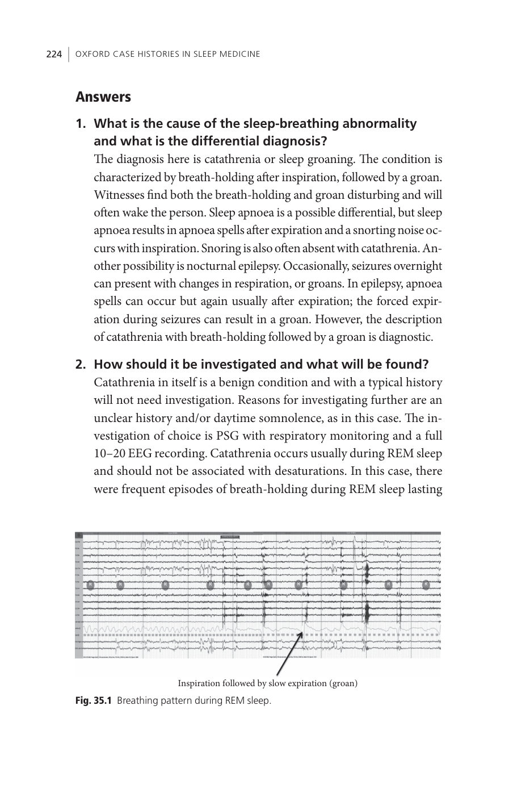
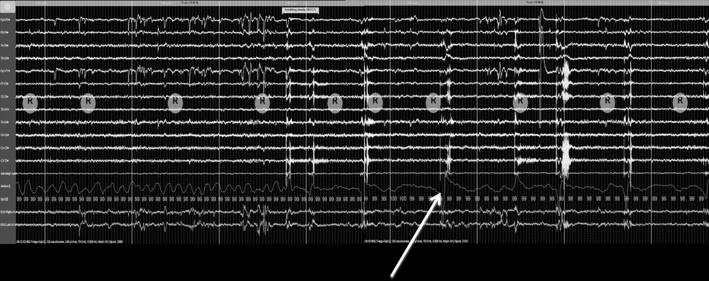

# Case 35 Sleep groaning

<!-- pdf-page: 236 -->

A 23-year-old right-handed woman presented with daytime somnolence and sleepiness for three to four years.

### Case 35

### Sleep groaning

Approximately three to four years ago she was noticed by her then new boyfriend as having episodes at night of holding her breath for approximately 10 seconds, followed by a loud exhaling sound, often resulting in a high-pitched groaning noise. These episodes occurred three to four times a night towards the second half of the night. Her boyfriend would wake her on account of the breath-holding. She does not snore.

There was no past medical history of note. In her family her mother snores, and her grandmother suffers from epilepsy. She sleep-talks at night in full sentences, having conversations with people but making little sense, and there is occasional mumbling.

She goes to bed at about 11 p.m. and sleeps through to 7 a.m.; she is often unrefreshed on waking and will have a one- to two-hour nap early evening after work. On the weekend, she will normally sleep for about twelve hours. She drinks approximately one bottle of wine a week and doesn’t smoke.

Neurological examination and examination of the mouth and throat were normal.

1 What is the cause of the sleep-breathing abnormality and what is

#### Questions

2 How should it be investigated and what will be found?

the differential diagnosis?

3 What is the relevance of the sleep-talking?

4 What treatments are appropriate?

<!-- pdf-page: 237 -->

#### Answers

#### 1. What is the cause of the sleep-breathing abnormality

#### and what is the differential diagnosis?

The diagnosis here is catathrenia or sleep groaning. The condition is characterized by breath-holding after inspiration, followed by a groan. Witnesses find both the breath-holding and groan disturbing and will often wake the person. Sleep apnoea is a possible differential, but sleep apnoea results in apnoea spells after expiration and a snorting noise occurs with inspiration. Snoring is also often absent with catathrenia. Another possibility is nocturnal epilepsy. Occasionally, seizures overnight can present with changes in respiration, or groans. In epilepsy, apnoea spells can occur but again usually after expiration; the forced expiration during seizures can result in a groan. However, the description of catathrenia with breath-holding followed by a groan is diagnostic.

#### 2. How should it be investigated and what will be found?

Catathrenia in itself is a benign condition and with a typical history will not need investigation. Reasons for investigating further are an unclear history and/or daytime somnolence, as in this case. The investigation of choice is PSG with respiratory monitoring and a full 10–20 EEG recording. Catathrenia occurs usually during REM sleep and should not be associated with desaturations. In this case, there were frequent episodes of breath-holding during REM sleep lasting

Fig. 35.1 Breathing pattern during REM sleep.

Inspiration followed by slow expiration (groan)

<!-- pdf-page: 238 -->

Case 35 225

3–20 seconds, sometimes associated with groaning noises with exhalation, typical of catathrenia (Figure 35.1). There were no desaturations or other signs of OSA.

#### 3. What is the relevance of the sleep-talking?

Sleep-talking can occur during all phases of sleep and is very common. It is not specifically associated with catathrenia and it is entirely benign. People rarely say anything of interest in their sleep!

Treatment of catathrenia is usually unnecessary unless it is waking the person and resulting in daytime somnolence. In my experience, it often responds poorly to medication. However, a sedative such as clonazepam may prevent associated arousals. In severe or distressing cases, CPAP can help.

#### 4. What treatments are appropriate?

Catathrenia—episodes of breath-holding during inspiration followed

#### Learning points

by groaning during REM sleep should be differentiated from obstructive apnoea, nocturnal seizures and sleep-talking.

Catathrenia is a benign condition and description of the episodes by a

Catathrenia rarely requires treatment—clonazepam helps if the epi­

bed partner is diagnostic.

Iriarte J, Alegre M, Urrestarazu E, Viteri C, Arcocha J, Artieda J. Continuous posi­

sodes disturb sleep.

#### Further reading

tive airway pressure as treatment for catathrenia (nocturnal groaning). Neurology 2006;66(4):609–10. Vetrugno R, Provini F, Plazzi G, Vignatelli L, Lugaresi E, Montagna P. Catathrenia

(nocturnal groaning): a new type of parasomnia. Neurology 2001;56(5):681–3.
