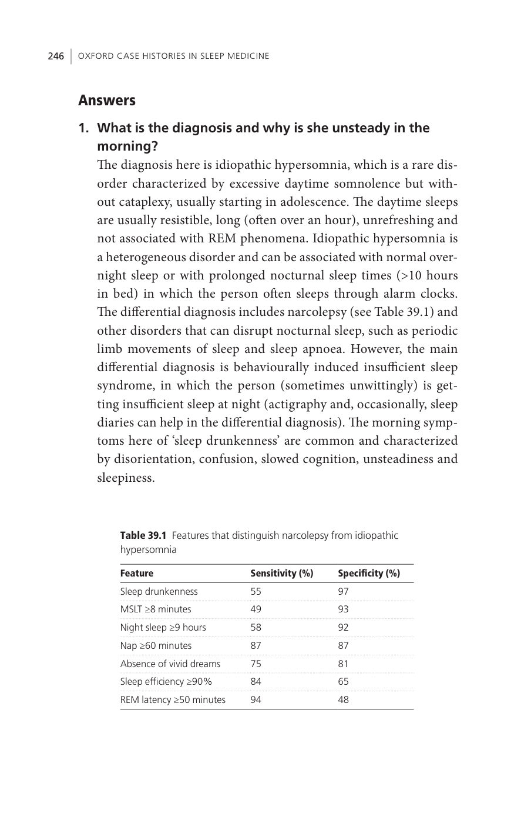

# Case 39 Just sleepy all the time

<!-- pdf-page: 258 -->

A 47-year-old woman presented with EDS. She is only awake for about 4–6 hours a day; the rest of the time she spends in bed sleeping. She can date her sleepiness back to her twenties, but is unaware of any precipitating event. Her sleepiness worsened over a few years but has remained much unchanged over the last 20 years. She describes an urge to sleep for most of the day. However, she has not fallen asleep in strange situations and is able to remain awake when required. She has an ESS score of 20/24. She goes to bed at 8 p.m. and sleeps through to 10–11 a.m. She will sleep through alarm clocks and has in the past used three or four alarm clocks to wake her. Apparently, she sleeps like a ‘log’ and there is no history of leg movements or snoring. When she gets up, she feels quite unsteady and muzzy-headed, and has fallen on occasions. She will fall asleep during the day sometimes for hours, and on waking she will feel unrefreshed. She does not recall any dreams. There is no history of hypnogogic or hypnopompic hallucinations or sleep paralysis. There is no history of sudden weakness or head drops with laughter or strong emotion.

### Case 39

### Just sleepy all the time

She was diagnosed with depression in the past, and has been treated with a variety of antidepressants without any benefit.

She has one daughter aged 28 years old who is well, but she is a long sleeper, usually requiring 10–12 hours sleep at night.

1 What is the diagnosis and why is she unsteady in the morning?

Neurological examination was unremarkable.

#### Questions

2 What would you expect PSG and multiple sleep latency tests to show?

3 What would be the appropriate treatments?

<!-- pdf-page: 259 -->

#### Answers

#### 1. What is the diagnosis and why is she unsteady in the

#### morning?

The diagnosis here is idiopathic hypersomnia, which is a rare disorder characterized by excessive daytime somnolence but without cataplexy, usually starting in adolescence. The daytime sleeps are usually resistible, long (often over an hour), unrefreshing and not associated with REM phenomena. Idiopathic hypersomnia is a heterogeneous disorder and can be associated with normal overnight sleep or with prolonged nocturnal sleep times (>10 hours in bed) in which the person often sleeps through alarm clocks. The differential diagnosis includes narcolepsy (see Table 39.1) and other disorders that can disrupt nocturnal sleep, such as periodic limb movements of sleep and sleep apnoea. However, the main differential diagnosis is behaviourally induced insufficient sleep syndrome, in which the person (sometimes unwittingly) is getting insufficient sleep at night (actigraphy and, occasionally, sleep diaries can help in the differential diagnosis). The morning symptoms here of ‘sleep drunkenness’ are common and characterized by disorientation, confusion, slowed cognition, unsteadiness and sleepiness.

Table 39.1 Features that distinguish narcolepsy from idiopathic

hypersomnia

Feature Sensitivity (%) Specificity (%)

Sleep drunkenness 55 97

MSLT ≥8 minutes 49 93

Night sleep ≥9 hours 58 92

Nap ≥60 minutes 87 87

Absence of vivid dreams 75 81

Sleep efficiency ≥90% 84 65

REM latency ≥50 minutes 94 48

<!-- pdf-page: 260 -->

Case 39 247

#### 2. What would you expect PSG and multiple sleep latency

#### tests to show?

The PSG often shows shortened sleep latency, increased TST (often increased deep sleep) and normal REM sleep onset. The multiple sleep latency test demonstrates fewer than two sleep onset REMs. The latency is variable, and those with prolonged nocturnal sleep may in many cases be within normal limits. However, in those with a normal sleep time, many would require a latency of less than 8 minutes to be necessary for diagnosis. Actinography in those with prolonged sleep shows >10 hours sleep per day.

CSF hypocretin (orexin) tends not to be useful for diagnosis, as it is usually low or normal.

#### 3. What would be the appropriate treatments?

Stimulants are helpful and are similar to those used in narcolepsy (e.g. modafinil, dexamfetamine and methylphenidate). Caffeine can also be helpful and many patients describe that a morning coffee helps with the sleep drunkenness. In those with long sleep times and difficulty getting up in the morning, modafinil at bedtime can be helpful.

Idiopathic hypersomnia is a rare cause of marked daytime sleepiness,

#### Learning points

It can be difficult to distinguish from narcolepsy, but PSG can help.

but other common causes should be excluded first.

Anderson KN, Pilsworth S, Sharples LD, Smith IE, Shneerson JM. Idiopathic hyper­

Stimulants can help to reduce daytime sleepiness.

#### Further reading

somnia: a study of 77 cases. Sleep 2007 Oct;30(10):1274–81.
