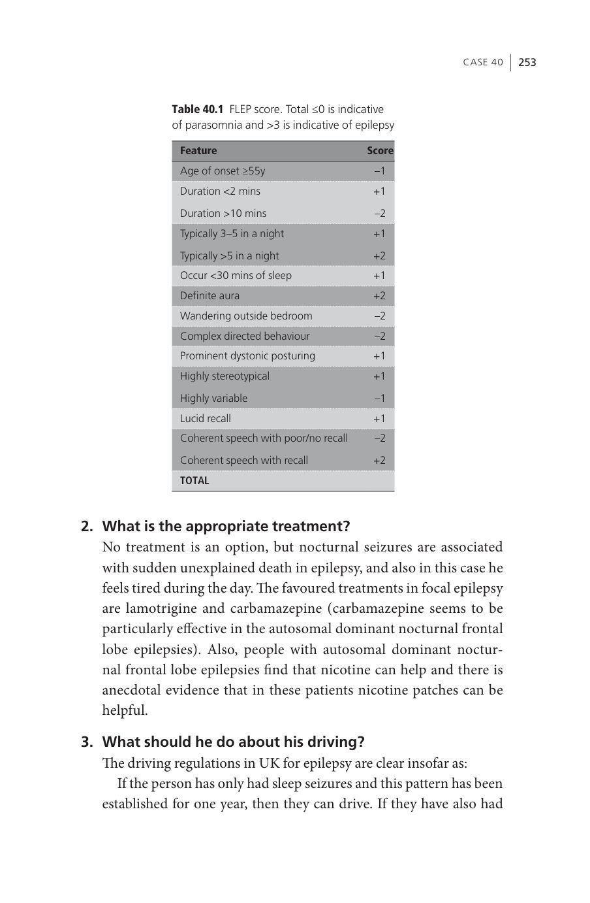

# Case 40 Moving and thrashing around during sleep

<!-- pdf-page: 262 -->

### Case 40

### Moving and thrashing around

### during sleep

A 32-year-old man presented with restless and broken sleep since around the age of 16 years. His mother mentioned that he has always been active in his sleep, moving about and thrashing around. There is also a possible history of some sleepwalking in his teens, although this no longer occurs. He usually goes to bed around 11 p.m.–12.30 a.m. at night, and gets up at 6.30 a.m. during the week and at 7.30 a.m. at weekends.

He does not feel refreshed. He is aware of waking a couple of times at night. His wife reports that he is restless in his sleep and there may be some kicking movements. There is also a history of mild snoring, but his wife also noted that there were episodes of heavy breathing rather than snoring and this appears in episodes during the night but not every night.

Although he is tired during the day, his ESS score was only 8/24. He keeps active during the day to avoid falling asleep. If he does permit himself to take a nap, usually for 20–30 minutes, he feels more refreshed.

There is no history of any sleep paralysis or any visual hallucinations. There is no history of any cataplexy, but sometimes when he is very tired he feels his muscles are weak, and when he laughs a lot his legs feel weak. There is no antecedent history of note. His father had a history of depression and insomnia, but there was no other history of note.

He lives with his wife. He works as a van driver and he takes a nap prior to driving if he has to travel long distances. He does not smoke or drink alcohol. He had been investigated with an MRI and a daytime EEG, which were normal.

<!-- pdf-page: 263 -->

In view of his sleepiness, he was admitted for PSG and a multiple sleep latency test. During the PSG, he was noted to have eight stereotypical events arising from both light and deep sleep in which he suddenly appears to rouse, and then both arms stiffen and he makes cycling movements with his legs for about 10 seconds. The EEG during these events is obscured by artefact. Otherwise, the EEG only shows some bursts of non-specific slow waves over the frontal regions. The multiple sleep latency test revealed a mean sleep latency of 12 minutes with no sleep onset REM.

<!-- pdf-page: 264 -->

Case 40 251

#### Questions

1 What is the likely diagnosis here?

2 What is the appropriate treatment?

3 What should he do about his driving?

<!-- pdf-page: 265 -->

#### Answers

#### 1. What is the likely diagnosis here?

The most likely diagnosis of stereotypical, brief events occurring many times at night during both light and deep sleep (but rarely from REM sleep) is nocturnal epilepsy. Approximately 20% of people with epilepsy have predominantly nocturnal seizures and 6% have exclusively nocturnal seizures. Sudden drug withdrawal or frequent seizures increase the risk of daytime seizures. Nocturnal tonic–clonic seizures are usually easy to diagnose in those who share a bed, but can be difficult in those who sleep alone; clues may include nocturnal incontinence (also caused by enuresis), tongue biting (also caused by facio-mandibular myoclonus), muscle aches and morning headaches. The other common nocturnal seizures are nocturnal frontal lobe seizures. Nocturnal frontal lobe seizures can manifest as (i) paroxysmal arousals, which consist of brief, sudden eye opening, head raising or sitting up in bed, a frightened expression and, sometimes, vocalization or nocturnal paroxysmal dystonia, which involves dystonic posturing, and (ii) hypermotor phenomena such as kicking, running or cycling movements of the legs. Episodic nocturnal wanderings have also been described, but in many cases these may be a parasomnia precipitated by the seizure. Daytime interictal EEG shows epileptiform abnormalities in up to one-third of cases; this increases to 50% with nocturnal EEGs. Ictal EEG is often unhelpful, as it is often obscured by artefact.

It is essential to distinguish epilepsy from non-REM parasomnia and REM behavioural disorder, and the frontal lobe epilepsy and parasomnias (FLEP) scale can be helpful (see Table 40.1).

In cases where there is doubt about the diagnosis, video-EEG telemetry is necessary. On occasions, people may be unaware of the seizures and present solely with daytime somnolence. On occasions, nocturnal frontal lobe epilepsy can be inherited as an autosomal dominant condition and has been associated with mutation in the nicotinic acetylcholine receptor.

<!-- pdf-page: 266 -->

Case 40 253

Table 40.1 FLEP score. Total ≤0 is indicative

of parasomnia and >3 is indicative of epilepsy

Feature Score

Age of onset ≥55y –1

No treatment is an option, but nocturnal seizures are associated with sudden unexplained death in epilepsy, and also in this case he feels tired during the day. The favoured treatments in focal epilepsy are lamotrigine and carbamazepine (carbamazepine seems to be particularly effective in the autosomal dominant nocturnal frontal lobe epilepsies). Also, people with autosomal dominant nocturnal frontal lobe epilepsies find that nicotine can help and there is anecdotal evidence that in these patients nicotine patches can be helpful.

Duration <2 mins

Duration >10 mins

Typically 3–5 in a night

Typically >5 in a night

Occur <30 mins of sleep +1

Definite aura +2

Wandering outside bedroom –2

Complex directed behaviour –2

Prominent dystonic posturing +1

Highly stereotypical

Highly variable

Lucid recall +1

Coherent speech with poor/no recall

Coherent speech with recall

TOTAL

#### 2. What is the appropriate treatment?

+1

–2

+1

+2

+1

–1

–2

+2

The driving regulations in UK for epilepsy are clear insofar as:

#### 3. What should he do about his driving?

If the person has only had sleep seizures and this pattern has been established for one year, then they can drive. If they have also had

<!-- pdf-page: 267 -->

seizures when awake, then they can drive once the pattern of solely sleep seizures has been established for three years.

Therefore, in this case, the seizures (which have been present for many years) will not prevent the patient from driving. He will, however, have to inform the DVLA. The rules about sleepiness are less clear and people should not drive if they are sleepy.

Sleep disruption due to nocturnal epilepsy should be distinguished

#### Learning points

from REM behavioural disorders and non-REM parasomnias.

The FLEP scale can help to distinguish between the two conditions.

Derry CP, Davey M, Johns M, Kron K, Glencross D, Marini C, Scheffer IE, Berkovic SF.

#### Further reading

Distinguishing sleep disorders from seizures: diagnosing bumps in the night. Arch Neurol 2006;63(5):705–9. Provini F, Plazzi G, Tinuper P, Vandi S, Lugaresi E, Montagna P. Nocturnal frontal

lobe epilepsy. A clinical and polygraphic overview of 100 consecutive cases. Brain 1999;122 (Pt6):1017–31.
