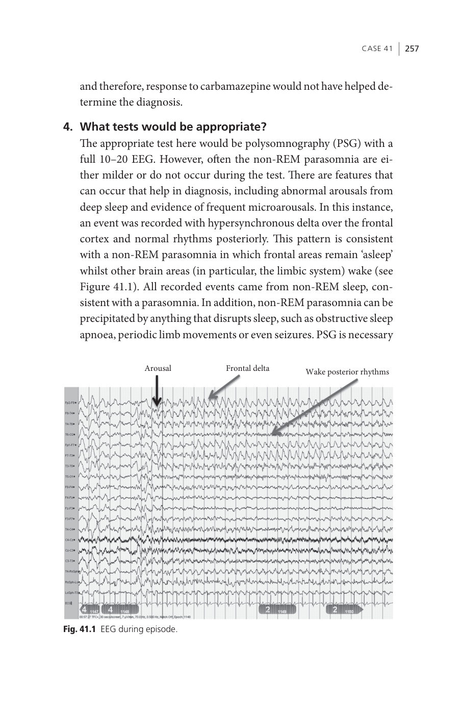
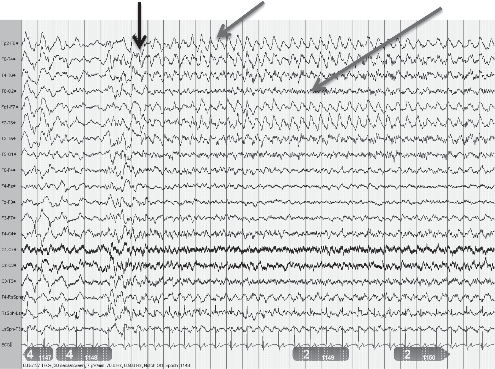

# Case 41 Panic attacks during sleep

<!-- pdf-page: 268 -->

A 50-year-old man presented with nocturnal events going back at least to the age of 19 years. They were now occurring two to three times per month. His wife had witnessed quite a number of these events. The events had some stereotypical features; whilst sleeping, he would suddenly sit up on the bed and shout, ‘No, no, no’. He would look very panicky and frightened, and appeared confused. He would then walk around the room, get back into bed and go back to sleep within about ten minutes. The events occurred sometimes up to four times at night, but usually once or twice. They did not have any particular temporal pattern during the night, but occurred at least an hour after sleep. There was no family history of note and the neurological examination was normal.

### Case 41

### Panic attacks during sleep

These episodes had been diagnosed as seizures because of their stereotypy and he was prescribed carbamazepine, which he took, but it had no beneficial effect and made him drowsy, so he stopped the medication.

1 What is the differential diagnosis for these events?

#### Questions

2 How does the temporal pattern and number of events help?

3 If the events had improved with carbamazepine, would this have

helped the diagnosis?

4 What tests would be appropriate?

<!-- pdf-page: 269 -->

#### Answers

#### 1. What is the differential diagnosis for these events?

The differential diagnosis lies between a parasomnia and epilepsy. REM behavioural disorders are usually characterized by rapid movements (dream enactment), eyes shut and not leaving the bed. These are therefore unlikely to represent REM behavioural disorders, and are either seizures or a non-REM parasomnia. Both are characterized by panic, tachycardia, a fearful expression and confusion.

#### 2. How does the temporal pattern and number of events

#### help?

The temporal pattern can help enormously in the differential diagnosis, as seizures occur throughout the night in both light and deep sleep, whilst non-REM parasomnia tend to occur in the first third of the night and usually occur after one to two hours of sleep (the first deep-sleep period). REM behavioural disorders tend to occur towards the morning during the longer REM periods. However, in people with disrupted sleep architecture these patterns can vary, as in this case in which there was no particular temporal pattern other than occurring more than one hour after sleep. The number of events can also help, as people with seizures tend to have multiple events at night, whilst those with non-REM parasomnia typically have one to two events at night. However, partners may only report those events which occur when they are awake and there may therefore be incomplete reporting of seizures.

#### 3. If the events had improved with carbamazepine, would

#### this have helped the diagnosis?

Non-REM parasomnia can be effectively treated with long-acting benzodiazepines such as clonazepam. Antidepressants have also been reported to be effective. There is a wide range of drugs that have also been reported to have some effect, including antiepileptic drugs. Topiramate has been described as being particularly efficacious in people who sleep-eat as their non-REM parasomnia. Carbamazepine can occasionally reduce the number of non-REM parasomnias,

<!-- pdf-page: 270 -->

Case 41 257

and therefore, response to carbamazepine would not have helped determine the diagnosis.

#### 4. What tests would be appropriate?

The appropriate test here would be polysomnography (PSG) with a full 10–20 EEG. However, often the non-REM parasomnia are either milder or do not occur during the test. There are features that can occur that help in diagnosis, including abnormal arousals from deep sleep and evidence of frequent microarousals. In this instance, an event was recorded with hypersynchronous delta over the frontal cortex and normal rhythms posteriorly. This pattern is consistent with a non-REM parasomnia in which frontal areas remain ‘asleep’ whilst other brain areas (in particular, the limbic system) wake (see

Figure 41.1). All recorded events came from non-REM sleep, con­

sistent with a parasomnia. In addition, non-REM parasomnia can be precipitated by anything that disrupts sleep, such as obstructive sleep apnoea, periodic limb movements or even seizures. PSG is necessary

Arousal Frontal delta Wake posterior rhythms

Fig. 41.1 EEG during episode.

<!-- pdf-page: 271 -->

to identify these, and treatment of these conditions can lead to a resolution of the non-REM parasomnia.

#### Learning points

Apparent panic attacks during sleep can be due to nocturnal epilepsy or

In non-REM parasomnia, the frontal brain area sleeps whilst the limbic

non-REM parasomnia.

Derry CP, Harvey AS, Walker MC, Duncan JS, Berkovic SF. NREM arousal parasom­

system wakes.

It can be treated with long-acting benzodiazepines.

#### Further reading

nias and their distinction from nocturnal frontal lobe epilepsy: a video EEG analysis. Sleep 2009;32(12):1637–44.
