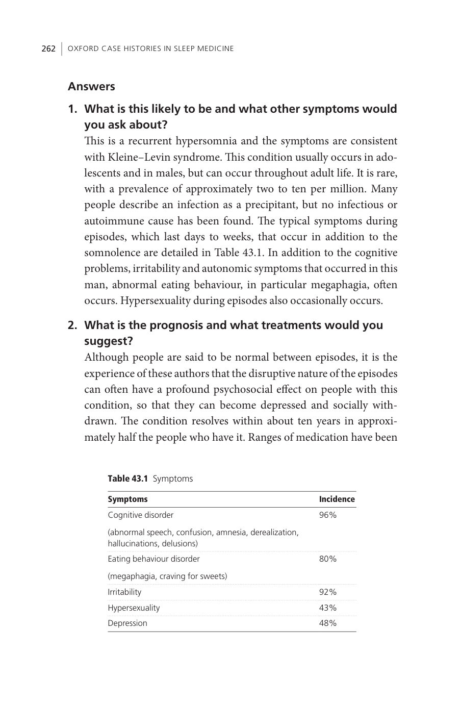

# Case 43 Confused, irritable and sleepy young man

<!-- pdf-page: 274 -->

### Case 43

### Confused, irritable and sleepy

### young man

A 19-year-old man presented with a two-year history of episodes of sleepiness. Every one to two months, he would have episodes when he would sleep most of the time and when he was awake, he would be confused and his parents described that his personality would change. He would become quite irritable, and when awake, he would look ‘as if he was on drugs’—he would be sweaty, jittery, restless and somewhat incoherent. These episodes would last a matter of days up to two weeks. Afterwards, his sleep pattern would normalize but he would be quite despondent. Because of these episodes, he had missed a significant amount of school time and so he had left school without completing his A-level examinations. He had become quite depressed and socially withdrawn. There was no family history of any note. He was otherwise well, and there were no obvious precipitants for these events.

Neurological examination was normal. He had had an MRI brain scan which was normal and he had an EEG during these episodes, as it had been thought that they may represent a form of non-convulsive status epilepticus. The EEG just demonstrated sleep episodes and some non-specific slow over the temporal regions.

1 What is this likely to be and what other symptoms would you ask

#### Questions

2 What is the prognosis and what treatments would you suggest?

about?

<!-- pdf-page: 275 -->

#### Answers

#### 1. What is this likely to be and what other symptoms would

#### you ask about?

This is a recurrent hypersomnia and the symptoms are consistent with Kleine–Levin syndrome. This condition usually occurs in adolescents and in males, but can occur throughout adult life. It is rare, with a prevalence of approximately two to ten per million. Many people describe an infection as a precipitant, but no infectious or autoimmune cause has been found. The typical symptoms during episodes, which last days to weeks, that occur in addition to the somnolence are detailed in Table 43.1. In addition to the cognitive problems, irritability and autonomic symptoms that occurred in this man, abnormal eating behaviour, in particular megaphagia, often occurs. Hypersexuality during episodes also occasionally occurs.

#### 2. What is the prognosis and what treatments would you

#### suggest?

Although people are said to be normal between episodes, it is the experience of these authors that the disruptive nature of the episodes can often have a profound psychosocial effect on people with this condition, so that they can become depressed and socially withdrawn. The condition resolves within about ten years in approximately half the people who have it. Ranges of medication have been

Symptoms Incidence

Table 43.1 Symptoms

Cognitive disorder

(abnormal speech, confusion, amnesia, derealization, hallucinations, delusions)

Eating behaviour disorder

(megaphagia, craving for sweets)

Irritability 92%

Hypersexuality 43%

Depression 48%

96%

80%

<!-- pdf-page: 276 -->

Case 43 263

used to prevent attacks including lithium, antiepileptic drugs and antidepressants. Treatment with stimulants during the episodes can be helpful, but are often poorly tolerated.

Episodes of sleepiness, associated with cognitive problems, and irrit­

#### Learning points

ability in a young person can be due to a rare disorder called Kleine– Levin syndrome.

It either resolves spontaneously or can be controlled with medications.

Arnulf I, Rico TJ, Mignot E. Diagnosis, disease course, and management of patients

#### Further reading

with Kleine–Levin syndrome. Lancet Neurol 2012 Oct;11(10):918–28. Arnulf I, Zeitzer JM, File J, Farber N, Mignot E. Kleine–Levin syndrome: a systematic

review of 186 cases in the literature. Brain 2005;128(Pt 12):2763–76.
