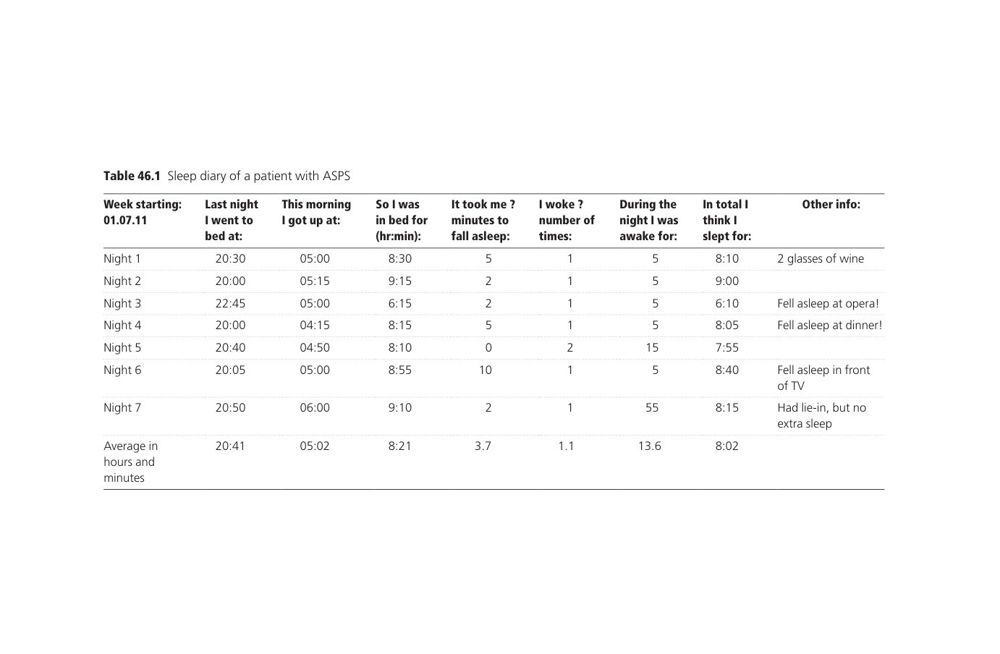

# Case 46 I keep falling asleep at family dinners

<!-- pdf-page: 284 -->

### Case 46

### I keep falling asleep at family

### dinners

Mr D is a retired civil servant with acquired retinal blindness who presented to the insomnia clinic with a complaint of waking too early in the morning. He was waking at around 4 a.m. every day and, while this in itself was not troubling him, the early start meant he was feeling sleepy early in the evenings. He would often nod off at family dinners and would generally be in bed asleep by 9 p.m. at the latest. He found this extremely frustrating while he was working, but it did not interfere with his occupational functioning. However, when he retired he resolved to indulge his passion for theatre and opera, but he kept falling asleep in the theatres and missing the performances. This motivated him to address the issue.

Mr D said he had always been an early riser and did his best work in the morning. He had always gone to bed earlier than his wife, but his cycle had gradually shifted forward as he got older. When he woke at 4 a.m.–5 a.m. he would immediately feel alert and be unable to go back to sleep no matter how long he stayed in bed. He therefore usually got up immediately on waking in the morning. He generally felt well and alert throughout the day, but started to feel sleepy at around 7 p.m.

#### Questions

1 What is the most likely diagnosis?

2 How would you confirm the diagnosis?

3 How would you treat this?

<!-- pdf-page: 285 -->

#### Answers

#### 1. What is the most likely diagnosis?

Mr D is most likely suffering from an advanced sleep phase syndrome (ASPS). His circadian rhythm is 24 hours long, but his body clock is advanced relative to the outside world. ASPS is the opposite of a delayed sleep phase syndrome (DSPS) and is less common. It may be under-reported to some extent, as it causes less occupational dysfunction. Whereas DSPS patients have difficulty getting up in time for work, are often sleepy deprived and are very sleep in the mornings, ASPS patients are able to get to work on time and, as they are usually able to go to bed early in the evening, are less likely to be sleep deprived. Furthermore, society tends to approve of this ‘early to bed, early to rise’ lifestyle, but late to bed and late to rise is discouraged. However, the difficulty in staying awake in the evenings does have a negative impact on the patient, particularly with regard to their social life.

The diagnosis of ASPS is generally made on history and investigations rarely add much value. A sleep diary is often helpful in terms of getting a longitudinal picture of the sleep cycle. Patients will often describe either their most recent night or their worst night, and so having a couple of weeks of a sleep diary allows you to get a fuller picture. It will also allow you to see if the sleep complaint is constant, how much night-to-night variability there is and how often the patient is using medication, alcohol, etc. to manage their condition.

#### 2. How would you confirm the diagnosis?

If objective evidence of their sleep pattern is required, one can perform actigraphy. The patient wears an actigraph (a wristwatchlike apparatus with a small accelerometer) on their wrist, usually for one to three weeks. The actigraph measures their movement and this information can be used to determine when the person is awake and asleep. In ASPS one would expect to see early sleep onset and early awakening.

<!-- pdf-page: 286 -->

Case 46 273

One can also perform an objective measure of the patient’s melatonin rhythm with a dim light melatonin onset (DLMO) test. In this test the patient provides serial saliva samples whilst in a dimly lit room and these samples are then analysed to determine the melatonin level. In a normal subject one would expect to see a fairly abrupt rise in melatonin levels around 9 p.m. In patients with ASPS this would occur earlier, while in patients with DSPS it would occur later. In fact, the DLMO test is very rarely done in clinical settings and is largely used as a research tool. However, it can be useful for determining the optimum timing of melatonin and light treatment, as well as in cases where there is a suspicion that the shift in sleep cycle may be due to lifestyle factors rather than a circadian rhythm disorder.

Mr D kept a sleep diary for two weeks, and the second week is reproduced in Table 46.1

The diary confirmed a consistent early sleep onset time and wake time. As you can see, he also fell asleep before going to bed on three nights, including at the dinner table during a family birthday celebration.

The strongest evidence base for the treatment of ASPS is using bright light in the evening to delay the person’s sleep phase. This should ideally be coupled with avoidance of light in the early part of the morning. However, positive studies have typically used high doses for extended periods and compliance with this regime can be difficult. Use of natural daylight when possible is preferred; otherwise a seasonal affective disorder (SAD) lamp can be used. Obviously, in Mr D’s case, light is not going to be helpful, as he is completely blind.

#### 3. How would you treat this?

Taking melatonin in the second half of the sleep period, or immediately on waking, would in theory delay the patient’s phase. However, there is no trial data to support this practice. The other factor to consider is that melatonin, in addition to having a circadian rhythm shifting effect, is also mildly sedative. There are therefore legitimate concerns that taking melatonin in the second half of the night might

<!-- pdf-page: 287 -->

Night 4 20:00 04:15 8:15 5 1 5 8:05 Fell asleep at dinner!

Night 3 22:45 05:00 6:15 2 1 5 6:10 Fell asleep at opera!

Night 6 20:05 05:00 8:55 10 1 5 8:40 Fell asleep in front

Night 7 20:50 06:00 9:10 2 1 55 8:15 Had lie-in, but no

Night 1 20:30 05:00 8:30 5 1 5 8:10 2 glasses of wine

Other info:

extra sleep

of TV

In total I

slept for:

think I

Night 2 20:00 05:15 9:15 2 1 5 9:00

Night 5 20:40 04:50 8:10 0 2 15 7:55

20:41 05:02 8:21 3.7 1.1 13.6 8:02

night I was

During the

awake for:

number of

I woke ?

times:

It took me ?

minutes to

fall asleep:

in bed for

I got up at: So I was

(hr:min):

This morning

Table 46.1 Sleep diary of a patient with ASPS

01.07.11 Last night

I went to

bed at:

Week starting:

Average in

hours and

minutes

<!-- pdf-page: 288 -->

Case 46 275

lead to excessive daytime sedation, particularly in drivers. Further, there is very little evidence regarding the efficacy of stimulants and hypnotics in these patients. Using a very short-acting hypnotic, such as zaleplon, on waking would probably extend the sleep period, but would not impact on the underlying circadian rhythm disorder. Stimulants in the evening to help patients stay awake have been used in individual patients with some success.

Our initial strategy with Mr D was to institute behavioural interventions. As we could not use light, we needed to find other wakefulness-promoting stimuli to try to keep him awake later in the evening. We therefore encouraged him to engage in physical exercise in the evening and he arranged for his family to take him for a brisk walk outdoors every evening before dinner. He found that this helped him stay awake during dinner and delayed his sleep onset, but only by about 30 minutes, and he was still waking up early in the morning. He had previously tried using caffeine to keep himself awake at night, but found it not particularly effective. However, it seemed to be slightly more effective when combined with the physical exercise.

Mr D decided that he would like to have a trial of melatonin and so we prescribed 2 mg slow-release melatonin (the only licensed preparation in the United Kingdom). He was concerned about the risk of daytime sedation and so he decided to cut the pills into quarters using a pill cutter. As you can see from his diary, he wakes at least once a night, usually to pass water, and the waking time was very consistent. He would generally wake between 2.30 and 3.00 a.m., and we felt this was a good time to take the melatonin.

He therefore woke, went to the toilet to pass water, took the melatonin and then went back to sleep almost immediately. Within a week his circadian rhythm shifted and he was falling asleep around 11.00 p.m., was still waking to pass water around 2.30–3.00 a.m. and was then sleeping through to 7.00 a.m. He was not experiencing any side effects from the medication and was much more alert in the evenings. The improvement was maintained at follow-up 1 year later.

<!-- pdf-page: 289 -->

#### Learning points

ASPS is probably an under-diagnosed condition, but one that can lead

to significant distress.

The first line of treatment for ASPS involves the use of bright light in

the evening to delay the circadian rhythm. However, this approach is often difficult for the patient to maintain due to the impracticality of getting long enough exposure to bright light in the evening every evening.

The use of melatonin in the morning to delay the circadian rhythm

is controversial due to the potentially sedative effects of melatonin, which may lead to daytime drowsiness.

Circadian rhythm disorders are common in people with impaired vi­

sion and one should be on the lookout for these disorders in the population.

Auger RR. Advance-related sleep complaints and advanced sleep phase disorder, Sleep

#### Further reading

Medicine Clinics 2009 Oct;4(2):219–27. Dodson ER, Zee PC. Therapeutics for circadian rhythm sleep disorders. Sleep Medi­

cine Clinics. 2010 Dec;5(4):701–15.
