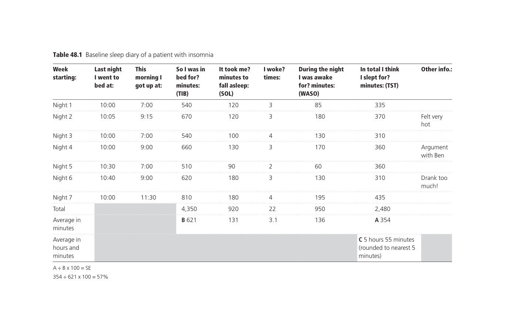
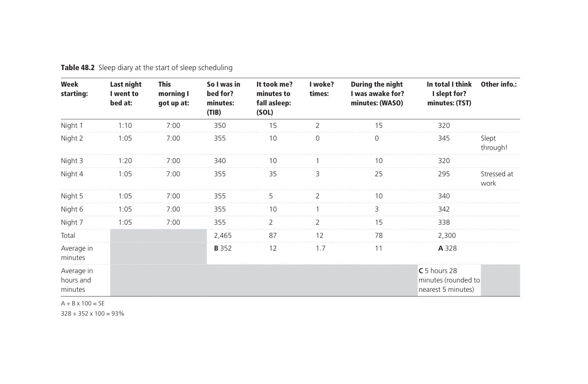
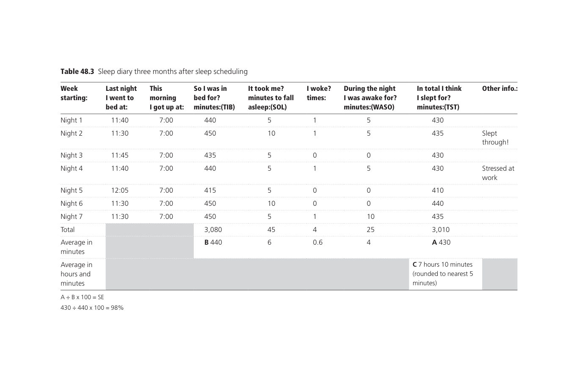

# Case 48 Spending too long in bed

<!-- pdf-page: 298 -->

Mrs C, a divorced mother of an 8-year-old girl, presented to the clinic with a 3-year history of insomnia. It started when she got divorced and returned to work as a tutor in a college. She felt that the stress of the divorce, the demands of her work and moving into a different neighbourhood raised her anxiety and led to progressively worse sleep over a period of some months. She reduced her work hours and her employers only scheduled afternoon and evening classes for her, thus reducing her work stress. She settled into her new neighbourhood and got used to her new lifestyle. Despite not having many external stresses, her sleep did not improve and, if anything, got worse.

### Case 48

### Spending too long in bed

She would go to bed at 11.00 p.m. every night and would take an hour or so to fall asleep. She frequently woke two to three hours later and would take 15 to 60 minutes to get back to sleep. She would have two to three further awakenings during the night and each time would be awake for about half an hour before getting back to sleep. Other than the first episode of sleep, she felt that what sleep she did get was light and broken—‘more dozing than sleeping’. She would wake to an alarm at 7.00 a.m. for three days a week when it was her turn to take her daughter to school. On the days her ex-husband took her daughter to school and on weekends, she would sleep in, waking spontaneously around 9.00. On Sundays when her daughter was at her ex-husband’s home she would frequently lie in until lunchtime, trying to catch up on lost sleep, though she spent much of this time awake or in a light doze.

Her poor sleep made her increasingly anxious and low, even though she felt most other things in her life were going well. Her GP suggested she start an antidepressant. Mrs C was reluctant to do this, as she felt her low mood was a result of her poor sleep and therefore felt the sleep

<!-- pdf-page: 299 -->

needed to be addressed in order for her to improve. Nevertheless, she agreed to try an antidepressant and was put on a succession of selective serotonin reuptake inhibitors and tricyclic antidepressants, without any benefit. She also tried over-the-counter antihistamines, which only worked for a few nights and made her feel drowsy during the day. Herbal remedies, lavender oil in her bath and an expensive new mattress did not improve her sleep.

In an attempt to get more sleep, she decided that she would reduce her evening work commitments further so she could go to bed earlier. She reasoned that this would give her more opportunity to sleep. She therefore started going to bed at 10.00 p.m., but found that she would often lie awake for two hours rather than one before falling asleep. If she did manage to fall asleep earlier, she found that her sleep was lighter and more fragmented than before. She felt that her sleep was therefore deteriorating and became increasingly anxious about it. This anxiety led to a further deterioration in both her sleep and her mood.

<!-- pdf-page: 300 -->

Case 48 287

#### Questions

1 Why did her sleep get worse rather than better when she spent

longer in bed?

2 What investigation would be most useful in this case?

3 What is her mean sleep onset latency (SOL), total sleep time

(TST), wakefulness after sleep onset (WASO) and sleep efficiency (SE)? How do these compare to normal values?

4 How do we calculate the threshold time and increase SE?

5 How do we adjust the sleep schedule over time?

<!-- pdf-page: 301 -->

#### Answers

#### 1. Why did her sleep get worse rather than better when

#### she spent longer in bed?

It is a common belief amongst insomnia sufferers that they need to give themselves more opportunity to sleep and that they should therefore spend as long as possible in bed. However, this is often a counterproductive strategy. They rarely get any more sleep than they did before and therefore the extra time in bed (TIB) is largely spent awake. This strengthens the association between the bed and wakefulness, and reinforces the belief that they are a poor sleeper. This leads to increased anxiety about sleep and they find themselves in a downward spiral.

During the day we gradually build up fatigue until we reach a threshold where the fatigue is sufficient to allow us to sleep through the night. Insomnia sufferers usually go to bed long before they have reached that threshold time. Hence they have to lie in bed awake until they reach the threshold time. Sometimes they will be able to fall asleep early, but as they have not yet built up enough fatigue to sleep through the night, they tend to wake up very early.

#### 2. What investigation would be most useful in this case?

Laboratory investigations such as polysomnograms are generally not indicated in insomnia unless there is a suspicion from the history that there is another comorbid sleep disorder. A good history is usually sufficient to make a diagnosis of insomnia as well as elucidating the underlying cause. However, a sleep diary is often very helpful. It allows you to look at more than one night and pick up patterns that are not always evident from the history. It also allows you to work out a number of important parameters such as TIB, TST, SOL, number of awakenings, WASO and SE. In patients who have excessive sleepiness, it allows you to determine whether they are giving themselves adequate sleep opportunity.

Mrs C kept a sleep diary for two weeks. The diary for the second week is shown in Table 48.1.

<!-- pdf-page: 302 -->

Other info.:

Night 4 10:00 9:00 660 130 3 170 360 Argument

Night 6 10:40 9:00 620 180 3 130 310 Drank too

with Ben

Night 2 10:05 9:15 670 120 3 180 370 Felt very

much!

hot

(rounded to nearest 5

C 5 hours 55 minutes

In total I think

minutes: (TST)

I slept for?

minutes B 621 131 3.1 136 A 354

Total 4,350 920 22 950 2,480

Night 1 10:00 7:00 540 120 3 85 335

Night 3 10:00 7:00 540 100 4 130 310

Night 5 10:30 7:00 510 90 2 60 360

Night 7 10:00 11:30 810 180 4 195 435

times: During the night

for? minutes:

I was awake

(WASO)

I woke?

It took me?

minutes to

fall asleep:

(SOL)

Table 48.1 Baseline sleep diary of a patient with insomnia

So I was in

minutes:

bed for?

(TIB)

morning I

got up at:

This

starting: Last night

I went to

bed at:

Average in

Average in

hours and

Week

minutes)

354 ÷ 621 x 100 = 57%

A ÷ B x 100 = SE

minutes

<!-- pdf-page: 303 -->

#### 3. What are her mean SOL, TST, WASO and SE? How do

#### these compare to normal values?

While there are no clear quantitative criteria for normal sleep, it is generally considered that an SOL of less than 30 minutes, a WASO of less than 30 minutes and an SE of above 85% are normal. Mrs C’s SOL is 131 minutes, and so she clearly has sleep initiation insomnia. Her WASO (the amount of time she is awake during the night, not counting the time it took her to fall asleep in the first place) is elevated at 136. She therefore has sleep maintenance insomnia as well. Her TST is 5 hours 55 minutes. There is no normal value for TST. Everyone has a different sleep need and the TST that is normal for each individual is the amount of sleep that person needs to feel well and alert most of the day on most days. SE is a measure of what proportion of the time one is in bed is actually spent asleep and this expressed as a percentage. Mrs C is in bed for an average of 621 minutes, but only 354 minutes are actually spent asleep. Therefore, her SE is 354/621 x 100 = 57%. This is low and indicates that she is spending an excessive amount of TIB awake. As she is spending 43% of the TIB awake, this pattern will strengthen her association between the bed and the insomnia. It will also increase the opportunity for her to have brief, light dozes, which will reduce the homeostatic drive for sleep, thus leading to light, broken sleep. We therefore want to ensure that she goes to bed close to the threshold time when she has built up adequate fatigue and had a strong homeostatic sleep drive, and we want to increase her SE so that she spends a minimum amount of TIB awake.

#### 4. How do we calculate the threshold time and increase SE?

The first step is to establish a set rising time for Mrs C. She should keep to this rising time 7 days a week, whether she has slept well or slept badly. It is far more important to keep a set rising time than a set bedtime. As Mrs C has to rise at 7.00 a.m. three days a week, we set this as her rising time. We then calculated her average TST (5 hours 55 minutes) and subtracted this from her rising time. This gave us a threshold time of 1.05 a.m. (Note: if the patient’s TST is less than five hours, we set the threshold time at five hours before the rising time.)

<!-- pdf-page: 304 -->

Other info.:

Night 4 1:05 7:00 355 35 3 25 295 Stressed at

through!

Night 2 1:05 7:00 355 10 0 0 345 Slept

work

minutes (rounded to

In total I think

nearest 5 minutes)

minutes: (TST)

I slept for?

C 5 hours 28

minutes B 352 12 1.7 11 A 328

Total 2,465 87 12 78 2,300

Night 1 1:10 7:00 350 15 2 15 320

Night 3 1:20 7:00 340 10 1 10 320

Night 5 1:05 7:00 355 5 2 10 340

Night 6 1:05 7:00 355 10 1 3 342

Night 7 1:05 7:00 355 2 2 15 338

times: During the night

I was awake for?

minutes: (WASO)

I woke?

It took me?

fall asleep:

minutes to

(SOL)

So I was in

minutes:

bed for?

Table 48.2 Sleep diary at the start of sleep scheduling

(TIB)

morning I

got up at:

This

starting: Last night

I went to

bed at:

Average in

Average in

hours and

minutes

Week

328 ÷ 352 x 100 = 93%

A ÷ B x 100 = SE

<!-- pdf-page: 305 -->

We then advised Mrs C that she should not go to bed until:

1. she had reached her threshold time; and
2. she was feeling sleepy.

This rapidly increased her SE. Because she was staying up much later, she was feeling very sleepy by the time she got into bed and therefore, with the exception of the first few nights when she was still feeling anxious about the reduced TIB, she fell asleep quickly. She also found that her sleep was deeper and her awakenings were fewer and briefer.

Her sleep diary on the second week after starting sleep scheduling is shown in Table 48.2. Note that, although her TST has dropped, she is falling asleep quickly and having very little wakefulness after sleep onset. Her SE is now excellent at 93%.

#### 5. How do we adjust the sleep schedule over time?

Mrs C continued to keep a sleep diary every week and calculated her SE at the end of each week. The SE she achieved each week determined the threshold time for the following week:

◆ If her sleep efficiency is less than 85%, she should move her thresh­

old time for the following week 15 minutes later (but not going below the five hours minimum).

◆ If her sleep efficiency is 85–89%, she should keep her threshold

◆ If her sleep efficiency was 90% or above, she should move her

time the same for the following week.

By keeping a sleep diary and making the relevant adjustments every week, Mrs C gradually increased her TIB and her TST, while maintaining a good SE. Her diary at three months is shown in Table 48.3. Her TST had increased to 7 hours 10 minutes and her SE was 98%. The improvement in sleep was reflected in improved daytime symptoms. Her mood was much improved and she stopped her antidepressant.

threshold time 15 minutes earlier.

She had the occasional bad night and the odd day when she felt tired and irritable, but was reassured that this is normal. This

<!-- pdf-page: 306 -->

Other info.:

Night 4 11:40 7:00 440 5 1 5 430 Stressed at

through!

Night 2 11:30 7:00 450 10 1 5 435 Slept

work

(rounded to nearest 5

C 7 hours 10 minutes

In total I think

minutes:(TST)

I slept for?

minutes B 440 6 0.6 4 A 430

Total 3,080 45 4 25 3,010

Night 1 11:40 7:00 440 5 1 5 430

Night 3 11:45 7:00 435 5 0 0 430

Night 5 12:05 7:00 415 5 0 0 410

Night 6 11:30 7:00 450 10 0 0 440

Night 7 11:30 7:00 450 5 1 10 435

minutes)

I was awake for?

times: During the night

minutes:(WASO)

I woke?

minutes to fall

asleep:(SOL)

It took me?

Table 48.3 Sleep diary three months after sleep scheduling

minutes:(TIB)

So I was in

bed for?

I got up at:

morning

This

starting: Last night

I went to

bed at:

Average in

Average in

hours and

minutes

Week

430 ÷ 440 x 100 = 98%

A ÷ B x 100 = SE

<!-- pdf-page: 307 -->

is not a minor point. When someone has been suffering from insomnia for a long time they will often come to believe that good sleepers sleep well every night and feel alert and refreshed all day every day. It is important to remind them that even the best sleepers have occasional bad nights and will have days, or periods during the day, when they feel tired. This ensures they have realistic expectations and also means they are less likely to panic if they have a bad night.

Once she had settled into her new sleep schedule she no longer felt the need to keep a diary and she felt much less anxious about her sleep. She still has a lie-in on some Sunday mornings and is aware that this may mean she will have slightly poorer sleep on Sunday night, but she is confident that her sleep will return to normal on Monday when she keeps to her 7.00 a.m. wake-up time.

What precipitates insomnia and what perpetuates it are not necessarily

#### Learning points

the same thing. Insomnia is often triggered by a defined stressor, but it often persists once the stressor has been removed. This is largely due to anxiety and dysfunctional sleep habits.

Most insomnia sufferers spend more TIB to give themselves more op­

portunity to sleep. This rarely works, as it simply extends the amount of wakefulness in bed and ultimately makes the insomnia worse.

Patients should be encouraged to rise at the same time every day. An­

choring the rising time is much more important than keeping a regular bedtime. In fact, keeping a regular bedtime can be counterproductive. Patients should only go to bed when sleepy. If they keep their rising time the same, they will naturally start to feel sleepy at the same time each evening.

Using a sleep diary to calculate the patient’s average TST one can work

out the threshold time (in practice the earliest bedtime) for the patient. They should not go to bed until they have reached their threshold time and are sleepy. As their sleep improves, their threshold can be moved forward.

<!-- pdf-page: 308 -->

Case 48 295

#### Further reading

Morin C, Espie C. Insomnia: a clinical guide to assessment and treatment. 2003;

Springer, New York. Perlis M et al. Cognitive behavioral treatment of insomnia: a session-by-session guide.

2005; Springer, New York.
