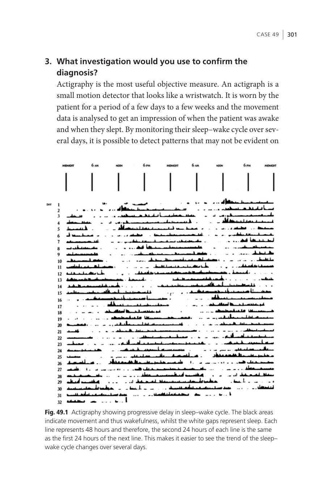
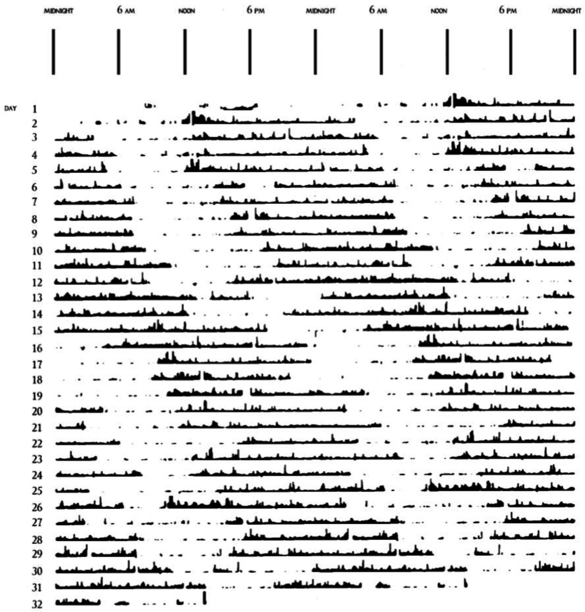

# Case 49 A sleep cycle that keeps moving

<!-- pdf-page: 310 -->

### Case 49

### A sleep cycle that keeps moving

Dr L is a 32-year-old musicologist who presented to the sleep clinic with a very chaotic sleep pattern. He would have periods of a week or two of sleeping reasonably well, followed by a week or two of having significant difficulty getting to sleep until the early hours of the morning. He also reported having nights where he would not sleep at all. If he slept well, he felt alert and well during the day. When his sleep was significantly delayed, or he did not get any sleep at all, he would be very sleepy during the day and would fall asleep on the train on his way to and from work, as well as at work. Some of these daytime naps could last for several hours if he was not disturbed and this made it even harder for him to fall asleep at night.

He had been sleeping in this pattern for most of his adult life. When he was a student his timetable was flexible enough that he was able to work around it, but since starting work as a lecturer his daytime commitments became more set and he found it extremely difficult to cope. As a result he went to the GP, who prescribed hypnotics. He found these helpful when he was going through a period of poor sleep, but still felt sleepier during the day than when he was having a period of good sleep.

On taking a full sleep history Dr L commented that his sleep cycle had evolved with time. When he was writing his PhD thesis he worked from home for a period of 6 months and had very few external commitments. During this time he noticed that his overall sleep time was better. However, he found that his sleep period would become progressively later each day. As a result, he would fall asleep later and wake up later each day and his sleep would gradually rotate around the clock. When he allowed his sleep cycle to drift around the clock in this manner he was reasonably alert during his wake period and able to concentrate on his

<!-- pdf-page: 311 -->

work. However, when he was going through periods of sleeping during the day and working through the night he felt socially quite isolated and his mood suffered as a result.

<!-- pdf-page: 312 -->

Case 49 299

#### Questions

1 What is the likely diagnosis?

2 Which group of patients are at high risk of non-24-hour sleep–

3 What investigation would you use to confirm the diagnosis?

wake syndrome?

4 How would you treat this?

<!-- pdf-page: 313 -->

#### Answers

#### 1. What is the likely diagnosis?

Dr L is suffering from a non-24-hour sleep–wake syndrome. The human circadian clock has an inherent rhythm which is slightly longer than 24 hours. In most people this clock is entrained by external cues called zeitgebers, which keep it in synchrony with the outside world. The most powerful zeitgeber is light. Ganglion cells in the eyes are sensitive to light in the blue–green part of the spectrum. When they are stimulated by light they inhibit the secretion of melatonin and this acts as a signal to the body that it is daytime. When it gets dark and the ganglion cells are no longer stimulated, the inhibition of the melatonin is removed and melatonin levels rapidly rise, telling the body it is night. In non-24-hour sleep–wake syndrome the internal clock is not adequately entrained by external zeitgebers and so the person’s internal clock runs on its own schedule. As the clock’s inherent cycle is longer than 24 hours, the person’s daily cycle is progressively delayed and their sleep period gets later each day. Therefore, their sleep–wake cycle rotates around the clock.

It is important to note that the diagnosis was not immediately obvious from the presenting history. The progressive delay in his sleep period only came to light when he told us about his PhD days when he had no external pressures influencing his sleep times. It is also difficult to discern what a person’s circadian rhythm is doing when they are taking hypnotics. It is therefore vital to ask patients about a time when they were not taking medication and did not have external time limitations, such as a holiday or period of unemployment.

#### 2. Which group of patients are at high risk of non-24-hour

#### sleep–wake syndrome?

Patients who are blind, particularly where the blindness is retinal in origin, have a high rate of non-24-hour sleep–wake syndrome. As they are unable to entrain to external light, it is very difficult for them to maintain a circadian rhythm that is synchronized with the outside world.

<!-- pdf-page: 314 -->

Case 49 301

#### 3. What investigation would you use to confirm the

#### diagnosis?

Actigraphy is the most useful objective measure. An actigraph is a small motion detector that looks like a wristwatch. It is worn by the patient for a period of a few days to a few weeks and the movement data is analysed to get an impression of when the patient was awake and when they slept. By monitoring their sleep–wake cycle over several days, it is possible to detect patterns that may not be evident on

Fig. 49.1 Actigraphy showing progressive delay in sleep–wake cycle. The black areas

indicate movement and thus wakefulness, whilst the white gaps represent sleep. Each line represents 48 hours and therefore, the second 24 hours of each line is the same as the first 24 hours of the next line. This makes it easier to see the trend of the sleep– wake cycle changes over several days.

<!-- pdf-page: 315 -->

history. The data is presented in both numerical and visual form, making it easy to see how the sleep–wake cycle evolves over time.

The patient’s actigraph is shown in Figure 49.1. The black spikes indicate movement and therefore wakefulness, whilst the white areas with little or no movement activity represent sleep. You can see a clear trend towards progressive delay of the sleep period, thus confirming the diagnosis of a non-24-hour sleep–wake syndrome.

Treatment of non-24-hour sleep–wake syndrome involves using melatonin and, where possible, light to stabilize the circadian rhythm. As the trend is for the sleep–wake cycle to be progressively delayed, the melatonin and light need to be timed in such a way as to counter this delay, i.e. they should advance the cycle. If the regime is successfully implemented, the body’s tendency to delay the cycle will be balanced by the treatment’s tendency to advance it.

#### 4. How would you treat this?

The timing of the melatonin and light is essential for successful treatment. For example, if the melatonin is given too late it will not pull the patient’s cycle forward and their natural propensity to drift later will not be adequately opposed. If the melatonin is taken too early it may in fact fall at a point in their cycle where it is ineffective or even accelerates their phase delay, thus pulling their circadian rhythm in the wrong direction. The timing of melatonin is particularly crucial in blind patients, as they cannot use light and so they have only one treatment available to them.

It is also important to note that not all light is equally effective in influencing circadian rhythms—it is particularly light in the blue– green part of the spectrum. The ideal light to use is natural daylight, but obviously this is not always practical. Therefore, patients usually use a SAD lamp. These lights are designed to be particularly intense in the blue–green wavelengths. Patients do not have to stare at the light, but the light should be placed directly in front of the patient and should be reasonably close to them. They can read, watch the TV behind the light, etc. In most applications it is advised that the

<!-- pdf-page: 316 -->

Case 49 303

patient use it for 30–60 minutes depending on the intensity of the light and their individual response to it.

We allowed Dr L’s cycle to rotate until he was falling asleep and waking up at the desired time. When he was falling asleep at 11.00 p.m. and waking at 7.00 a.m. he started taking melatonin in the late afternoon and used bright light for an hour immediately on waking. This held his cycle stable for long periods of time and his daytime symptoms improved significantly. Ten months after starting treatment he had a month’s holiday and decided to stop the melatonin and light to see what would happen. He very rapidly returned to his non-24-hour sleep–wake cycle, but on restarting the treatment he was able to reinstate an entrained circadian rhythm. He experienced some mild headaches from time to time in the mornings, which could have been a side effect of either the melatonin or the light, but otherwise reported no side effects.

Non-24-hour sleep–wake syndrome is characterized by a circadian

#### Learning points

rhythm that is progressively delayed, leading to the sleep period getting later and later, ultimately rotating around the clock.

It is particularly common in blind patients and should always be

Treatment involves stabilizing the circadian rhythm with carefully

screened for in this population.

Where daylight is not an option, a SAD light can be used.

timed melatonin and, if possible, daylight.

Circadian rhythm disorders can be masked by hypnotics, lifestyle and

work pressures, and so it is important to enquire about periods of time when these were not impinging on the patient’s natural sleep cycle.

Ancoli-Israel S et al. The role of actigraphy in the study of sleep and circadian rhythms.

#### Further reading

Sleep 2003 May;26(3):342–92. Uchiyama M, Lockley SW. Non-24-hour sleep–wake syndrome in sighted and blind

patients. Sleep Med Clin 2009 Jun;4(2):195–211.
