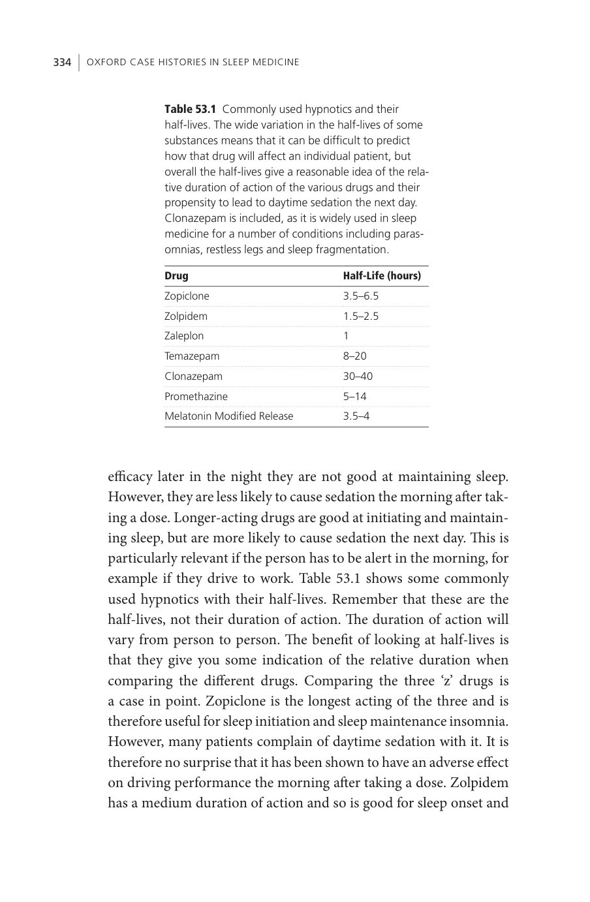

# Case 53 Choosing and using hypnotics

<!-- pdf-page: 342 -->

### Case 53

### Choosing and using hypnotics

Mrs P was a 44-year-old married mother of two teenage boys. She worked as a head teacher and her job frequently involved both early mornings and late nights. She had been a poor sleeper for as long as she could remember, but her sleep had been particularly bad for a period of three years. She went to bed feeling exhausted, but would take one to two hours to fall asleep. Once asleep she would sleep through on some nights, but on other nights would wake up after about an hour and a half and would take 30 to 90 minutes to get back to sleep. This gave her a total sleep time of four to six hours, leaving her severely fatigued, tearful and irritable during the day.

She had used basic sleep hygiene techniques and a number of alternative remedies such as valerian, hops, lavender, hypnosis CDs, hypnotherapy, homoeopathy and acupuncture. She had spent a small fortune on an expensive mattress and pillows, high-quality sheets, blackout blinds and a white noise machine. Some of these remedies would work for a few nights, which would raise her hopes, but this made it all the more devastating when they lost their effectiveness.

With her tearfulness and irritability the GP felt that she may have depression, though Mrs P disputed this. She felt her low mood was entirely secondary to the poor sleep. On the rare nights when she did sleep well her mood was noticeably better the day after. Nevertheless, she agreed to a trial of antidepressants and the GP gave her citalopram. She persisted with this for three months, but found that, if anything, it made her sleep even worse and had no impact on her mood. The GP then switched her to clomipramine, which is a sedative antidepressant. This did improve her sleep to a small extent, but she suffered significant drowsiness during the day and so asked to be taken off the medication.

<!-- pdf-page: 343 -->

#### Questions

1 Are antidepressants a good choice in insomnia?

2 Should polysomnograms be a routine part of insomnia

4 What is the point of doing CBT-I if the person is taking a hypnotic?

investigations?

3 How do you decide which hypnotic to use?

<!-- pdf-page: 344 -->

<!-- pdf-page: 345 -->

#### Answers

#### 1. Are antidepressants a good choice in insomnia?

They certainly can be, if used in the right way with the right patients. It is true to say that insomnia can be a symptom of depression, but insomnia frequently precedes the depression and in many cases causes the depression. It is also important to note that treating the depression does not necessarily result in resolution of the insomnia. Therefore, one should never presume that treating depression and insomnia with an antidepressant is sufficient. However, if one is going to use an antidepressant in these circumstances it obviously makes sense to use a sedative antidepressant as a first line, as there is a chance you might be able to treat the depression and the insomnia with a single drug. If using a non-sedating antidepressant one should remember that it could exacerbate the insomnia, particularly in the first few weeks of treatment, and it may be wise to prescribe a short course of hypnotics to manage the insomnia in these first few weeks.

When her school was approaching the exam season Mrs P’s work became much more demanding and she was extremely anxious that with her lack of sleep she would be unable to cope. The GP therefore prescribed a month of zopiclone 7.5 mg to tide her over. She found this extremely effective and reported getting the best sleep she could ever remember having. She did complain of drowsiness in the mornings and a bitter taste in her mouth, but overall felt much better during the day. She asked the GP for a further month’s prescription to last her until the school holidays, which he reluctantly agreed to. When the school holidays came round and the workload reduced significantly she stopped taking the medication nightly, but still used it on an occasional basis if she had a bad night.

During the holidays she went to see a private sleep therapist who taught her sleep scheduling (see Case Study 46). She struggled with this, but persisted for two months. However, her progress was very slow and when her workload increased at the start of the new term she found it too difficult to do and gave up. Her GP continued to prescribe zopiclone for occasional use and she tended to use it twice a

<!-- pdf-page: 346 -->

Case 53 333

week. However, the GP felt she needed more specialist input and referred her to the sleep clinic. The sleep clinic performed an overnight polysomnogram to exclude any organic causes of sleep disruption.

#### 2. Should polysomnograms be a routine part of insomnia

#### investigations?

An overnight sleep study is rarely a substitute for a good history. Every insomnia patient should be asked about the signs of the other common sleep disorders, in particular:

◆ slow wave sleep parasomnias and REM behaviour disorder

◆ sleep apnoea

◆ restless legs

◆ periodic limb movements

◆ nightmares

If there are no signs of any of these on history it is highly unlikely that the polysomnogram will show anything other than that the patient has insomnia! However, if there is a suspicion that any of the above may be occurring, it is certainly worth doing the polysomnogram.

◆ narcolepsy.

Other than showing the expected periods of wakefulness during the night, Mrs P’s PSG was unremarkable. She was therefore referred on to the insomnia clinic.

When we saw her at the insomnia clinic she was approaching the exam period again and, while she was willing to consider a course of cognitive behaviour therapy for insomnia (CBT-I), she felt she needed more immediate intervention to get her through her busy period. We therefore agreed to give her another course of hypnotics.

#### 3. How do you decide which hypnotic to use?

Probably the most important factor in choosing a hypnotic is the half-life of the drug. Most hypnotics have a relatively quick onset of action, but they differ significantly in terms of their duration of action (Table 53.1). There is a trade-off between having a sustained action through the night and having a ‘hangover’ the next day. Shorter-acting drugs may be good at initiating sleep, but as they lose

<!-- pdf-page: 347 -->

efficacy later in the night they are not good at maintaining sleep. However, they are less likely to cause sedation the morning after taking a dose. Longer-acting drugs are good at initiating and maintaining sleep, but are more likely to cause sedation the next day. This is particularly relevant if the person has to be alert in the morning, for example if they drive to work. Table 53.1 shows some commonly used hypnotics with their half-lives. Remember that these are the half-lives, not their duration of action. The duration of action will vary from person to person. The benefit of looking at half-lives is that they give you some indication of the relative duration when comparing the different drugs. Comparing the three ‘z’ drugs is a case in point. Zopiclone is the longest acting of the three and is therefore useful for sleep initiation and sleep maintenance insomnia. However, many patients complain of daytime sedation with it. It is therefore no surprise that it has been shown to have an adverse effect on driving performance the morning after taking a dose. Zolpidem has a medium duration of action and so is good for sleep onset and

Drug Half-Life (hours)

Zopiclone 3.5–6.5

Zolpidem 1.5–2.5

Zaleplon 1

Temazepam 8–20

Clonazepam 30–40

Promethazine 5–14

Melatonin Modified Release 3.5–4

Table 53.1 Commonly used hypnotics and their

half-lives. The wide variation in the half-lives of some substances means that it can be difficult to predict how that drug will affect an individual patient, but overall the half-lives give a reasonable idea of the relative duration of action of the various drugs and their propensity to lead to daytime sedation the next day. Clonazepam is included, as it is widely used in sleep medicine for a number of conditions including parasomnias, restless legs and sleep fragmentation.

<!-- pdf-page: 348 -->

Case 53 335

confers some benefit for sleep maintenance, though not to the same extent as zopiclone. However, the shorter half-life makes it safer for driving the next morning. Zaleplon is rarely used, but its extremely short duration of action makes it ideal for patients who have no difficulty getting to sleep but who wake up in the middle of the night. Zaleplon can be taken in the middle of the night and will re-establish sleep quickly, but will leave the body quickly enough that there will be little or no hangover on waking in the morning.

Additional factors to consider when choosing a hypnotic are the other side effects of each drug. For example, benzodiazepines may be more likely to exacerbate obstructive sleep apnoea, while zopiclone causes an unpleasant metallic after-taste in some (though not all) patients. Whether the risks of addiction are greater with some hypnotics than others is controversial. The addictive potential of the benzodiazepines is well established; some research suggests that the ‘z’ drugs may be less addictive, but not everyone is convinced of this.

We discussed the options with Mrs P and, given that she drove to work every morning, we were concerned about her using zopiclone. We decided to switch her to zolpidem 10 mg, which we felt would be sufficient to control her symptoms, as her insomnia was primarily sleep initiation insomnia and when she did wake at night it tended to be in the first half of the night. Mrs P found the zolpidem to be largely effective and she felt much more alert during the day. She was also appreciative of the fact that zolpidem does not cause the metallic after-taste. She did find that once or twice a week she would wake up earlier than usual, but was not too bothered by it.

When the summer holidays came around Mrs P asked to remain on the hypnotics. She said she felt so well on the medication that she was reluctant to stop it. She was aware of the risk of addiction, but felt that it was a risk worth taking. We agreed to continue prescribing it, with a number of conditions. First, we asked that the GP prescribe the medication so that he could monitor her use on a regular basis. We arranged to see her three monthly to review whether she still needed the medication and whether there were any adverse side effects. We advised her to try to take regular drug holidays in order to

<!-- pdf-page: 349 -->

reduce the likelihood of developing tolerance to the drug. Finally, we asked her to attend a course of CBT-I.

#### 4. What is the point of doing CBT-I if the person is taking a

#### hypnotic?

First, it is important to remember that a hypnotic is not an anaesthetic. It is unlikely to put a patient to sleep if their physiological and psychological state is not conducive to sleep. A hypnotic should be seen as something that helps someone sleep rather than something that makes them sleep. It is not uncommon for patients to initially have a good response to a hypnotic but to then find that it becomes progressively less effective. This may be a sign of tolerance, but is often actually due to poor sleep habits. Patients may become lazy about their sleep-related behaviours, for example being erratic about their sleep schedules, having caffeine in the evening or watching TV in bed. Therefore, their behaviours counteract the effect of the medication. Doing CBT-I helps patients to optimize their sleep-related behaviours so the medication has the best chance of working.

Second, most patients prefer to sleep without medication and they are often under pressure from their GPs to discontinue their hypnotics. It is therefore important to provide them with an alternative treatment.

Mrs P found the CBT course extremely helpful. She found that when the medication was combined with the CBT she was able to sleep well on only 5 mg of zolpidem on most nights. She had not been successful in stopping the medication, but was happy with her sleep and how she felt during the day. We followed her up three monthly for a year and over that time there was no loss of efficacy or dose escalation.

The polysomnogram is rarely useful in insomnia, unless the history

#### Learning points

Insomnia can precede and cause depression, and does not necessarily

suggests the presence of another sleep disorder.

remit when the depression improves.

<!-- pdf-page: 350 -->

Case 53 337

The most important consideration when choosing a hypnotic is the

duration of action. Long half-life drugs are good for improving sleep initiation and maintenance, but can lead to daytime sedation. Shorter half-life drugs are good for sleep initiation but less so for sleep maintenance. However, they are less likely to cause daytime sedation. Always consider how important it is for the person to be alert in the morning, particularly if they drive.

When starting hypnotics it is tempting to presume that the condition is

treated and nothing else needs to be done. In fact, starting a hypnotic should prompt one to redouble one’s efforts to institute non-medical interventions such as CBT-I.

Hall-Porter JM, Curry DT, Walsh JK. Pharmacologic Treatment of Primary Insomnia.

#### Further reading

Sleep Medicine Clinics 2012;5(4):609–25. Wilson SJ et al. British Association for Psychopharmacology consensus statement on

evidence-based treatment of insomnia, parasomnias and circadian rhythm disorders. Journal of Psychopharmacology 2010 Nov;24(11):1577–601.
